# Mizrahi Tefahot × JEEN: Loan Completion Agent (concept demo)

> **A JEEN concept demonstration using synthetic data. It is not an official Mizrahi-Tefahot product and is not connected to any Mizrahi banking environment.** Every person, ID number, employer and amount is invented. The bank's case stage is synthetic demo data. Nothing here is a credit decision or a bank acceptance of a document: a human banker decides.

This is **Mizrahi #2**: the mortgage document-review demo (Mizrahi #1, `/Users/nakash/Desktop/מזרחי`, :8790) adapted to a
personal loan that needs documents ("הלוואה לכל מטרה"). It runs as a separate instance on **:8791** (Vite dev :5192),
with its own DATA_DIR and `mzl_*` session cookies; only the Gemini key is shared with #1. Plans, research and the
round reports are in [`docs/plans/`](docs/plans/). Rounds 1–2 are frozen (2026-10-14): the baseline, its guard
script and the integration rules for the parallel Rounds 3–4 work are in `docs/plans/round-1-2-freeze/`.

## Personal-loan completion (Rounds 1–2)

- **Requirements come from a versioned policy, not from code.** `backend/policy/seed/loan_policy.demo.json` is published
  as `loan_policy@v1` (`app/policy/`). Each case pins the version it was first evaluated under (`case_profile`);
  `workflow/requirements.py` turns it into requirement instances: an ID card per applicant, payslips per salaried
  applicant (3 months), statements per declared account (90 days), proof of purpose per case, a tax assessment per
  self-employed applicant. Mizrahi publishes this package for its all-purpose loan (see `docs/plans/02-loan-process-research.md`).
- **Every family is reviewed by the same Gemini pipeline.** The rubric is the one of the requirement the file was
  uploaded for (`id_document.il`, `bank_statement.il`, `purpose_proof.il`, `tax_form.il`, `payslip.il.salaried`); the
  extractor still classifies blindly, so a payslip in the ID card fails the type criterion ("המסמך אינו תעודת זהות").
  Code decides the ID check digit, expiry, statement period and recency, and quote age (`review/family_checks.py`).
- **Case level.** A missing requirement is a `REQUIRED_DOCUMENT_MISSING` finding and statements that leave a gap in the
  90-day window a `STATEMENT_PERIOD_GAP`; both are coverage facts the banker cannot dismiss. Payslip coverage, the
  income comparison and the wrong-month logic are unchanged. `READY_FOR_HUMAN_REVIEW` (case status `READY_FOR_BANKER`)
  needs every mandatory requirement satisfied and nothing open.
- **Customer app.** Documents lists every requirement with its state; the upload sheet takes its document type from the
  requirement; the home card and summary count requirements ("3 מתוך 4 דרישות"); a new application can be started from
  the menu ("בקשת הלוואה חדשה"), and its answers only decide which documents are required (since Round 1 of Mizrahi #2:
  the JEEN questionnaire, see "Smart document profiling").
- **Banker desk.** Same queue, Evidence Viewer and decision panel; a requirement matrix under "פירוט דרישות", per-family key
  fields over the original page, missing-requirement items with "בקשת השלמת מסמך".
- **Presenter pane.** Four featured loan scenarios (cases 006, 011, 008, 009) and eleven test scenarios (cases 004/005,
  and the two-applicant Lavi case 003 for L-11), built by `fixtures/loan/build_manifest.py`. Sources:
  - `fixtures/presenter/loan_set/` (generated by `fixtures/loan/generate.py`);
  - four unmodified golden-set payslips;
  - the Lavi payslips of `fixtures/out`.

  Every file has manifest metadata checked against the PDF itself:
  - a Hebrew label;
  - its owner and period;
  - where it is uploaded ("עידו ← תלושי שכר");
  - for intentionally invalid files, why the file is there.

  The cards show that metadata, with the file name in small print and a compact download. Each scenario has a one-line
  "מה עושים" and the expected banker view.
  - `e2e/verify_presenter_scenarios.py` runs every scenario through the upload endpoint on REPLAY. It asserts the
    advertised reason codes and final case status, plus the end state the card claims (manifest `expectedResult`):
    - exact open findings;
    - each file's route;
    - requirement states and missing months;
    - the progress a card quotes;
    - for the income scenario, declared ₪16,500 against a verified average of ₪14,700.
  - L-11's two Lavi payslips were recorded live against case 003 on 2026-10-14: 4 Gemini calls. The answers are in
    `recordings.json`, the full results with evidence in `e2e/replay/live_results/`. The other Lavi payslips under
    "קבצים משלימים" are not recorded.
- **Tests.** `backend/tests/test_loan_review.py`, `test_recorded_reviews.py` (the real provider on the real PDFs with the
  recorded LIVE answers), `test_intake.py`; the browser suite `e2e/test_loan_journey.py` on a REPLAY stack (34 checks, including re-filing a
  file under the right requirement, the document-page replacement, first-upload wording and a 390×844 phone pass).
  The payslip suites run against a payslip-only policy version (`tests/conftest.py::payslip_scope`).
- **Not yet adapted:** the older live browser suites (`e2e/test_journey.py`, `test_chat_actions.py`, `test_presenter.py`,
  `test_ai_card.py`, `test_banker_review.py`, `test_finding_resolution.py`) and `e2e/test_featured_demo.py` still assert
  the mortgage scenarios and are marked LEGACY in their docstrings; `e2e/test_loan_journey.py` replaces the featured
  suite. `e2e/test_mcp_sdk.py` needs no adaptation (9/9 on a REPLAY stack with its keys: `E2E_MCP_KEY=replay-mcp-key-001
  E2E_MCP_KEY_2=replay-mcp-key-002`). Sections below this one describe the
  shared architecture and still use mortgage examples where they were written for #1.

## Smart document profiling (Mizrahi #2 Round 1): six use cases and new-customer onboarding
- **One composition engine.** `workflow/requirements.compose(case, policy)` turns a case's profile into requirement
  instances. The profile is the entity (`applicant_type`: individual / company), the loan purpose, each applicant's
  `income_sources` (salaried, self-employed, or both), their VAT registration (`business_registration`: vat_exempt /
  vat_registered), and the accounts with their holders. Both the prepared cases and the questionnaire preview call
  `compose`, so they cannot drift apart. Every instance carries:
  - an owner (`owner_type`, `owner_he`);
  - why it is required (`why_he`) and the documents accepted instead (`alternatives_he`);
  - its intake (`ai_review`, or `human_review` when no rubric covers the family);
  - the pinned policy version.
- **Demo policy, not bank policy.** The rules live in `backend/policy/seed/loan_policy.demo.json` and are editable in
  Admin → מסמכים: condition chips for registration and entity, and "למה" and "חלופות" fields. Conditions are
  `employment` (matches any income source), `registration`, `entity` and `purposes`. A data directory created before this
  round gets the new requirements as a new published version (`store.upgrade_from_seed`, additive; cases already pinned
  keep their version, and a requirement the Admin removed is not brought back). These are demonstration rules based on
  public banking and tax practice, not certified Mizrahi-Tefahot requirements.

  | Profile | ID | Payslips | Statements | Purpose | Tax / CPA | VAT-exempt cert | VAT-dealer cert | P&L | Company docs |
  |---|---|---|---|---|---|---|---|---|---|
  | Salaried | per person | ✓ | per account | ✓ | | | | | |
  | Self-employed, עוסק פטור | per person | | per account | ✓ | ✓ | ✓ (human) | | | |
  | Self-employed, עוסק מורשה | per person | | per account | ✓ | ✓ | | ✓ (human) | ✓ (human) | |
  | Salaried + self-employed | once | ✓ | once per account | ✓ | ✓ | by registration | by registration | by registration | |
  | Joint applicants | one each | per salaried borrower | one per account; a non-borrower holder gets nothing | once | per self-employed borrower | | | | |
  | Company (חברה בע״מ) | signatory | | | | | | | | extract, signatories, audited FS, interim P&L, business statements (all human) |

  No VAT returns are asked of a VAT-exempt dealer. For a VAT-registered dealer, periodic VAT returns are one accepted
  alternative to the P&L.
- **No rubric, no verdict.** An upload for a family without a rubric (`business_registration`, `pnl_statement`,
  `company_registry`, `signatory_authority`, `financial_statements`, `business_bank_statement`) is stored with status
  `stored` and no review job. It gets the outcome `HUMAN_REVIEW_PENDING`, and the requirement moves from "טרם הועלה" to
  "התקבל · ממתין לבדיקת הבנקאי", then to "התקבל אצל הבנקאי" once the banker accepts it. It is never marked valid. The
  case review still counts it for coverage, so a missing one is a `REQUIRED_DOCUMENT_MISSING` finding.
- **Six prepared use cases ↔ six presenter test cases.** Cases `DEMO-MTZ-2026-101…106` (`mock_bank._USE_CASES`, flag
  `executive_demo`, so "התחל דמו חדש" also empties them and then opens TC-01). The mapping lives in the presenter
  manifest's `useCases`, built by `fixtures/loan/build_manifest.py`. Each entry holds TC-0n ↔ UC-0n, the case, the
  persona, and the expected checklist; `backend/tests/test_document_profiles.py` asserts that checklist against the engine.

  | TC | UC | Case | Persona | Profile |
  |---|---|---|---|---|
  | TC-01 | UC-01 | 438839101 | מיכל ברק (the seeded identity of case 002) | salaried, car |
  | TC-02 | UC-02 | 438839102 | יואב כרמי | עוסק פטור, car |
  | TC-03 | UC-03 | 438839103 | שירן אזולאי | עוסק מורשה, car |
  | TC-04 | UC-04 | 438839104 | אלון פרידמן | salaried + עוסק פטור, car |
  | TC-05 | UC-05 | 438839105 | רועי ומאיה שטרן | salaried + עוסקת מורשית, renovation; רחל is a holder on account 2 but not a borrower |
  | TC-06 | UC-06 | 438839106 | ש.ג. מערכות מיזוג בע״מ · גלעד ששון | company, equipment financing (limited, banker-assisted) |

  The presenter shows the six cards first. The 4 featured and 11 library scenarios are unchanged and sit under the
  collapsed "בדיקות נוספות". Round 1 cards offer no downloads (`packStatus: ROUND_2`).
- **Personas and "התיקים שלי".** Every case has a `persona_id` (QA cases 003–005 have none and are flagged `qa`). The
  drawer lists the open case's persona's applications. Every other case stays reachable under a collapsed "תיקי הדגמה
  ובדיקות של לקוחות אחרים". The Lavi and Levy families are separate personas.
- **New customers (`/customer/apply`).** A deterministic JEEN questionnaire (`workflow/onboarding.py`, no model) asks
  about the entity, name, purpose, income sources, VAT registration if self-employed, a co-borrower (with their income
  and a joint or separate account), and the amount and payments. A company path asks for the company name, the
  signatory and the business purpose. The draft is stored server-side and resumable (`mz.onboarding.draft.v1`). Every
  answer can be changed before confirmation; hidden dependent answers are kept. The summary shows the profile and the
  composed checklist. Confirming creates one case, however many times or however concurrently it is clicked, extends
  the session to it, and opens Documents. A draft is not a case: it gets no requirement, follow-up or review.
  API: `POST /api/demo/onboarding`, `GET …/{draft}`, `POST …/{draft}/answers`, `POST …/{draft}/confirm` (demo identity only).
- **Business path.** The company case is limited by design: identification, a representative financial checklist,
  intake, and a banker-assisted marker in the app and the banker console. Consumer rules carry
  `entity: ["individual"]`, so none of them apply to a company, and there is no business underwriting.
- **Tests.** `backend/tests/test_document_profiles.py` (14). The browser suite `e2e/check_document_profiles.py` runs on a
  REPLAY stack (51 checks: six profiles, the presenter mapping, personas, the drawer, the banker view, a human-review
  upload, and onboarding for salaried, self-employed, a mixed correction, joint and company; the double-click
  confirmation creates one case).

## Smart document profiling — Round 2: six complete test cases and document intelligence
- **Synthetic packs.** `fixtures/profiles/generate.py` renders 52 PDFs into `fixtures/presenter/profile_set/` (pass a
  file name to regenerate only that file). Every identity is its prepared case's own: names, ID numbers, employers,
  businesses, accounts and the company number. Payslip nets match the declarations, and statements carry the matching
  credits. The presenter manifest (`useCases[].steps`, `newCustomer`) lists each file with its Hebrew label, slot,
  period, role and expected outcome, and the downloads are checksum-verified like every other presenter file.
- **New rubrics.** `business_registration.il` (VAT-exempt and VAT-registered dealer certificates) checks the proprietor,
  the registration type the requirement asks for, and that the dealer number equals the ID number (a demo assumption).
  `pnl_statement.il` (a sole proprietor's P&L, or a periodic VAT report accepted instead) checks the proprietor, that
  the period ended at most 120 days ago (a demo assumption) and that the preparer is printed. Both are decided by code
  in `review/family_checks.py`; `PROMPT_VERSION` is 2.1.0. Neither extracts figures or assesses profitability.
- **The company path stays with the banker.** In a company case only the signatory's ID is AI-reviewed
  (`requirements.COMPANY_AI_FAMILIES`). Company documents, the company's interim P&L included, are stored as
  "התקבל · ממתין לבדיקת הבנקאי" and accepted or sent back by the banker. A follow-up task for such a requirement
  resolves when the document is received, so the follow-up never asks again for a document that is waiting for the banker.
- **Engine fixes found by the packs.**
  - Payslip months are asked only of borrowers who have a payslip requirement (before this, a self-employed borrower
    or a signatory got `REQUIRED_PERIOD_MISSING`).
  - For a salaried and self-employed applicant, IS-04 is NOT_APPLICABLE: payslips cover only the salary part of the
    declared income.
  - מיכל ברק's seeded ID number failed the check digit and was corrected to `311204572` (cases 002 and 101).
- **Profile change after confirmation.** `POST /api/cases/{id}/profile` (`workflow/profile_change.py`; "עדכון מקורות
  ההכנסה" in the profile card on Documents) stores the new income profile as the case's overlay (`profile_overlays`,
  cleared by a case reset), and `compose` recomposes the checklist under the pinned policy version. New requirements
  appear at once. An obsolete requirement's documents and reviews are kept: they are listed as "לא נדרש עוד" for the
  customer and as an inactive row in the banker's matrix, and are left out of the evaluated set. Its customer-action
  findings are superseded, its open customer requests are closed, its tasks are canceled, and a queued simulated call
  that concerned only those tasks is canceled before it runs. Banker-review findings stay open for the banker.
- **New customers give an ID number** in the questionnaire (9 digits with a valid check digit, or `DEMO-ID-NNN`), so
  their uploads can be matched to them. The new-customer pack (נטע אלון, `DEMO-ID-201`) demonstrates Path 2 with real
  REPLAY reviews.
- **REPLAY coverage.** All 46 AI-reviewed files of the packs were recorded live on 2026-10-14: 94 Gemini calls, 2 of
  them for a statement that was then regenerated. The raw API responses are in `e2e/replay/live_results/raw/`. The 6
  company documents have no recording because they never go to the model. `record_live.py --only … --max-calls N` was
  used for a 9-file pilot first.
- **Verification.**
  - `e2e/verify_presenter_scenarios.py` now also runs TC-01…06, including the banker's correction and acceptance
    steps and follow-up task states (21/21 on REPLAY).
  - `e2e/check_round2_journeys.py` runs both paths in real Chrome (53 checks), including TC-02 through presence, grace,
    a mock call and the secure link, the profile change, and the new customer from questionnaire to banker.
  - Its follow-up checks depend on the 09:00–18:00 contact window (Sunday–Thursday, real time), like
    `check_policy_acceptance.py`.

## Follow-up engine and Admin Settings (Rounds 3–4, integrated at G3–G5)
When a customer leaves a correction unfinished, the server decides whether to wait, nudge in the app, schedule a call
or block. It decides in code, with rule ids and a Hebrew reason (`followup/policy.py`, 39 scenario fixtures in
`backend/policy/scenarios/`).

**When the engine never contacts the customer**
- while they are active on the screen that fixes the task;
- while an upload or a review is running;
- outside the call window or on holidays;
- without consent, or after an opt-out;
- while a banker has paused the follow-up, or the kill switch is on;
- after the task is resolved.

**How a contact happens**
- Calls go through `OutboundProvider`. In this demo that is a simulated JEEN Talk (`mock-talk`) that never dials. It
  posts the status events a live provider would and sends a secure completion link: `/customer/link#t=…`, reusable
  until expiry or resolution.
- The link redeems into a session for that case only and opens that requirement's upload (`?req=`).
- A corrected upload that passes review resolves the task and cancels further contact.

**Wiring (G5)**
- **Worker:** `review-worker-0` runs `orchestrator.tick()` every 5 s between review jobs.
- **Triggers:** `engine.followup_event` fires after an accepted upload, after a document review and after a case
  review. A follow-up error never fails an upload or a review.
- **Presence:** the customer app reports presence (`presence.ts`). The events are session start, heartbeat, activity,
  file picker, upload, and end by beacon. The presenter pane is not counted as customer activity, and activity after
  the server ended the session resumes it.
- **Customer:** the home screen shows a short notice only when there is something to say, with two controls: snooze
  for an hour, and no phone calls.
- **Banker:** the console has a "מעקב השלמה" tab with:
  - the plan state, the decision and its reason, the next allowed contact time;
  - the completion tasks, the simulated attempts and their outcome;
  - the timeline;
  - pause, resume and call now.
- **Presenter:** "סימולציית מעקב השלמה" in the left pane: the customer leaves, clock +20 min / next window, run the
  engine, the call's outcome, open the sent link, reset the clock.
- **Assistant and MCP:** `get_followup_context`, read-only, so the MCP catalog has 11 tools.
- **`/system`:** a "Follow-up engine" row and a "JEEN Talk (outbound follow-up calls)" row: DEMO, SIMULATION.

**Admin Settings (`/admin`, "הגדרות" in the console bar)**
- Five tabs:
  - performance and insights ("ביצועים ותובנות", `?tab=insights`): a frontend-only concept view. It shows interrupted
    applications, the customers who returned, the packages ready for banker review, and three follow-up variants that
    differ only in grace period (5 / 20 / 60 min). All of it comes from a fixed synthetic dataset
    (`pages/admin/insightsData.ts`) and is labelled as illustration. No API, engine or simulator output feeds it; the
    only live values are the active policy's grace period and version number, shown as a chip.
    It has two presentations of the same data, switched in the Admin bar ("תצוגת הלוח"; a floating pill below
    1240 px) without a reload: V1 — מקורי (default) and V2 — חדש (`&dash=v2`). The switch is display-only and
    never touches policy versions;
  - documents and process (the default tab);
  - follow-up and completion (with the envelope bounds and the kill switch);
  - prompt and templates;
  - simulation and versions.
- Drafts stay inactive until "שמירה והפעלה". The publish gate checks, in order:
  1. schema and envelope (call window 08:00–20:00, no Saturday, at most 3 attempts, at least 4 h between calls);
  2. locked fields;
  3. the draft's base;
  4. that there is a change;
  5. that every mandatory scenario passes in a recorded simulation.
- Timing scenarios pin the seed values they depend on, so the gate stays a deterministic regression check. The
  simulator panel also shows what the draft's own values do there ("בהגדרות הטיוטה", `POST /policy/as-configured`).
- Publishing moves the version the running engine reads. Rollback publishes a new version with the old configuration.
- No login, roles or approval step: the demo staff session of `/banker`.

**Tests**
- `backend/tests/test_followup_*.py`, `test_talk_webhook.py`, `test_upload_links.py`, `test_clock.py`,
  `test_admin_*.py`, `test_g5_wiring.py`.
- Browser:
  - `e2e/test_followup_journey.py`: journeys A–F, 27 checks;
  - `e2e/test_admin_ui.py`: 19 checks;
  - `e2e/check_policy_acceptance.py`: grace 20→30 simulated, published and used by the engine; window edit; refusals;
    hard guards; rollback.
- Mock JEEN Talk boundary and what a live provider needs: `docs/plans/07-jeen-talk-handoff.md`.

The demo extends the existing Tefahot Touch mortgage journey with an AI document-review layer. Customers upload salary slips in the app. Each document is classified, read (including scans), verified value by value against the original file, judged against a versioned rubric, and checked across documents. Customers fix what's missing, and the whole set is re-checked. A Hebrew assistant answers by chat and voice from the same persisted case state, and the banker receives an evidence package and makes the only human decision.

| Customer home (demo start) | Missing September, duplicate August | Verdict, criteria and evidence boxes |
|---|---|---|
| 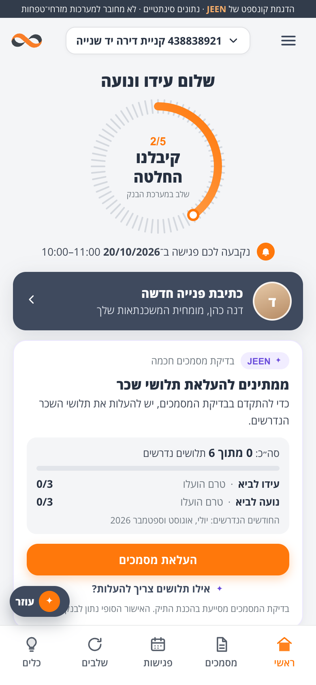 | 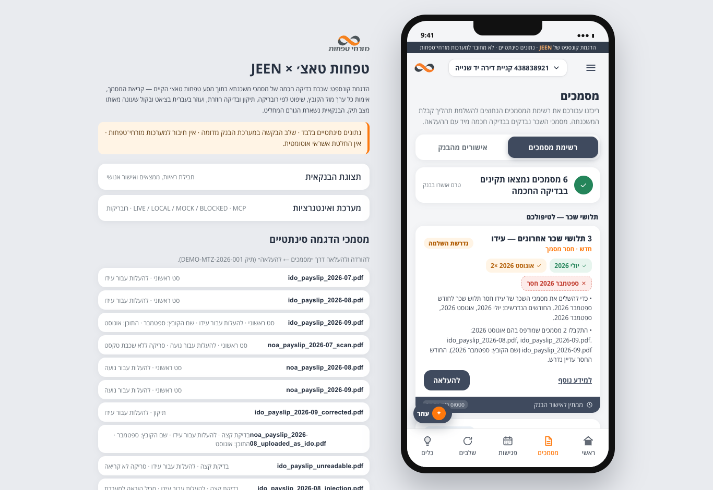 | 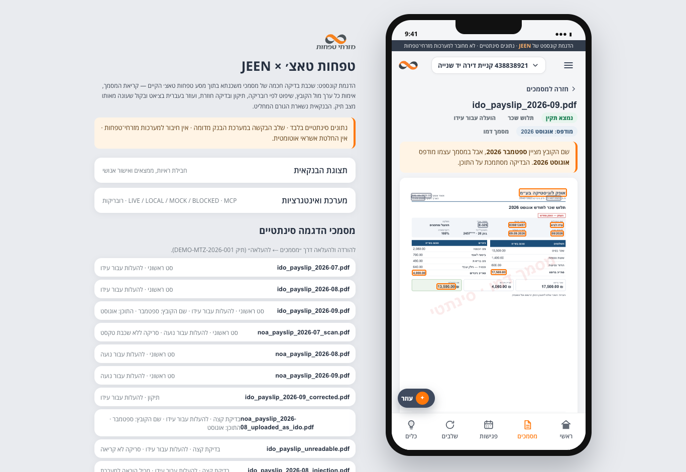 |
| **Hebrew chat and voice, one agent** | **Banker findings and the customer's explanation** | **Banker evidence viewer** |
| 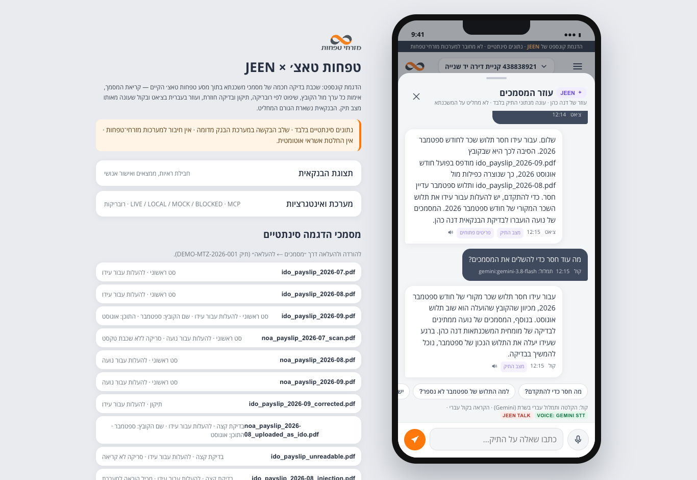 | 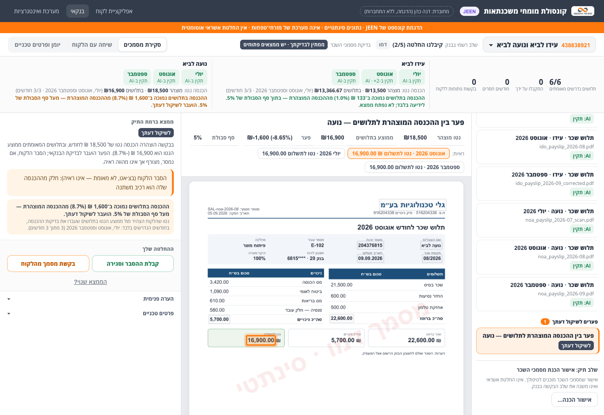 | 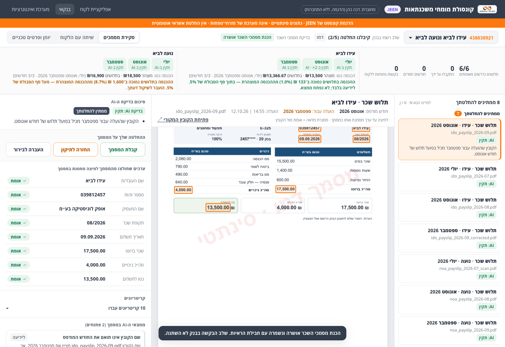 |
| **Banker review queue: the mislabeled file first** | **Correction request: editable message and preview** | **The customer sees the request in the app** |
| 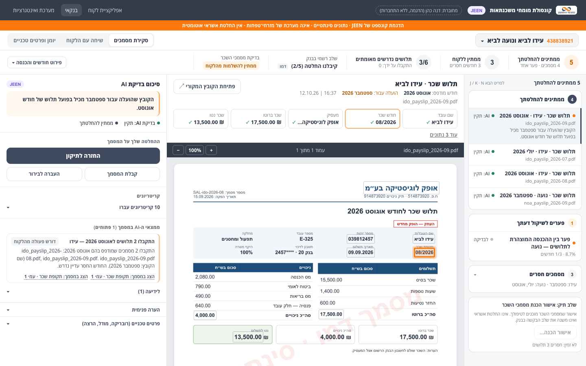 | 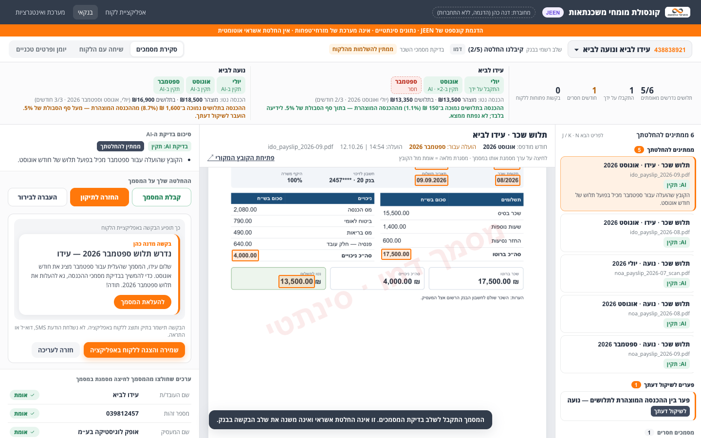 | 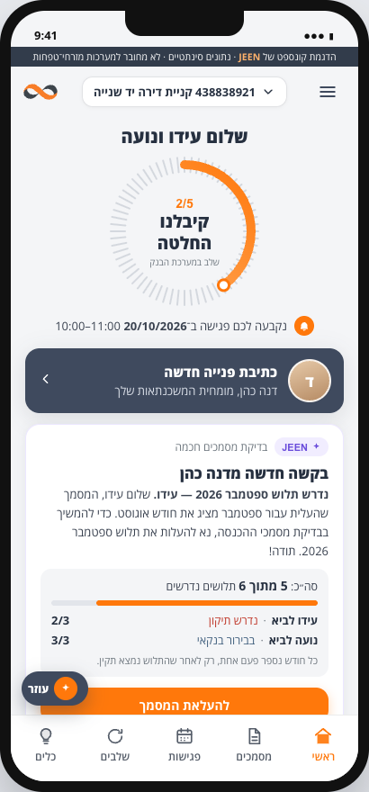 |
| **A one-month income comparison, labelled preliminary** | **Closing an inquiry: basis, documents, reason, impact** | **The customer answers an explanation request** |
| 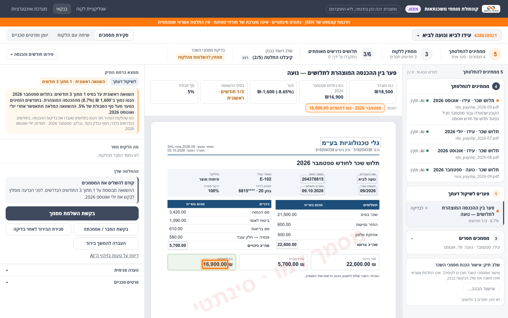 | 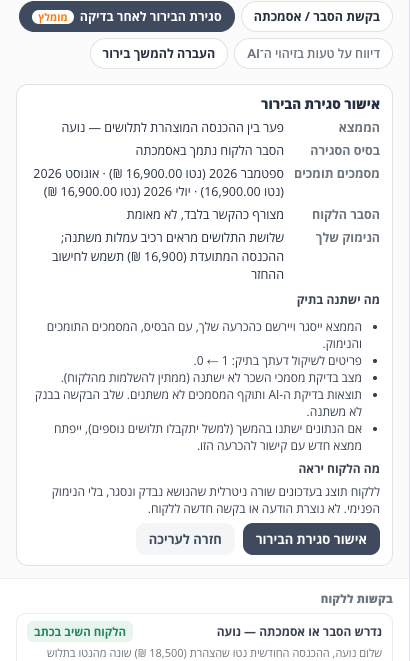 | 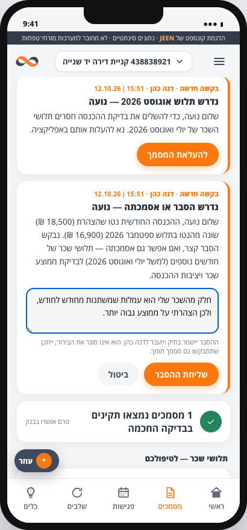 |

---

## Quick start

Prerequisites: Python 3.12, Node 20+, Google Chrome (fixtures and browser tests use the system Chrome through Playwright), and a Gemini API key. macOS `say`/`afconvert` are used only by the voice step of the browser test.

```bash
./run.sh setup     # venv + pinned deps, npm install + build, synthetic PDFs, backend/.env with random MCP keys
#   then put GEMINI_API_KEY into backend/.env
./run.sh start     # API + MCP + built app on http://127.0.0.1:8791
```

| URL | What it is |
|---|---|
| `http://127.0.0.1:8791/customer` | Touch customer app (Hebrew RTL, mobile-first; desktop shows the phone centred, with a collapsible "תרחישי הדגמה" panel of presenter test scenarios and downloadable synthetic documents) |
| `http://127.0.0.1:8791/banker` | Mortgage-specialist review workspace: prioritized queue, original document with evidence, decision panel; secondary views for the conversation and for runs, findings and audit |
| `http://127.0.0.1:8791/system` | Integration matrix (LIVE / LOCAL / DEMO / BLOCKED), Gemini usage ledger, live MCP self-test, rubrics |
| `http://127.0.0.1:8791/mcp` | Mortgage Case MCP server (Streamable HTTP, POST only) |

Other commands: `./run.sh dev` (Vite on :5192 proxying to :8791, with backend reload), `./run.sh test` (unit, browser E2E and MCP checks against a running backend; it resets cases 001, 003 and 005), and `./run.sh reset` (demo case and QA case back to nothing uploaded).

To start a presentation from an already-reviewed case instead of uploading live, run `backend/.venv/bin/python backend/tests/live_journey.py --reset --scene initial`. It uploads the six initial documents through the API, and the review takes about 50 s.

### Demo script (case `DEMO-MTZ-2026-001`, Ido and Noa Lavi, second-hand apartment after preliminary approval)

1. **Home.** Bank stage "קיבלנו החלטה" (2/5, synthetic) in the stage card, the "מה צריך לעשות עכשיו?" card shows "ממתינים להעלאת תלושי שכר" with the required months, and the document summary shows 0 of 6 required payslips, Ido 0/3 and Noa 0/3.
2. **מסמכים → להעלאה.** Upload the six "סט ראשוני" files from the side panel for the borrower each one names. One of Noa's files is a scan with no text layer. The file Ido calls `…2026-09.pdf` actually prints **August**.
3. Each upload shows its live review stages, and then the set is reviewed. Ido: **September missing** and **August ×2**, with a filename-versus-content note. Noa: declared net ₪18,500 against verified payslips averaging ₪16,900 (−8.65%), which goes **to the banker**.
4. Open any document to see the verdict, all 10 rubric criteria, and orange boxes on the original page for every verified value.
5. **עוזר.** Ask "מה עוד חסר לנו ולמה?" by text or microphone. The answer comes from case tools only.
6. Upload `ido_payslip_2026-09_corrected.pdf`. The missing-month finding closes as *resolved by new evidence*, the duplicate becomes informational, and the state moves to "מוכן לבדיקת הבנקאי — עם ממצאים פתוחים". The customer card reads "תלושי השכר הושלמו · נדרש בירור בנקאי" (6 of 6).
7. Tell the assistant Noa has a variable pay component and confirm. The explanation is attached to the finding **as unverified context and does not close it**. Confirm a handoff, and the case enters the banker queue once.
8. **/banker.** The queue opens on what needs a decision. Accept a payslip (**קבלת המסמך**), decide the income finding in "פערים לשיקול דעתך" (request missing payslips or an explanation, close the inquiry after checking with a stated basis, report an AI error, or escalate — each with a reason), and confirm **"אישור הכנת מסמכי השכר"** at the bottom of the queue. None of these is a credit decision, and none touches the bank stage.

**Banker → customer correction loop (instead of step 6).** After step 3, open `/banker`. The file named September is first in the queue with "הקובץ שהועלה עבור ספטמבר מכיל בפועל תלוש של חודש אוגוסט." Press **החזרה לתיקון**: the suggested message reads "שלום עידו, המסמך שהעלית עבור ספטמבר מציג את חודש אוגוסט. כדי להמשיך בבדיקת מסמכי ההכנסה, נא להעלות את תלוש ספטמבר 2026." Edit it, preview it and save it. The customer's home card now reads "בקשה חדשה מדנה כהן". Its button opens the upload sheet preset to the request. Upload `ido_payslip_2026-09_corrected.pdf`: it is reviewed again, the September gap closes, and the new file returns to the banker's queue as "מסמך חלופי", linked to the one it replaced.

The QA case `DEMO-MTZ-2026-003` (pick it in the case selector) takes the four "בדיקת קצה" files: Noa's payslip uploaded as Ido's, an unreadable scan, a payslip containing a prompt-injection instruction, and a payslip with contradictory amounts. None of them may come out VALID.

### Presenter panel layout ("תרחישי הדגמה")

The customer app is the centre of the page; the presenter starts collapsed on every page load. The small "תרחישי הדגמה" toggle in the top-left corner opens it; its own close button or Escape collapses it. From 1000 px wide it docks on the left (340–420 px, its own scroll) and the phone re-centres in the remaining space at its usual size. Below 1000 px it opens as a drawer over a backdrop (a click on the backdrop closes it). On a phone (≤ 520 px) there is no floating toggle: the menu's "הדגמה" section has "תרחישי הדגמה וקבצים להורדה", which opens it full width. The panel stays mounted while collapsed, so toggling keeps the open case, the app's screen and the panel's own state, and sends nothing to the server. The toggle and the backdrop, like the panel itself, are not counted as customer presence. Within the app, and after a visit to the banker or system page, it keeps the chosen state. `e2e/check_presenter_layout.py` checks all of this.

### Executive demo: PASS · REVIEW · BLOCKER (left pane, "תרחישים מומלצים לדמו")

The top of the left pane is for live presentations. **התחל דמו חדש** wipes the three executive demo cases and nothing else, then opens the first one on the right. Below it are three scenario cards. Each card names what is checked, what to expect, the exact golden-set PDFs to download, the borrower, the case and the upload destination, and the expected result. "איך מציגים" expands the upload order, what the app will show, the presenter's steps and one sentence to say. Downloading changes nothing; the presenter uploads the file on the right.

| Card | Case | Files (golden set) | What the app does |
|---|---|---|---|
| 1 · עובר — "עבר בדיקת AI — ממתין לקבלת הבנקאי" | `DEMO-MTZ-2026-006` (438839006), עידו לוי | `ido_2026_07.pdf`, `ido_2026_08.pdf`, `ido_2026_09_CORRECTED.pdf` | Each payslip VALID with verified values; home "בדיקת תלושי השכר הושלמה" 3/3; the banker accepts in "ממתינים להחלטתך". Acceptance is documentary only. |
| 2 · לבירור בנקאי — "נדרש בירור בנקאי — נמצא פער בהכנסה" | `DEMO-MTZ-2026-007` (438839007), נועה לוי | `noa_2026_07.pdf`, `noa_2026_08.pdf`, `noa_2026_09.pdf` | Each payslip VALID; declared ₪18,500 against a ₪16,900 average over 3 months goes to "פערים לשיקול דעתך" with the comparison, evidence and a suggested question. |
| 3 · חוזר ללקוח — "המסמך אינו מתאים לדרישה — נא להעלות מסמך חלופי" | `DEMO-MTZ-2026-008` (438839008), עידו לוי | optional `ido_2026_07/08.pdf`, then `bank_statement_Jul_Sep_2026.pdf` for September, then `ido_2026_09_CORRECTED.pdf` | The statement is not a payslip: the customer gets "העלאת מסמך חלופי" at once, the banker can't accept it as a payslip. The replacement is reviewed again; the old file stays in history as "הוחלף". |

| Featured scenarios and "התחל דמו חדש" | BLOCKER: replace the rejected file | REVIEW: the banker's comparison | The banker sees the customer's replacement |
|---|---|---|---|
| 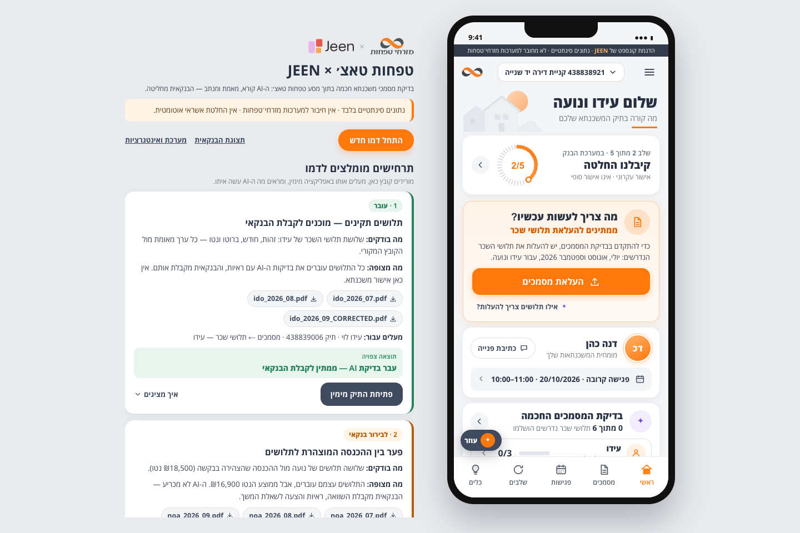 |  | 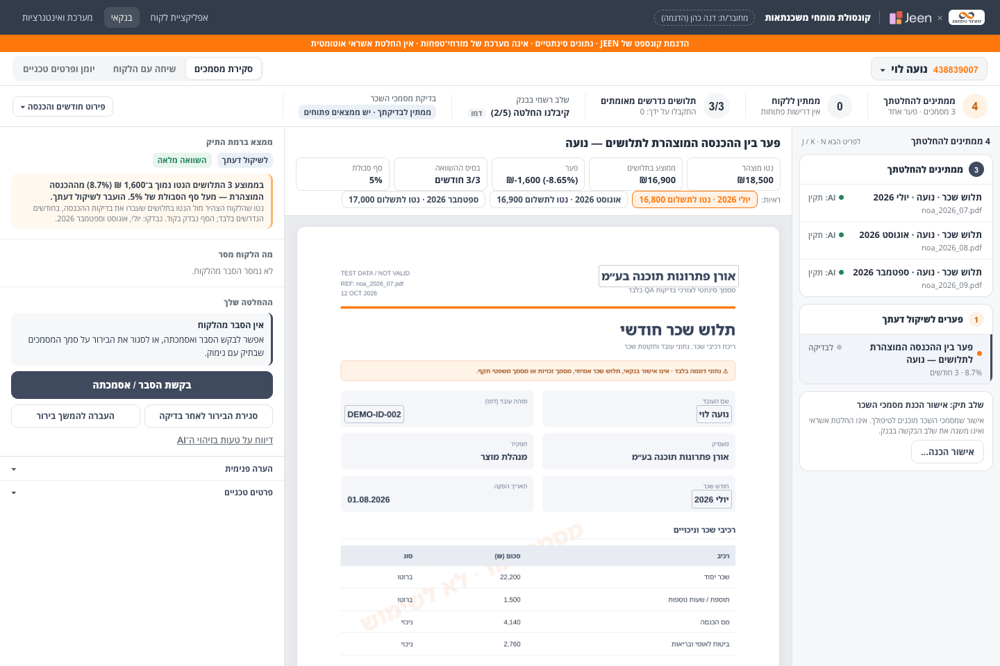 | 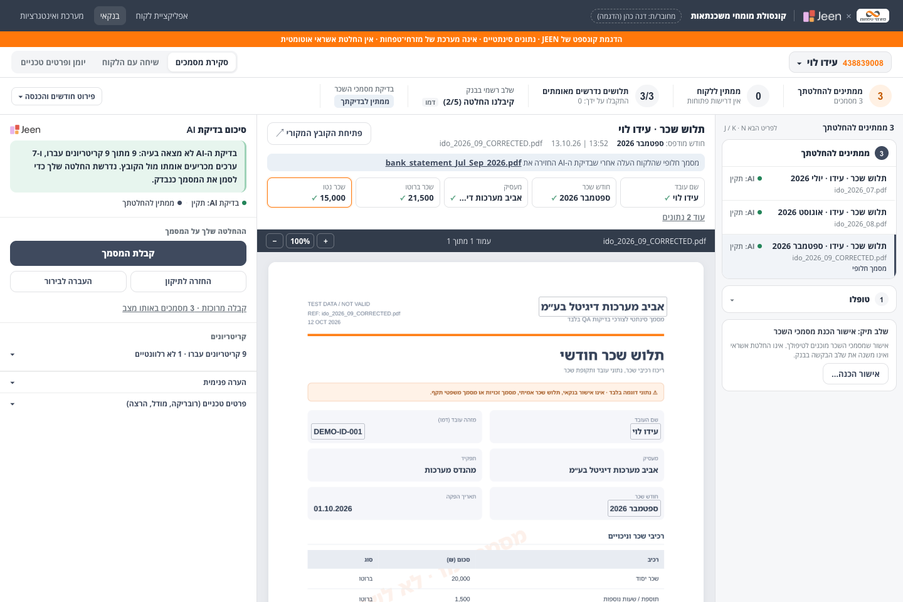 |

Screenshots from the REPLAY browser suite (2026-10-13), not from a live Gemini run.

- **Cases.** 006–008 carry one golden-set borrower each (`MockBankAdapter`, flag `executive_demo`), so each scenario has its own case-wide status. Nothing in the bank data says what a review should conclude; the expected labels live in the presenter manifest (`featured`) and are JEEN routing expectations for golden-set facts, not live results.
- **Outcomes.** PASS / REVIEW / BLOCKER are derived on every read by `workflow/outcomes.py` from the document verdict, open findings, the banker's documentary status and the customer status. They are never stored and never written by a model. A human decision wins (accepted, sent back, escalated). A failed check the customer can fix (BLOCKER) comes before a question for the banker (REVIEW). PASS needs a VALID verdict with nothing open on the document. The customer sees the label on the document page and in the upload sheet. The banker workspace returns the same value per document.
- **Start a new demo.** `POST /api/presenter/demo-reset` (`workflow/demo.py`) deletes every case-scoped row of 006–008 in one transaction, together with their uploaded files and page renders. It writes one global audit record and leaves every other case, the Gemini ledger, rubrics and fixtures alone. While a review of these cases is running it answers 409 and the button waits and retries. It is off with `DEMO_RESET=0`. Worker guards make a review that finishes after any reset write nothing, so no ghost events.

### Presenter test scenarios (left pane, "כל תרחישי הבדיקה")

The presenter panel keeps all technical scenarios in "כל תרחישי הבדיקה", collapsed by default below the featured scenarios. The panel scrolls on its own, so the live app stays in place. Inside is an accordion of the 11 loan test scenarios, and "קבצים משלימים", which holds the files no scenario uses, among them the remaining Lavi payslips for cases 001/003. Expected reason codes, statuses and each file's Expected Output are under "פרטים טכניים". Each scenario shows:

- its goal and prerequisites (start clean, continue after 01, or isolated QA case);
- what to look for in the app, with expected reason codes and case, salary-documents and bank status;
- numbered file cards. Each card shows:
  - the Hebrew label;
  - the owner and period;
  - a compact download;
  - where to upload it on the right (applicant ← card, plus the month to pick);
  - the technical file name in small print;
  - for an intentionally invalid file, the reason it is there;
  - an Expected Output block that separates the document verdict from case-level consequences;
- manual "הועלה / התוצאה תואמת / לא תואמת / לבדיקה" marks;
- a collapsed "פרטים טכניים" section with expected JSON, golden rubrics, income figures and SHA-256 provenance.

Files that belong to no scenario are under "קבצים משלימים", labelled from the same manifest. There is no second fixture list.

| | |
|---|---|
| 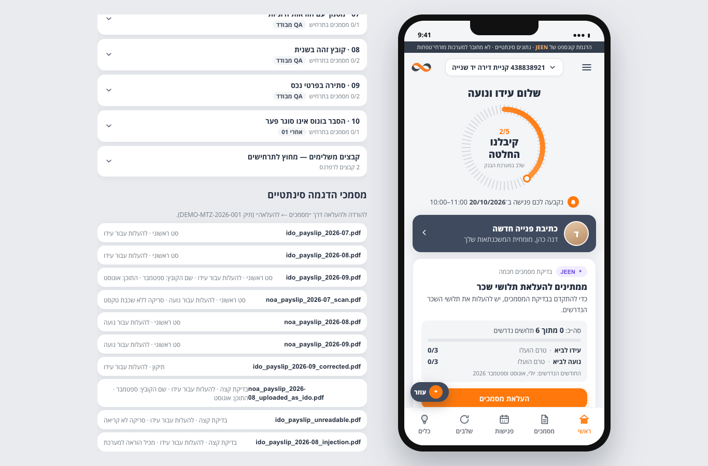 | 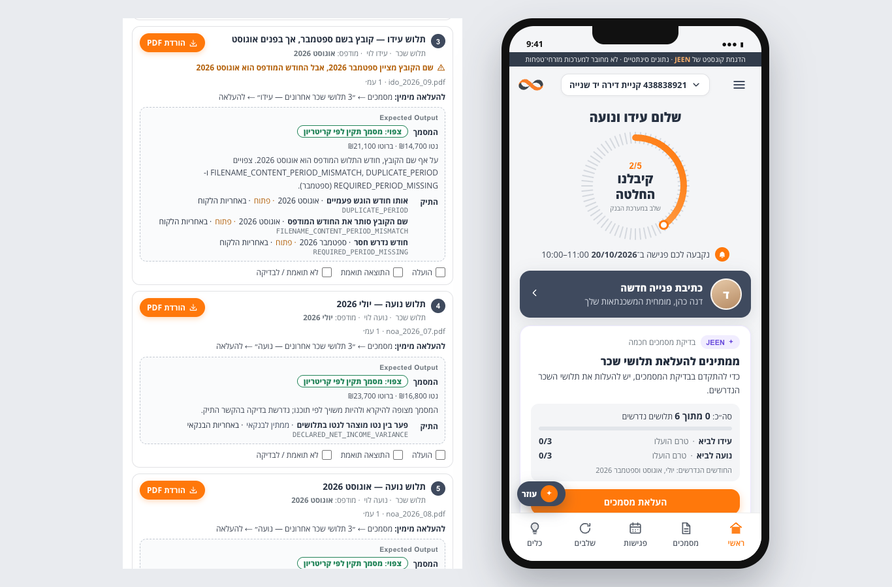 |

- **Data.** `fixtures/presenter/presenter_scenarios_manifest.json` is the curated view, and `fixtures/presenter/golden_set/` is an unmodified copy of the golden set (v1.1, 21 PDFs, expected JSON, rubrics). Expectations are read from these files at runtime, not hard-coded in React.
- **Serving.** `GET /api/presenter/scenarios` returns the manifest, a server-side SHA-256 check of every PDF, the referenced expected JSON, the negative-test expectations and the golden rubrics. `GET /api/presenter/file?id=<manifest id>` serves only manifest-listed PDFs, as `application/pdf` attachments under their original names. It refuses to serve bytes whose SHA-256 differs from the manifest.
- **Cases.** The golden PDFs print `עידו לוי · DEMO-ID-001` and `נועה לוי · DEMO-ID-002`, which differ from the Lavi borrowers in cases 001/003. The mock bank therefore has two cases with the golden profile: `DEMO-MTZ-2026-004` (display 438839004) for scenarios 01, 02 and 10, and the isolated QA case `DEMO-MTZ-2026-005` (438839005) for 03–09. Cases 001–003, the review engine, the rubrics and MCP are unchanged.
- **State.** Expected output is static ground truth and never reaches the app. The presenter marks live only in `localStorage` (`mz.presenter.marks.v1`). "איפוס סימון בדיקות" clears just those marks. "איפוס התיק באפליקציה…" asks for inline confirmation, then calls the existing `POST /api/cases/{id}/reset`, and only for 004/005.

**Live demo, 01 → 02.**

1. Open `/customer` on a desktop browser. Scenario 01 is expanded.
2. Under "לפני שמתחילים", press "איפוס התיק באפליקציה…" → "כן, לאפס את התיק", then "לפתוח את התיק מימין". The app switches to case 438839004 on the Documents screen.
3. For files 1–6: press "הורדת PDF". On the right, press "להעלאה" on the card named in "להעלאה מימין", choose the downloaded file and press "העלאה ובדיקה חכמה". Tick "הועלה".
4. When the reviews finish, compare the right side with "מה צריך לראות באפליקציה" and each file's Expected Output, and tick "התוצאה תואמת" or "לא תואמת / לבדיקה".
5. Expand 02. Don't reset. Download "תלוש עידו — ספטמבר המתוקן", upload it for עידו, and compare again.

**Declared income.** Declared income is the structured application data in the Mortgage Case Service, marked `CUSTOMER_DECLARED`, and is never treated as verified income. `application_declarations.pdf` is not a required document in the demo scope, so it is no longer part of the 01 upload sequence. It stays downloadable under "קבצים משלימים". The app judges every upload against the payslip rubric, so uploading it would only add a "not a payslip" finding.

**Live run, 2026-10-12, after the PS-10 and declared-income correction** (`e2e/test_presenter.py --live`, 42/42 checks): real Gemini, with every PDF downloaded from the pane and uploaded through the app's upload sheet, on an isolated backend with a fresh database. The full table is in `e2e/artifacts/presenter/live-comparison.md`.

- **01.** All 6 golden payslips came back VALID, with printed month and net amount verified against the PDF text layer. PS-10 was decided by code as NOT_APPLICABLE on each, because no payment date is printed; the issue date was extracted as a separate field. Ido's September is missing and August is doubled, so the case needs customer action. Noa's declared ₪18,500 against documented ₪16,900 (−₪1,600, three months) is open for the banker.
- **02.** The corrected September closed the missing month as `resolved_by_new_evidence`. The salary-document subset is complete, with no open customer action, and the state is "מוכן לבדיקת הבנקאי — עם ממצאים פתוחים". The income gap stays open for the banker. Readiness is scoped to payslips only, the other case requirements are listed as not evaluated, and no bank decision was created.
- **Pay-date fixtures** (`fixtures/pay_date/`, golden PDFs untouched):
  - payment date 09.10.2026 with issue date 15.09.2026 → PS-10 PASS, VALID;
  - payment date 25.08.2026 → PS-10 FAIL, NEEDS_REVIEW;
  - payment date 15.09.2026 → PS-10 NEEDS_REVIEW.

  The slip held for review on its payment date still fed the income comparison.
- **Still different from the golden expectations** (outside this correction):
  - The filename/content mismatch is an INFO finding rather than a customer action.
  - Before September arrives, the app averages Ido's two available months (₪14,550, −₪150, within tolerance), where the golden set defers the average.
  - After 02, the old August copy still counts as an informational duplicate rather than superseded.

| CASE-01: expected (left) vs actual (right) | `ido_2026_09.pdf` review | CASE-02: salary documents complete, income gap with the banker |
|---|---|---|
| 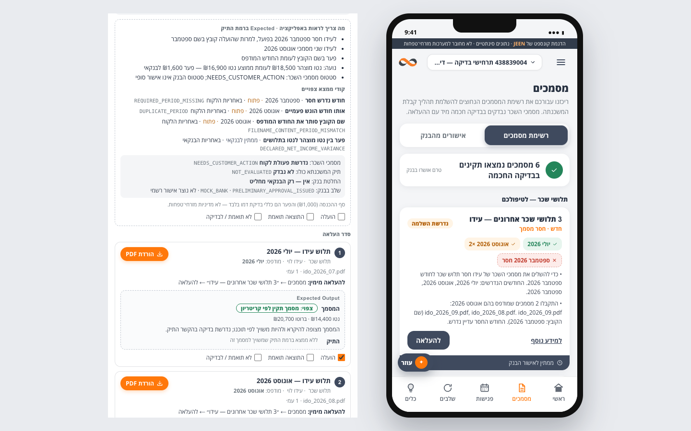 | 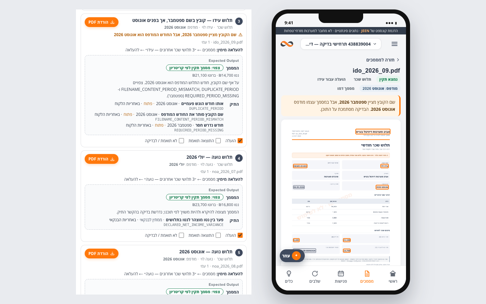 | 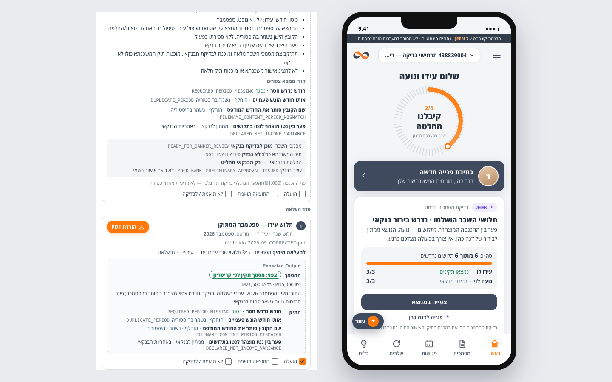 |

---

## Architecture

```
 Customer app (React, Touch design)   Banker console        JEEN Talk / JEEN agents (future)
          │  REST                           │ REST                    │ MCP (Streamable HTTP)
          ▼                                 ▼                         ▼
 ┌──────────────────────── Mortgage Case Service (FastAPI, SQLite WAL) ─────────────────────────┐
 │ case state · document inventory · durable jobs · findings lifecycle · readiness · audit       │
 │ Agent (Gemini function calling) ── one tool registry ── MCP server (/mcp, case-bound keys)    │
 │ MockBankAdapter (stage, requirements; authoritative = false)                                  │
 └───────────────┬───────────────────────────────────────────────────────────────────────────────┘
                 │ ReviewProvider contract (start · status · result · case review · re-run)
     ┌───────────┴──────────────┐
     ▼                          ▼
 GeminiReviewProvider (ACTIVE)   VisionTraceReviewProvider (BLOCKED until a real mortgage review is verified)
```

**Ownership** (`backend/app/review/contract.py`):

- **The review provider** owns the whole review: intake and classification, extraction, evidence, rubric judgement, the document-level verdict, cross-document consistency, and re-review.
- **The Mortgage Case Service** owns bank-case state, the required-document inventory, orchestration, run history, the findings lifecycle, readiness and audit.
- **Bank staff** own acceptance.
- A provider verdict is a *document review* verdict, never a credit decision.

`REVIEW_PROVIDER=gemini` is the only selectable value today. `visiontrace` requires the provider's readiness to be LIVE, and `hybrid` raises until it's designed (`backend/app/review/registry.py`).

### How one document is reviewed (Gemini provider)

| Stage | What happens | Where |
|---|---|---|
| Intake | PDF/PNG/JPEG up to 15 MB. SHA-256 dedupe per case and document family: re-uploading the same file for the same kind of document reuses its review, and an upload note is added if it was filed under another borrower. The same file sent for a different kind of document (a payslip first put in the ID-card slot, then under the payslips) is a new document, reviewed under that requirement's rubric. Pages are rendered on demand for the evidence viewer. | `workflow/engine.py`, `review/evidence.py` |
| A+B. Classify, OCR, extract | One **blind** multimodal call on the original file: the model never sees the expected values. JSON output constrained by `responseSchema`: doc type, legibility, scan/photo, typed fields, earnings/deductions lines. | `review/gemini_provider.py`, `review/prompts.py` |
| Evidence verification | **Text-layer PDFs:** the value must be found in the PDF text layer, and its box is the union of the real word boxes (`text_layer_exact`). **Scans:** the region is cropped and re-read by a second call that must agree (`vision_reread_confirmed`). Anything else stays `vision_unverified` or `not_found`, and evidence coordinates are never invented. | `review/evidence.py` |
| C. Deterministic rules | Period and named month, gross − deductions = net (±₪2, total lines excluded), employer present, identity relation (name/ID) to the assigned borrower, injection patterns, demo marker, evidence for decisive fields. | `review/deterministic.py` |
| E. LLM-as-a-Judge | Gemini evaluates the judge and hybrid criteria of the versioned rubric, citing evidence ids. Code merges: deterministic outcomes win, hybrid criteria give code precedence, and a PASS whose evidence isn't verified is downgraded. **The verdict policy is computed by code:** INVALID if a criterion with `on_fail=INVALID` fails, NEEDS_REVIEW if anything is FAIL or NEEDS_REVIEW, otherwise VALID. The result records rubric id/version, model ids, prompt version, run id and timestamps. | `review/gemini_provider.py`, `review/rubrics.py` |

### How the case is reviewed after every change

| Stage | What happens | Where |
|---|---|---|
| Coverage | The last 3 complete salary months as of the simulation date 2026-10-12, with payday on the 9th: **2026-07, 2026-08, 2026-09**. A month counts on the *printed* period, never the filename. Months covered only by documents that aren't VALID show as "בבדיקה". | `review/case_review.py`, `workflow/readiness.py` |
| D. Semantic cross-document review | Declared versus documented income, and identity consistency across documents. Declared income comes from the bank case as a customer declaration (`CUSTOMER_DECLARED`). It is compared over the payslips whose income-relevant criteria passed. The 5% tolerance is arithmetic in code; the model only judges whether the definitions are equivalent and proposes explanations and evidence to request. A customer statement is passed as *unverified context* and is never proof. Cached by input hash. | `review/case_review.py` |
| F. Findings lifecycle | Findings have stable keys (`CODE:subject[:period]`). On each case run, customer and informational findings that no longer reproduce close as `resolved_by_new_evidence`. **Banker findings are never closed by AI**; they are marked `not_reproduced_by` and wait for a banker decision (resolve with a basis, dismiss as an AI error, escalate, or ask the customer), which records a reason. A banker ruling holds until its evidence changes: a finding on a document is not reopened (the file never changes), and a case-level finding reopens only when its computed figures change — as a new finding whose history links to the earlier ruling, which stays as it was. Missing and duplicate months are coverage facts and are never suppressed. When the customer uploads a replacement the banker asked for, the old document's findings close as `replaced_by_customer_upload` once the new file is reviewed, and the replaced file no longer counts toward coverage (no leftover duplicate month). The same happens when the customer replaces, on their own, a document the AI review sent back: only its customer findings close, and a banker finding on the old file stays open for the banker. A criterion whose escalation is "customer" becomes a customer action only when it FAILs. When the review could not decide (NEEDS_REVIEW, for example "is this a payslip?"), it goes to the banker with wording that does not tell the customer the file is wrong. The doubt also counts as the document's single root cause. Every finding keeps its history. | `workflow/engine.py` (`reconcile_findings`), `workflow/review_desk.py` |

Each document collapses to a single root cause: an unreadable page yields only DOCUMENT_UNREADABLE instead of a cascade of downstream failures.

**Workflow.** Jobs live in SQLite with idempotency keys and run on three worker threads. Document jobs take priority; the case review is single-flight and waits for pending document jobs. A failed job gets up to 3 attempts with 4 s and 8 s backoff, and interrupted jobs are recovered on startup. Every run (document and case) is kept in `review_runs`.

**Two state machines, never mixed.** The bank stage comes from `MockBankAdapter`. Only "קיבלנו החלטה" was observed in the reference screenshots, so the 5-stage dictionary is treated as demo data with `authoritative=false`. The AI readiness states are NOT_CHECKED, CHECKING, RECHECKING, ACTION_REQUIRED, READY_FOR_HUMAN_REVIEW_WITH_OPEN_FINDINGS, READY_FOR_HUMAN_REVIEW and ERROR. **PREPARATION_CONFIRMED is reachable only through the banker's action**, and that action is refused while customer actions or banker requests are open. A confirmation lapses when a document is uploaded after it or the banker asks the customer for something after it (`readiness.confirmation`); the console says why, and the banker confirms again. An open banker request also puts the case in ACTION_REQUIRED. A failed set-level review is ERROR, never "ready".

**What the customer sees first.** The home screen (`pages/customer/Home.tsx`) is one page, top to bottom: a greeting from the borrowers' first names (with a decorative inline SVG); the bank stage card (`MockBankAdapter`, shown as stored and never relabelled from AI state; when the case has a preliminary decision it adds "אישור עקרוני · אינו אישור סופי", the wording the Documents screen already uses); the action card; the assigned banker (a synthetic demo portrait for Dana Cohen, `frontend/public/people/dana-cohen.jpg`, with an initials fallback for other bankers or a failed load; "כתיבת פנייה" to the assistant, and the case meeting on one line, or "אין פגישה מתוכננת"); the document summary; the three latest updates; and the request details. The action card (`DocumentCheckCard`) is orange ("מה צריך לעשות עכשיו?") only when the customer has something to do, and neutral ("מה קורה עכשיו?") while waiting. An open banker request comes first: its own title is the action ("נדרש תלוש ספטמבר 2026 — עידו"), the banker's message is quoted as written (two lines on screen, attributed to the banker), and the button is named after the requested month and opens the upload sheet preset to the request. Without a request, missing months lead to the backend's first upload action (`available_actions`, the same one the assistant offers): the card is titled by that borrower and month ("חסר תלוש ספטמבר 2026 של עידו") and the button opens the upload sheet preset to them. One footer line names what the action does not cover ("עוד 3 תלושים של נועה", further requests) with a link to the full list, so one action never reads as the only missing item; the assistant shortcut sits in the same row. The document summary (`DocumentSummary`) has one row per borrower (status, required months fulfilled, a link to that borrower on the Documents screen) and keeps four numbers apart: required months fulfilled (the total), and files uploaded, reviewed and accepted by the banker (one line); "איך סופרים" expands the counting rule, the documents handled directly with the bank and the "final approval is the bank's" note. It offers a second upload only for a borrower the action card does not lead to and who has no open banker request. The update list (`RecentUpdates`) folds for display only: set re-checks are left out, an upload is left out once its review is listed, retries of one failed review show the latest attempt, and identical banker closures in a row become one line; banker requests and the customer's answers are never folded, and "לכל העדכונים בתיק" shows the snapshot's full list (the last 25 customer-visible events). There is no read/unread state, so nothing is marked "new". After a case switch nothing from the previous case is shown until the new snapshot arrives (`caseContext`). When refreshes fail twice in a row while a case is on screen, one line above the cards says the data may be out of date since the last successful refresh, with a retry; it clears on the next successful refresh. The assistant button shrinks to its icon while the screen is scrolled, and the bottom navigation and scroll padding respect the device safe area. The status itself is `readiness.customer_status`, derived from the same persisted facts with its own precedence (`workflow/readiness.py`): no documents (AWAITING_UPLOAD), a review that stopped (ERROR), work in progress (PROCESSING, or REVALIDATING after an earlier set review), a document to fix (CORRECTION_REQUIRED), months still missing (MISSING_DOCUMENTS), the banker's confirmation, open banker items or payslips not yet verified (BANKER_REVIEW), and only then CHECKS_COMPLETE. Its counter is required months covered by a VALID payslip or by one the banker accepted: a duplicate counts once, a document that is unreviewed or not VALID counts only after a banker accepts it, and a payslip the banker sent back for correction (or that was replaced) never counts. An open banker correction request makes the status CORRECTION_REQUIRED, and any other open banker request MISSING_DOCUMENTS. The required months come from the case rubric and the simulation date, so they are known before the first upload.

### Banker review workspace and human decisions

The console's default view is one review workspace: **queue → original document with evidence → decision panel**. The queue is built by the service (`GET /api/banker/cases/{id}/workspace`, `api/banker_package.py`) and groups items by what the banker can do:

| Group | What is in it |
|---|---|
| ממתינים להחלטתך | Reviewed documents without a banker decision. Items that need attention come first: an AI verdict that isn't VALID, open findings, or a printed month that differs from the month the file was uploaded for. |
| פערים לשיקול דעתך | Case-level banker findings, such as declared versus documented income. |
| בבירור | Documents the banker escalated. |
| תיקון אצל הלקוח | Documents sent back for correction, or with an AI finding the customer must fix. |
| מסמכים חסרים | Required months nobody uploaded. They are not documents and have no "accept"; the action is **בקשת השלמת מסמך**. |
| בעיבוד / טופלו | Documents still being read or that failed; accepted and replaced documents and ruled findings (collapsed). |

Above the panels, one summary row shows what waits for the banker, what waits for the customer, how many required payslips are verified, the bank's official stage (demo data) and the review state. "פירוט חודשים והכנסה" opens each borrower's month strip (verified by AI, accepted by you, waiting for a decision, missing, requested) and an income line that follows the rubric outcome, not the model's label. Above the document, the key extracted fields sit in one strip with a quiet tick when verified; the rest are under "עוד נתונים". The page highlights only the selected evidence (the printed month when it contradicts the upload, the field an open finding cites, otherwise net pay); every other box stays as a faint, clickable outline. The decision panel leads with one primary action chosen from the item's state; the others stay as neutral buttons, and history, notes and technical details are in collapsible sections at the bottom. For example, Ido's −₪150 (−1.1%) is within the 5% tolerance of IS-04, so it reads "לידיעה בלבד; לא נפתח ממצא". The model's `INCONSISTENT` label is shown only under technical details. The bank's official stage sits in the case bar as its own fact, labelled as demo data.

Every decision is a persisted transition in `workflow/review_desk.py`, written in one transaction with its audit event. It records actor, time, previous and new status, reason, customer message and evidence references. Banker status is derived from the append-only `banker_decisions` log and `customer_requests` (`workflow/desk_state.py`), next to the AI verdict and never instead of it:

| Action | Allowed from | Effect |
|---|---|---|
| קבלת המסמך (`ACCEPT_DOCUMENT`) | awaiting decision, escalated | Accepted for the documentary review step. The banker must acknowledge the document's open banker findings (the list must match, otherwise 409 "stale"), and a reason is required when there are findings or the AI verdict isn't VALID. Refused while an AI finding asks the customer to fix the file: mark that finding wrong first. |
| החזרה לתיקון (`REQUEST_CORRECTION`) | awaiting decision, customer fix, escalated, failed | Opens an in-app customer request with the banker's edited message and the requested month. The document's banker findings close as `correction_requested_by_banker`. |
| העברה לבירור (`ESCALATE`) | awaiting decision, customer fix | Requires a reason. The customer gets no request. |
| בקשת השלמת מסמך (`REQUEST_MISSING_DOCUMENT`) | a month currently missing | Opens an in-app request. One open request per borrower and month. |
| בקשת השלמת מסמך · בקשת הסבר / אסמכתה (`REQUEST_MISSING_DOCUMENT`, `REQUEST_EXPLANATION`) | open banker finding | In-app requests with an editable message. One request per missing month; an explanation request lets the customer answer in writing or attach a document. The answer is attached to the finding as unverified context, and the finding stays open. |
| סגירת הבירור לאחר בדיקה (`RESOLVE_FINDING`) | open banker finding | Requires a basis: verified against documents in the case, or the customer's explanation supported by a document (both need the supporting documents ticked), or a professional decision under policy (a detailed reason, recorded as a human override). A customer statement alone can't close it. When the comparison rests on part of the months, the banker must acknowledge the partial basis. A confirmation shows the finding, basis, documents, reason, what changes in the case and what the customer sees. Open requests on the finding close in the same transaction. |
| דיווח על טעות בזיהוי ה־AI (`DISMISS_FINDING`) | open finding on a document, or banker finding | A reason category and a detailed reason. It says the AI was wrong; it is not a decision on the document. Coverage facts and informational findings can't be ruled on. |
| העברה להמשך בירור (`ESCALATE_FINDING`) | open banker finding | Requires a reason. The finding stays open, in "בבירור". |
| ביטול בקשה ללקוח (`WITHDRAW_REQUEST`) | an open customer request | Requires a reason. The request leaves the app; the finding doesn't change. A request is never closed by the AI. Withdrawing a correction request returns the document to its previous banker status (it can be decided again) and reopens the banker findings the correction had closed. The document panel offers it next to the open request. |
| בקשת השלמת מסמך while the AI is reviewing | — | Refused (409) while any review job of the case runs: the month may already be on its way. The missing-month item offers no request until the review settles. |
| קבלת פניית הלקוח לטיפול (`ACKNOWLEDGE_HANDOFF`) | a customer's "pass me to my banker" request (assistant, voice or MCP) | Shown as a banner above the workspace. Taking it records a decision; the customer sees "‹banker› קיבלה את הפנייה שלכם", never the internal note. |
| הערה פנימית, אישור הכנת מסמכי השכר | any time / no open customer items | A note changes no state. The confirmation keeps open banker items open, and lapses on a later upload or banker request (see "Two state machines"). |

- **Sessions, not headers.** Every banker route needs a staff session (`app/auth.py`); writes need the case's assigned banker (another banker gets 403 and a read-only console). There is no login screen in the demo: the console obtains the demo banker's session (Dana) by itself. An `X-Staff-Id` header is ignored. The decision log records the session's staff id.
- **Idempotency.** Each form submission carries a `request_id`. Replaying it returns the recorded decision with `duplicate: true`, and the state check and write run under one lock.
- **The income comparison is labelled by its basis.** IS-04 compares the declared net income with the payslips available in the required months, against the 5% tolerance (`income-set.salaried` policy). When some months are missing, the console, the finding text and the customer's view call it a preliminary comparison of N of 3 months and name the missing months, and never call a single payslip an average. The threshold and the rule are unchanged.
- **Customer messages.** The suggested Hebrew message is a deterministic template built from the verified review facts, not generated by a model. The banker edits it, sees a preview of the customer's card, and confirms. The internal reason never reaches the customer API: snapshot findings and timeline events are projected without it. Nothing sends an SMS, an e-mail or a push notification. The request lives in the case and shows in the app: on the home action card ("בקשה חדשה מ…", button "העלאת תלוש <month>"), under "בקשות מ…" on the Documents screen, on the document's page, and in the assistant's open items. Its button opens the upload sheet preset to the request (`/customer/documents?request=<id>`).
- **Replacement.** An upload answers a request when it names it, or when it is the borrower's only open request and the months agree. Re-uploading a file already in the case answers nothing. The new file is reviewed like any upload, the set is re-checked, and the banker sees it as "מסמך חלופי" linked to the file it replaced, with the old file's evidence and decisions kept.
- **Customer replacement without a request.** A document the AI review sent back to the customer (an open customer finding on it, banker status "תיקון נדרש מהלקוח") can be replaced by the customer directly. The home card's "העלאת מסמך חלופי", the document page or the upload sheet's "המסמך החדש יחליף את …" sends `replaces_document_id`. `review_desk.check_replacement` refuses anything else before the file is stored: another case or borrower, a document that isn't waiting for a fix, one already replaced, or one with an open banker request. The link is stored on the upload intent. The banker sees "מסמך חלופי שהלקוח העלה אחרי שבדיקת ה-AI החזירה את …". If the customer disagrees with the AI, "המסמך כן נכון? פנייה לבנקאית" asks the banker to look, and the banker can report the AI error and accept.
- **Grouped acceptance.** When several documents wait in the same state (all clean, or all with the same AI finding), one form accepts them with one reason. Each is still recorded as its own decision.
- **Secondary views.** "שיחה עם הלקוח" shows the conversation and unattached customer statements. "יומן ופרטים טכניים" shows human decisions, customer requests, all findings including closed ones with history, runs, case criteria and the audit log. Rubric ids, model names and run ids appear in the default view only inside "פרטים טכניים".

### Banker Intelligence V2 — case briefing, financial context and scenarios

A second presentation of the same case, beside V1: the case bar's switch **V1 · סקירה | V2 · תמונת מצב JEEN** (`?view=intel`; the choice is remembered per browser, and V1 stays the default). V2 is read-only. It writes nothing, records no decision, and every action ("הפעולה הבאה", "פתיחה בסקירת המסמכים") opens the V1 workspace at the right item, so approval semantics, audit and state transitions are unchanged.

`GET /api/banker/cases/{id}/intelligence` (`api/banker_intelligence.py`, staff session) derives the briefing on each request from `build_workspace` (document state, findings, IS-04 income, drafts), the case in the bank adapter (application and declarations), the synthetic bank context and `workflow/finance.py`. The pipeline is: facts → deterministic calculations → named demo assumptions → rules → Hebrew templates. No model is called.

- **Two tracks, never merged.** The documentation track comes from readiness: ready for credit review, documents incomplete, clarification required, processing, no documents, preparation confirmed. The illustrative financial track is full, partial (declared-only income, or no bank context), provisional (an open income-gap finding) or unavailable (company case). Neither says "approved"; a suggested scenario appears only when both tracks are complete, labelled "חלופה להמחשה לבחינת הבנקאי — לא החלטת אשראי".
- **Income basis.** The payslip average verified by IS-04 when it is complete and every month is `text_layer_exact`/`vision_reread_confirmed`. With an open income gap, the lower of declared and documented, so the analysis never picks the number that flatters the request; the declared-income ratio is shown next to it. Otherwise the declared figure, marked unverified.
- **Synthetic bank context** (`bank/financial_context.py` ← `backend/bank_context/demo_financial_context.v1.json`, keyed by national id). It holds existing loans, credit lines, card spending and account events for Michal Barak (311204572) and Ido Levy (DEMO-ID-001), with fixture id and observation date 2026-10-11, marked `synthetic`/`authoritative=false`. Balances (exposure, אובליגו), monthly payments (debt service) and card spending are kept apart; only monthly loan payments enter the ratios. The fixture's figures match the uploaded statements: card charges equal the statements' card debits, and a positive balance means no overdraft use. Customers without a record get "no bank context", never zero debt.
- **Arithmetic** (`workflow/finance.py`, ported to `frontend/src/finance.ts`). Fixed-rate annuity `P·r/(1−(1+r)^−n)`, 0% → `P/n`. Payment rounded to agorot; interest from the unrounded payment, because the last payment absorbs the rounding, so it is exactly 0 at 0%. Combined ratio = (new + existing payments) ÷ net income. Financing ratio = amount ÷ the purpose document's verified `total_amount`. Scenarios are requested term ±24 months within 12–120. Demo assumptions: 6.0% annual rate; repayment ratio up to 30% (25% with business income). These are the same values as the conversational questionnaire's preliminary indication, so the customer and banker stages agree.
- **Provenance on every number.** Each value carries a `source_id` into `sources`: a document field (its evidence, opened in the existing `EvidenceViewer`), a declaration, synthetic bank data (fixture and date), a calculation (formula and inputs, each clickable), an assumption, or missing. Nothing is located without a real evidence box.
- **What-if.** Amount, term and rate recompute the three scenarios in the browser and can be reset. Nothing is sent back. The browser check verifies the numbers equal `finance.py`'s.
- **Drafts.** Deterministic Hebrew templates: complete documentation, missing documents (from the V1 missing/correction items), financial clarification (wrapping `review_desk.draft_explanation`), and conditional financing (illustrative payments with explicit conditions, no ratios). Editable, copyable, with optional references to case documents. Nothing is sent.
- **Integration with the conversational application (feature/conversational-loan-v2, not merged).** V2 reads only the canonical case (`loan.requested_amount_ils`, `loan.payments`, `loan.purpose`, borrowers' `declared_net_monthly_ils`, `income_sources`, `national_id`), so applications created by the questionnaire appear without changes. To keep one engine, its `workflow/indication.py` should import `finance.monthly_payment` / `max_principal` and the `DEMO_*` constants instead of its own copies. Its payment is rounded to ₪10 and its ratio applies to declared income only; the banker view uses verified income and existing obligations.

### Banker Case-Centric V3 — the prepared case, top to bottom (design alternative to V2)

A third presentation of the same intelligence payload: **V3 · תיק מוכן** in the case bar (`?view=case`, remembered like V2). It is a design experiment beside V2, not a replacement: one centered column of white sections that reads as a prepared banking brief rather than a dashboard. It uses the same endpoint, arithmetic, sources and drafts as V2, has no backend change, and is read-only. Every action opens V1.

- **Order.** Header (customer, "הלוואה ל<מטרה> · סכום · תשלומים", documentation status, **מעבר לטיפול בתיק** → V1 at the recommendation's next item) → three figures (net income, estimated payment, combined ratio) → customer and loan details → the customer's documents → financial analysis → financing alternatives → the JEEN recommendation, as the conclusion of what came before → reasoning and conditions → proposed reply.
- **Recommendation.** A conclusion card on the column's edges with centered content: the label, a status seal, a short title chosen in code from the recommendation state (for example READY_FOR_CREDIT_REVIEW → "מומלץ להתקדם בתהליך ההלוואה", CLARIFICATION_REQUIRED → "נדרש בירור לפני בחינת האשראי"), the backend's own sentence, and a three-part basis row (document requirements, income basis, combined ratio). A hairline links it to the reasoning card below.
- **Reasoning and conditions.** Open findings and corrections come first, in a full-width strip. Below them are two panels: the main findings, each with grouped source chips, and a conditions checklist in which case actions come first with their own link into V1, followed by a "מעבר לטיפול בתיק" action. The detail (document values, what was not checked, provenance marks) sits behind a disclosure row. Open discrepancies, missing items, corrections, open findings and flagged account events are listed inside the card, never collapsed.
- **Documents.** One tile per document in the case, showing its real first page (`/api/documents/{id}/pages/1.png`; a file-type label if rendering fails), the AI verdict and the banker's status. A tile opens the document in the existing `EvidenceViewer` with its extracted fields and a link to the original file. Missing requirements are dashed "חסר" tiles that open the item in V1. Replaced documents sit behind a toggle. The documentation status and the banker's pending acceptance are separate lines.
- **Progressive disclosure.** Payslip months, the obligations detail, the calculation detail, the What-if controls ("מה יקרה אם?") and the reasoning detail are expanded on demand. Material gaps are not.
- **Provenance.** Numbers keep their sources (the same source drawer as V2) but show a quiet dot and a tooltip instead of a pill. Obligations carry one "נתוני דמו" tag per section; findings group their sources by kind.
- **No assistant panel.** There is no case-aware banker assistant to reuse, so none is shown.

`e2e/check_banker_case_centric.py` verifies V3 in Chrome on an isolated REPLAY stack: 101, 011 and 008; parity of the three scenarios and the What-if with `finance.py`; documents, the original file and evidence; reply editing and copying; V1/V2/V3 switching; and the 390 px layout.

### Rubrics (`backend/rubrics/`, versioned JSON validated on load)

- `payslip.il.salaried` **v1.3.0** (current; v1.2.0, v1.1.0 and v1.0.0 kept for history):
  - PS-01 is a payslip (judge, INVALID on fail)
  - PS-02 legible (judge)
  - PS-03 identity matches the assigned borrower (hybrid, INVALID on fail)
  - PS-04 period (code)
  - PS-05 gross and net present (code)
  - PS-06 arithmetic (code)
  - PS-07 employer (code)
  - PS-08 no instructions or editing marks (hybrid)
  - PS-09 decisive evidence verified (code)
  - PS-10 payment date, if printed, plausible for the period (hybrid)
  - Changelog for v1.1.0: the demo watermark is expected, and total lines are excluded from the sums.
  - Changelog for v1.2.0: PS-10 is decided by code. The Wage Protection Law (s. 24(b) and its addendum) does not list a payment date among the mandatory payslip details, so a payslip that prints none gets NOT_APPLICABLE and the date stays unknown. The issue date (תאריך הפקה) is a different field and never stands in for it. A verified printed date before the period is FAIL; inside the period, more than 3 days before its end, it is NEEDS_REVIEW; through the 9th of the following month it is PASS. The judge decides only a printed date that code can't parse or verify.
  - Changelog for v1.3.0 (2026-10-14): wording only. The description names a personal-loan applicant instead of a mortgage borrower. The criteria are identical to v1.2.0 (asserted in `tests/test_pay_date.py`), so the REPLAY recordings made under v1.2.0 still apply: they are matched by rubric id.
- `income-set.salaried` **v1.1.0** (v1.0.0 kept for history): IS-01 all months covered, IS-02 no unhandled duplicate, IS-03 each payslip on the right borrower, IS-04 declared income consistent (code tolerance plus judge), IS-05 freshness, IS-06 every required payslip reviewed VALID.
  - Changelog for v1.1.0: IS-04 averages the net pay of payslips whose income-relevant criteria passed (PS-01–06, PS-08, PS-09), rather than requiring an overall VALID verdict. A criterion that doesn't bear on the amounts, such as PS-10, can't suppress the comparison. Declared income is the customer's declaration from the bank case (`declared_income_provenance: CUSTOMER_DECLARED`), never verified income.

### Assistant, voice and JEEN Talk boundary

- **One brain.** `backend/app/agent/agent.py` runs Gemini function calling over the 10 case tools in `agent/tools.py`: overview, documents, document review, open items, upload guidance, explain finding, review history, record statement, banker handoff, re-validation. In the app it also has `offer_app_actions`, which puts buttons under the answer (see the next section).
  - Facts come only from tool output, and a yes/no question about the case still calls `get_case_overview` first.
  - The two write tools (record statement, banker handoff) require `customer_confirmed=true` and are idempotent. A handoff is not duplicated while one is already in the banker queue.
  - A reply guard blocks approval claims and masks ID numbers.
  - If Gemini is unavailable, the reply is built from tool output without a model and labelled as such.
- **Voice uses the same endpoint** with `channel=voice`. `frontend/src/voice.ts` defines a `VoiceChannel` interface.
  - `BrowserVoice` uses Chrome's Hebrew Web Speech recognition when available. Otherwise it records with MediaRecorder, re-encodes to 16 kHz WAV, and transcribes through `/api/voice/transcribe` (Gemini). Answers are spoken with the system Hebrew voice.
  - `?voice=server` forces the server path.
  - `JeenTalkVoice` is the slot for JEEN Talk. JEEN Talk itself would call the **same tools through the MCP server**, so phone and app see one case state.

### Assistant actions: from the answer to the right screen

When the customer asks what is missing, the answer comes with buttons. Each button opens an existing screen with everything the case already knows filled in.

| Answer with actions | Upload sheet, preselected | Real outcome and next step | Same chat, stale action disabled |
|---|---|---|---|
| 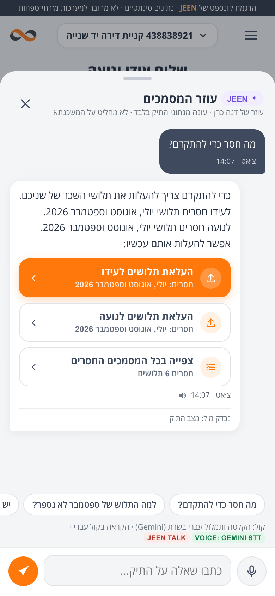 | 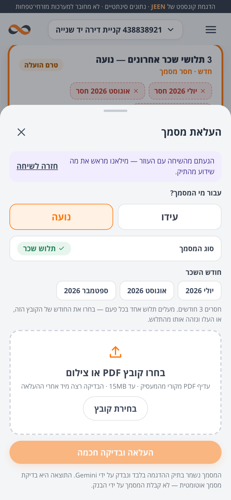 | 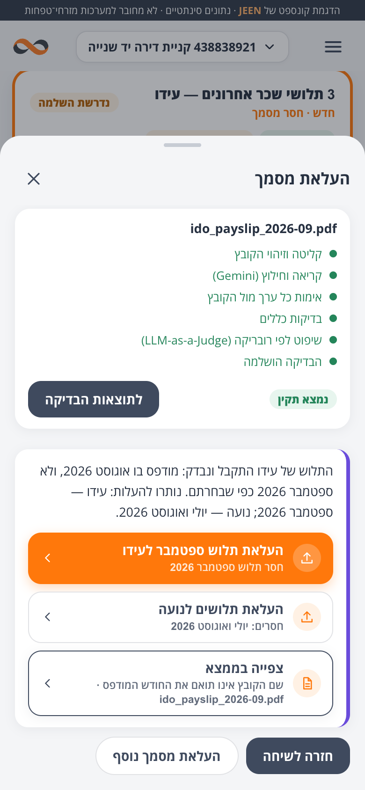 | 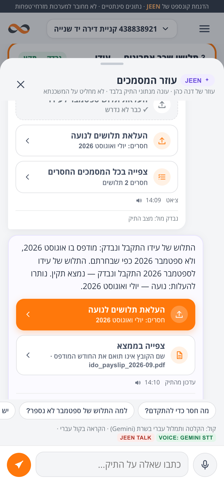 |

**The contract.** `app_action.v1` lives in `backend/app/agent/actions.py`. The Mortgage Case Service derives every action from persisted state: requirements and missing months, open findings, documents and handoffs. Each action has a stable id, the case id, a Hebrew label and detail, a priority, and typed parameters validated by Pydantic.

| Type | Opens | Offered when |
|---|---|---|
| `NAVIGATE_TO_DOCUMENT_UPLOAD` | the borrower's payslip card and the existing upload sheet, preselected | months are missing, or a customer finding needs a new document |
| `VIEW_DOCUMENT_REVIEW` | the document's review page with its evidence, scrolled to the finding | an open finding points at a document |
| `VIEW_MISSING_DOCUMENTS` | Documents, with the incomplete payslip cards highlighted | something is missing |
| `VIEW_REVIEW_STATUS` | Documents, uploaded list | a document review or a set re-check is running |
| `VIEW_CASE_DETAILS` | פרטי הבקשה | always |
| `CONTACT_BANKER` | an explicit confirmation sent through the same agent, which uses the existing handoff tool | banker items are open and nothing is queued |

No action is offered for bank statements or other document families, because the demo doesn't review them.

- **The model only chooses.** `offer_app_actions` takes action ids from the `app_actions` list that the case tools return in the same turn. It is available to in-app chat and voice only. The server rejects unknown ids, orders the chosen actions by its own priority, and stores them on the assistant turn. When Gemini is unavailable, the fallback reply carries the top next steps from case state.
- **Every click is checked again.** `POST /api/cases/{case}/actions/resolve` returns fresh parameters, or refuses with 403 (the turn belongs to another case), 404 (the action wasn't offered in that turn) or 409 (the action is stale).
- **The app navigates with its own router.** An upload action opens `/customer/documents?case=…&upload=PAYSLIPS:BRW-B[&period=…]`. The Documents screen checks the link against the active case and the live requirements before it opens the upload sheet. A document page won't show a document from another case.
- **Months.** A single missing month is preselected. When several are missing, the sheet lists them, selects none, and lets the customer pick one. The chosen month is stored as an upload intent (`upload_intents`) and never reaches the reviewer, so the review stays blind. After the review it is compared with the printed month.
- **After the upload.** `GET /api/cases/{case}/documents/{doc}/outcome` moves through `reviewing_document`, then `rechecking_case`, then `complete`. The final message is composed from the review result and the refreshed case, for example: "התלוש של נועה לספטמבר 2026 התקבל ונבדק — נמצא תקין. נותר להעלות את תלוש ספטמבר 2026 של עידו." The word "נבדק" appears only after the review finished. A wrong month, a finding or a failed review is stated as such, together with its next action.
- **Same conversation.** An upload started from the assistant gets one follow-up turn (channel `app`) once the set re-check is done. The turn is written on the next conversation read, so it survives a closed chat or a reload. Older buttons render from live state: actions that are still needed show current details, and satisfied ones are disabled ("✓ כבר לא נדרש"). Only the newest answer's first action is emphasized.
- **Voice.** A spoken request such as "תעביר אותי להעלאת התלוש של נועה" goes through the same agent and returns the same action. The reply says a button is on the screen, and the app never navigates by itself. `offer_app_actions` isn't exposed over MCP because a phone call has no screen. It can be enabled for JEEN Talk once there is a verified way to show an action in the app.

### Mortgage Case MCP server (`backend/app/mcp/server.py`)

- **Transport and auth:** Streamable HTTP, stateless JSON responses, protocol versions 2026-07-28 / 2025-11-25 / 2025-06-18 / 2025-03-26. Each bearer key is bound to **one case**, so a model never names the case. Extra arguments such as `case_id` are rejected.
- **Refusals:** browser Origins other than localhost get 403, invalid keys get 401, and GET/DELETE get 405.
- **Results:** sized for voice (about 3,800 characters). Write tools carry non-read-only annotations, and every call is audited.

```json
{ "mcpServers": { "mizrahi-touch-mortgage-case": {
    "url": "http://127.0.0.1:8791/mcp",
    "headers": { "Authorization": "Bearer <MCP_DEMO_KEY from backend/.env>" } } } }
```

---

## Integration matrix

| Component | State | Notes |
|---|---|---|
| Gemini document review (classify, OCR/extract, evidence re-read, judge, semantic) | **LIVE** | `gemini-3.8-flash` for every stage, temperature 0, low thinking |
| Gemini conversational agent (function calling) | **LIVE** | same model; chat and voice |
| Gemini voice transcription (fallback STT) | **LIVE** | used when the browser has no Hebrew speech recognition, or with `?voice=server` |
| Deterministic validation, evidence verification, rubric policy | LOCAL | PyMuPDF text layer, crop re-read, versioned rubrics |
| Mortgage Case Service (state, workflow, findings, audit) | LOCAL | SQLite WAL, in-process workers |
| Mortgage Case MCP server | LOCAL | verified with the official MCP Python SDK client |
| Browser voice (Web Speech STT, system TTS) | LOCAL | Hebrew TTS depends on an installed Hebrew voice (e.g. macOS Carmit) |
| JEEN Talk | **BLOCKED** | no credentials; adapter slot ready; **no calls were placed** |
| VisionTrace review provider | **BLOCKED** | see below |
| VisionTrace MCP (read-only probe) | **BLOCKED** | the provided key returned HTTP 401; the probe never opens an intake |
| Bank systems (stage, requirements, acceptance) | DEMO | `MockBankAdapter`, synthetic, `authoritative=false` |
| Identity and authorization | DEMO | server-checked signed sessions on every route; demo sessions are issued without a login (`DEMO_IDENTITY=1`), no identity provider; banker writes need the case's assigned banker; MCP keys bound to one case |

The `/system` page renders this matrix live from the backend.

## VisionTrace: adapter contract and remaining work

VisionTrace is intended to become the full review engine behind the **same** `ReviewProvider` contract: start, status, document result, case review, and re-run. Results carry facts with evidence, criterion outcomes with reason codes, a verdict, limitations, provider identity, rubric version, run id and timestamps. `backend/app/review/visiontrace_provider.py` holds the stub, the read-only probe, and an **untested** `map_envelope()` that maps a VisionTrace review envelope onto `DocumentReviewResult`. **No VisionTrace integration is claimed:** a VisionTrace MCP connection that only lists workflows is not a document-review integration.

What is needed, based on VisionTrace `main` 5a1ca7d (2026-10-11):

1. **A valid MCP key.** The provided key returned 401. Because it was pasted in chat, it should be rotated.
2. **A mortgage payslip workflow.** It can build on the unemployment-claim payslip workflow, which already has month coverage, `named_month`, a grounding gate and `locate_verbatim`. It needs borrower assignment per document, the requested-months policy above, and declared-income comparison.
3. **Expose the workflow to intake.** `visiontrace_open_intake` only accepts `fire` and `protected_spaces` today.
4. **Evidence-bearing results.** The MCP read tools return voice-shaped summaries without boxes. The adapter needs the review envelope (facts, `field_sources`, `screening.cases[].checks[]`) through REST service access or a new MCP tool.
5. **Implement the provider lifecycle.** Implement `start_document_review` (intake plus consented upload), `get_status`, `get_document_result` and `review_case`, then validate `map_envelope()` against a real envelope.
6. **Prove it on the golden corpus.** Run `fixtures/` through VisionTrace and compare with `fixtures/world.json` and the Gemini results. Only after the findings are verified should `REVIEW_PROVIDER=visiontrace` be enabled.
7. **Optional hybrid mode.** VisionTrace document verdicts plus Gemini semantic review. Not implemented.

**JEEN Talk needs:**

- a base URL and a Developer API key (`X-API-Key`);
- a Hebrew agent configured with this MCP server and a case-bound key;
- explicit approval before any live phone call.

---

## Test results (real Chrome, real Gemini, 2026-10-12)

| Suite | Result | Run with |
|---|---|---|
| Unit and integration tests (deterministic layer, evidence, reply guard, customer-status precedence, actions, payment-date rule and income selection, banker review desk and finding decisions through the real routes) | **64/64** | `cd backend && .venv/bin/python -m pytest -q tests` |
| Browser end-to-end journey | **17/17** (about 4 min) | `backend/.venv/bin/python e2e/test_journey.py` (resets cases 001 and 003) |
| Banker review workspace and the banker → customer → re-review loop | **41/41** (about 80 s) | `backend/.venv/bin/python e2e/test_banker_review.py` (isolated backend; see its docstring) |
| Resolving a banker finding: preliminary comparison, requests, customer reply and uploads, re-review, resolution, AI false positive | **30/30** (about 75 s) | `backend/.venv/bin/python e2e/test_finding_resolution.py` (isolated backend; see its docstring) |
| MCP with the official SDK client | **9/9** | `backend/.venv/bin/python e2e/test_mcp_sdk.py` (after the journey) |
| Chat-to-action navigation (mobile RTL, real uploads, voice, other-case refusals) | **22/22** (about 3 min, 26 Gemini calls) | `backend/.venv/bin/python e2e/test_chat_actions.py` (resets cases 001 and 003) |
| Presenter pane: accordion, 21 downloads with SHA-256, RTL, marks, no regression | **28/28** (about 25 s, no Gemini) | `backend/.venv/bin/python e2e/test_presenter.py` (resets case 005) |
| Presenter live 01 → 02 through the app UI, plus pay-date fixtures | **14/14**, plus an expected-vs-actual report (about 2 min) | `backend/.venv/bin/python e2e/test_presenter.py --live` (resets cases 004 and 005) |

**Executive demo, 2026-10-13: REPLAY, zero Gemini calls.** These runs prove the workflow and the UI, not the model's accuracy.

| Suite | Result | Run with |
|---|---|---|
| Featured scenarios, customer replacement, uncertainty routing, scoped reset, worker guards, golden-set independence (pytest, stored reviews) | **18/18** | `cd backend && .venv/bin/python -m pytest -q tests/test_featured_demo.py` |
| PASS · REVIEW · BLOCKER through the real UI: downloads, uploads, banker acceptance, banker request and customer reply, customer replacement and re-review, customer/banker consistency, refresh, "התחל דמו חדש" | **25/25** (about 40 s) | REPLAY backend `e2e/replay_backend.py` + `e2e/test_featured_demo.py` (commands in its docstring) |
| Presenter pane with the new layout (no Gemini) | **29/29** | `PRESENTER_BASE=<isolated stack> backend/.venv/bin/python e2e/test_presenter.py` |

The REPLAY backend replaces only the Gemini HTTP transport. Evidence verification against the uploaded PDF, rules, verdicts, case review, findings, outcomes, the banker desk and the reset all run for real. Model answers come from `e2e/replay/recordings.json`, looked up by the uploaded file's SHA-256, never by filename. The six golden payslips restate the live review of 2026-10-12 (`RECORDED_LIVE`). The bank statement uploaded as a payslip has no live recording; its answer is written by hand and labelled `AUTHORED`, so the BLOCKER classification itself has **not** been verified live. The semantic step is a fixed rule. Every call is logged to `<DATA_DIR>/replay-transport.jsonl`, and model ids read `replay-recorded`.

The browser journey uploads every file through the UI. It checks:

- all six initial documents VALID;
- the scan read with re-read evidence (net ₪16,900);
- the file named "09" extracted as August (gross ₪17,500);
- the missing, duplicate, filename and income-variance findings in the API and the UI;
- 10 rubric criteria with at least five evidence boxes;
- a grounded chat answer;
- a **voice turn** (a Hebrew phrase played into Chrome's fake microphone was transcribed as "מה עוד חסר כדי להשלים את המסמכים?" and answered by the same agent with case tools);
- correction and re-validation (`resolved_by_new_evidence`, duplicate becomes INFO);
- the customer explanation attached without resolving the finding;
- exactly one banker handoff;
- state surviving a reload;
- the banker confirmation keeping the banker item open;
- the MCP self-test matching the app;
- the four negative documents with no false approval (wrong borrower INVALID; unreadable, injection and contradictory NEEDS_REVIEW).

The MCP suite checks:

- the handshake and the 10-tool catalog;
- `get_case_overview`, `list_open_items` and `list_documents` against the app;
- a write without confirmation refused, with no change;
- the second case's key seeing only its own case;
- a smuggled `case_id` rejected;
- 401 / 403 / 400 / 405 refusals.

Results and screenshots are written to `e2e/artifacts/`, and the screenshots above are copied into `docs/screenshots/`.

`e2e/test_banker_review.py` uploads the six initial payslips to an isolated backend (real Gemini). In the browser it checks that the mislabeled file is first in the queue, that missing September is listed as missing, that the progress counts required payslips, and that Ido's income gap is informational. It inspects the page and its evidence boxes, accepts a payslip with a double click (one decision recorded), sends the mislabeled file back with an edited message, and checks the customer's home card, timeline and preset upload sheet. It uploads the replacement from the app and waits for the real re-review. Then it checks the replacement and history in the console, that every open banker finding is still tracked, the keyboard navigation, refresh, replayed submissions, invalid transitions, unauthorized calls, and that the bank stage never moves. The backend tests in `backend/tests/test_review_desk.py` cover the same transitions without Gemini, against a temporary data directory set up in `tests/conftest.py`.

`e2e/test_finding_resolution.py` follows one finding on an isolated backend (real Gemini). Noa uploads only September (₪16,900 against ₪18,500 declared). The banker sees a preliminary one-month comparison, can't close it without acknowledging the partial basis, and asks for July, August and an explanation. MCP and the in-app assistant report the same three requests. The customer answers in writing and uploads both months from the request cards, and Gemini re-reviews. The finding stays open with the full comparison and the unverified explanation, and the banker closes it with the three payslips as supporting documents (a double click records one decision). The decision survives a refresh and a later review, the customer's timeline shows only a neutral line, and a pay-date false positive on case 004 is dismissed with a reason, audited, and not reopened.

`e2e/test_ai_card.py` walks the home-screen card through real states on an isolated backend: nothing uploaded, under review, one payslip, a missing month, a duplicate month, re-validation, full coverage with a banker item, complete, banker-confirmed, invalid documents, a processing error and an unreachable API. It checks the title, the counts against an oracle built from the raw document reviews, the borrower rows and every button's destination. Its docstring lists the commands; it resets the cases it uses, so never point it at a backend whose data matters.

## Gemini usage and cost control

- One full browser journey made **37 Gemini calls**, all successful: about 77K input and 31K output tokens. That breaks down into 11 extractions, 11 judgements, 1 scan re-read, 3 semantic reviews, 10 agent steps and 1 transcription.
- **Hourly call budget.** `GEMINI_MAX_CALLS_PER_HOUR` (default 400) is enforced before every call.
- **Limited retries.** Only 429 and 5xx responses are retried, up to 3 attempts.
- **Repeat work is skipped.** Re-uploading the same file triggers no new review, and semantic reviews are cached by input hash.
- **Every call is recorded** (purpose, tokens, latency, error) and shown on `/system`.

## Security and governance

- Synthetic data only. A concept-demo ribbon on every screen states that the data is synthetic and not connected to Mizrahi systems.
- Secrets live server-side in `backend/.env` (chmod 600, gitignored) and are never sent to the browser.
- Document text is treated as hostile: it's quoted to models as data, and injection patterns are flagged by code.
- **Code, not the LLM, decides:**
  - arithmetic, permissions, state transitions and verdict policy;
  - the agent cannot approve a mortgage, change a verified finding, or close a banker finding;
  - customer statements are recorded as unverified context only.
- Case binding is enforced server-side for both the agent and MCP. Writes require explicit confirmation and are idempotent per request, and every tool call is audited.
- **Sessions and access (`backend/app/auth.py`).** Every `/api` route except health, fixtures, presenter files and the session routes checks an HMAC-signed, expiring session (HttpOnly, SameSite=Strict cookie, or the same token as a bearer). A customer session is bound to the cases it was issued for: it reads no other case, document or original file, and never reaches the banker API. The raw review data (`/api/cases/{id}/findings`, `/audit`, `/runs`, `/api/runs/{id}`) and every banker read need a staff session; banker writes need the case's assigned banker. A request header can't choose an identity. Customer views are projected: no banker reason, note, handoff package or confirmation note reaches them, and the assistant/MCP finding history is projected the same way. `retry` accepts only a failed document of your own case; a demo reset needs the case's customer or banker and can be switched off (`DEMO_RESET=0`).
- **Demo identity.** There is no identity provider in this demo. With `DEMO_IDENTITY=1` (default) the apps obtain sessions without a login: the customer app for the case picked in its selector (`POST /api/session/demo/customer`), the banker console for the demo banker (`POST /api/session/demo/staff`). Anyone who can reach the server can therefore obtain a demo session; outside a demo set `DEMO_IDENTITY=0` and issue sessions from the bank's SSO/OTP (`auth.issue`). Sessions are signed with `SESSION_SECRET`, or a random secret kept in `DATA_DIR/session_secret`; `SESSION_TTL_MINUTES` (default 480).

## Known limitations

- Only salaried payslips are reviewed. Other document families appear as "לא נבדק בהדגמה".
- No identity provider. Access is enforced on every route by server-issued sessions, but in demo mode anyone who can reach the server can obtain a demo session for any case or for the demo banker, so the demo still must not hold real data. Turn `DEMO_IDENTITY` off and connect bank SSO/OTP before any real use. One browser holds one customer session and one staff session at a time (the presenter plays both roles). Single-process SQLite with in-process workers is fine for a demo; production needs a database server and a queue.
- There is no push channel: both apps poll every 4 s (1.2 s while work is in progress). Measured propagation on a local machine was 0.1–4 s.
- The app can only upload payslips. A "request a document" on the income finding asks for something like an employer letter, which is uploaded as a payslip and reviewed against the payslip rubric, so it comes back "not a payslip". The banker can still read it in the evidence viewer.
- The BLOCKER scenario's classification of a bank statement uploaded as a payslip has only been exercised with an authored REPLAY answer. Run it once live (about 4 Gemini calls) before relying on it in front of an audience. The income check compares a 3-month average with the declaration: a single bonus month can lift the average inside the 5% demo tolerance, so month-to-month volatility is not flagged. The 5% tolerance is demo configuration, not bank policy.
- Customer requests can be withdrawn (with a reason) but not edited, and a document or finding decision can't be reversed. A new decision is the only correction.
- A professional decision needs a reason of at least 15 characters, and so does a report of an AI error. That minimum is a UX safeguard in this demo, not a bank policy.
- Accepting a document is recorded per document. It doesn't change the AI verdict, so case criterion IS-06 (all payslips VALID) can still read NEEDS_REVIEW while the banker has accepted every payslip.
- During development, one transcription request got HTTP 400 from Gemini and didn't reproduce in later runs. The UI now shows a Hebrew retry message instead of a raw error.
- Gemini model ids are configurable in `backend/.env`.

## Brand note

The Mizrahi-Tefahot logo files in `frontend/public/brand/` are taken from the bank's public website, solely so this internal concept demonstration is recognisable. The marks belong to Bank Mizrahi-Tefahot Ltd. They must be removed, or their use approved by the bank, before any external use. The Jeen logo (`jeen-logo.png`, plus `jeen-logo-light.png` with a white wordmark for dark bars and the tile mark `jeen-mark.png`) is generated from JEEN's own logo file. Colours and typography follow the public brand (orange `#ff780b`, slate `#3f4a5e`, Open Sans Hebrew).

## Project layout

```
backend/app/
  review/      contract.py (provider contract) · gemini_provider.py · case_review.py · deterministic.py
               evidence.py · prompts.py · rubrics.py · registry.py · visiontrace_provider.py
  workflow/    engine.py (durable jobs, reconciliation) · readiness.py (AI readiness state machine)
               review_desk.py (banker decisions, customer requests, drafts) · desk_state.py (banker status per document)
  agent/       agent.py (Gemini function calling, guard) · tools.py (one tool registry for agent and MCP)
               actions.py (app_action.v1: derive, choose, resolve) · continuation.py (after-upload outcome)
  mcp/         server.py (Mortgage Case MCP server)
  api/         routes.py (customer + system API) · assistant.py (action resolve, upload outcome) · banker.py · banker_package.py
  bank/        mock_bank.py · store/repo.py · llm/gemini.py · db.py · config.py · main.py
backend/rubrics/   versioned rubric JSON
backend/tests/     unit tests · test_review_desk.py (banker desk integration) · conftest.py (temp DATA_DIR) · live_journey.py
frontend/src/      customer app (pages/customer), banker console (pages/banker: BankerConsole · ReviewWorkspace · DecisionPanel),
                   system page, voice.ts, components
fixtures/          world.json (ground truth) · generate.py · out/ (synthetic PDFs + manifest)
                   presenter/ (presenter_scenarios_manifest.json + golden_set/, served to the "תרחישי בדיקה" pane)
                   pay_date/ (generate.py + out/: payslips that print a payment date, for the PS-10 regression)
e2e/               test_journey.py (browser) · test_mcp_sdk.py · test_presenter.py · test_chat_actions.py · screens.py (visual QA)
                   test_banker_review.py (banker → customer → re-review) · test_finding_resolution.py (finding decisions)
                   banker_screens.py · banker_visual.py (console screenshots, overflow and clipping checks)
```
