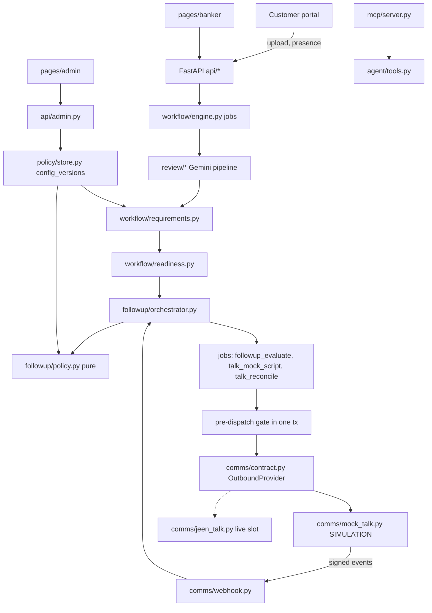

# 04 — Target Architecture & Integration Contracts

PRD route names (`/api/loan-cases/...`) are mapped onto the existing `/api/cases/...` contract; the PRD calls its
paths "proposed, adapt to existing contracts" (§10.2).

## 1. Component view



Boundaries kept from today: `ReviewProvider` is the only review boundary; code decides verdicts and transitions;
the bank stage and AI readiness are separate; AI never closes a banker finding; customer projection strips banker
rationale. New boundary: `OutboundProvider` is the only path to a customer contact; nothing else knows whether a
contact is simulated or live, except that every attempt records `provider` and `simulated`.

## 2. Persistence (new tables)

| Table | Key columns | Notes |
|---|---|---|
| `config_versions` | `version_id`, `kind` (`loan_policy`/`talk_prompt`), `scope`, `number`, `status` (DRAFT/PUBLISHED/ARCHIVED), `config`, `schema_version`, `hash`, `revision` (ETag), `author`, `created_at`, `updated_at`, `published_at`, `published_by`, `based_on`, `change_reason`, `validation` | one PUBLISHED per (kind, scope) |
| `case_profile` | `case_id`, `requirement_set_version`, `pinned_at`, `profile` | pins requirement set per case |
| `demo_applications` | `case_id`, `created_at`, `application` | customer-started applications (synthetic) |
| `completion_tasks` | `task_id`, `case_id`, `requirement_code`, `reason_code`, `status`, `issue_version`, `document_id`, `created_at`, `updated_at`, `resolved_at`, `history` | partial UNIQUE(case, requirement, reason) where open |
| `contact_plans` | `case_id` PK, `state`, `decision`, `next_eligible_at`, `policy_version`, `plan_version`, `updated_at`, `nudge` | one per case (consolidation) |
| `contact_attempts` | `attempt_id`, `case_id`, `channel`, `provider`, `simulated`, `idempotency_key` UNIQUE, `status`, `outcome`, `provider_call_id`, `task_ids`, `policy_version`, `prompt_version`, `link_id`, `created_at`, `updated_at`, `history` | |
| `policy_decisions` | `decision_id`, `case_id`, `action`, `blocked_by`, `rule_ids`, `next_eligible_at`, `policy_version`, `explanation_he`, `trigger`, `evaluated_at` | append-only |
| `customer_presence` | `case_id`, `session_id`, `state`, `last_seen_at`, `last_activity_at`, `last_upload_action_at`, `picker_open_until`, `ended_at`, `seq` | per tab/device |
| `contact_preferences` | `case_id` PK, `consent_voice`, `consent_message`, `opt_out_voice`, `opt_out_message`, `snooze_until`, `preferred_channel`, `updated_at`, `updated_by` | seeded from mock bank |
| `provider_events` | `event_id` PK, `provider`, `received_at`, `attempt_id`, `payload`, `result` | dedupe |
| `case_events` | `event_id`, `type`, `case_id`, `occurred_at`, `actor`, `correlation_id`, `payload` | outbox `*.v1` |
| `case_overrides` | `override_id`, `case_id`, `type`, `reason`, `actor`, `created_at`, `expires_at`, `revoked_at` | |
| `upload_links` | `link_id`, `token_hash` UNIQUE, `case_id`, `task_ids`, `requirement_code`, `created_at`, `expires_at`, `used_at`, `attempt_id` | token never stored in clear |
| `simulation_runs` | `run_id`, `version_id`, `created_at`, `actor`, `results`, `passed` | side_effects=false |
| `system_flags` | `key` PK, `value`, `updated_at`, `updated_by` | kill switch, demo clock offset |

## 3. Policy configuration (`kind=loan_policy`, Pydantic-validated, `schema_version` "1.0")

```json
{
  "schema_version": "1.0",
  "scope": {"environment": "demo", "product": "personal_loan.all_purpose"},
  "product": {"label_he": "הלוואה לכל מטרה", "purposes": {"car": {"label_he": "רכישת רכב", "proof_he": "הצעת מחיר או חשבונית"}}},
  "document_requirements": [
    {"id": "ID_CARD", "family": "id_document", "per": "applicant", "required": true, "label_he": "תעודת זהות",
     "condition": null, "rules": {"check_expiry": true}},
    {"id": "PAYSLIPS", "family": "payslip", "per": "applicant", "required": true, "label_he": "תלושי שכר",
     "condition": {"employment": ["salaried"]}, "rules": {"months": 3}},
    {"id": "BANK_STATEMENTS", "family": "bank_statement", "per": "account", "required": true,
     "label_he": "דפי עו״ש", "rules": {"coverage_days": 90, "max_age_days": 30, "joint_satisfies_all": true}},
    {"id": "PURPOSE_PROOF", "family": "purpose_proof", "per": "case", "required": true,
     "label_he": "אסמכתה למטרת ההלוואה", "rules": {"max_age_days": 90}},
    {"id": "TAX_ASSESSMENT", "family": "tax_form", "per": "applicant", "required": true,
     "condition": {"employment": ["self_employed"]}, "rules": {"min_tax_year_offset": 1}}
  ],
  "validation": {"low_confidence_threshold": 0.6, "undetermined_route": "HUMAN_REVIEW"},
  "customer_messages": {"PAYSLIP_WRONG_PERIOD": "המסמך שהעלית שייך ל{detected}. נדרש תלוש {expected}."},
  "followup": {
    "auto_followup_enabled": true, "presence_ttl_seconds": 90, "in_app_idle_nudge_minutes": 5,
    "abandonment_grace_minutes": 20, "unknown_presence_extra_minutes": 10,
    "channel_order": ["in_app", "voice"], "min_hours_between_calls": 24,
    "max_attempts_per_case": 2, "max_attempts_per_case_per_day": 1, "max_attempts_per_customer_per_day": 2,
    "call_window": {"timezone": "Asia/Jerusalem", "days": ["SUN","MON","TUE","WED","THU"], "from": "09:00", "to": "18:00"},
    "holidays": ["2026-10-14"], "on_exhausted_attempts": "HUMAN_REVIEW", "statement_extends_grace_minutes": 30
  },
  "talk": {"mode": "simulation", "enabled": true, "link_ttl_minutes": 1440, "reconcile_after_minutes": 10,
           "retry": {"max_provider_errors": 2, "backoff_minutes": [5, 30]}},
  "templates": {"in_app_correction": "...", "link_message": "...", "reminder": "...", "completed": "..."}
}
```

Locked (hard) rules are code constants shown read-only in Admin: no contact while any session is meaningfully
active or an upload/evaluation is in flight; consent and opt-out; closed task; human review; kill switch;
simulation never dials; envelope limits (call window within 08:00–20:00, max 3 attempts per case,
min 4 hours between calls, grace ≥ 1 minute in demo / ≥ 5 in other environments).

`kind=talk_prompt`: `{"locale": "he-IL", "opening_locked": "...AI disclosure...", "instructions": "...",
"allowed_variables": ["first_name","missing_documents","secure_upload_link","next_step"]}`.

## 4. State machines

**Derived case status** (from existing readiness + follow-up): `NOT_CHECKED→AWAITING_DOCUMENTS`,
`CHECKING/RECHECKING→ANALYZING`, `ACTION_REQUIRED→NEEDS_COMPLETION` (or `FOLLOWUP_IN_PROGRESS` when a plan is
SCHEDULED/DISPATCHING/IN_CALL, `AWAITING_CUSTOMER` after a completed contact), `READY_FOR_HUMAN_REVIEW_WITH_OPEN_FINDINGS→HUMAN_REVIEW`,
`READY_FOR_HUMAN_REVIEW→READY_FOR_BANKER`, `PREPARATION_CONFIRMED` (banker), `ERROR`.

**Completion task**: `OPEN → IN_APP_PROMPTED → FOLLOWUP_SCHEDULED → CONTACT_ATTEMPTED → AWAITING_CUSTOMER → RECHECKING → RESOLVED`;
from any open state: `ESCALATED`, `CANCELED`, `PAUSED_BY_CUSTOMER`, `PAUSED_BY_BANKER`, `POLICY_BLOCKED`, back to
`OPEN` when un-paused. A task resolves only when a new document for its requirement passed review.

**Contact plan (per case)**: `IDLE`, `IN_APP` (customer active), `WAITING` (grace), `SCHEDULED`, `DISPATCHING`,
`IN_CALL`, `AWAITING_CUSTOMER`, `BLOCKED`, `PAUSED`, `ESCALATED`, `COMPLETED`, `CANCELED`.

**Contact attempt** (ranked, callbacks can only move forward): `QUEUED(0) → DISPATCHING(1) → DIALING(2) →
CONNECTED(3) → COMPLETED/NO_ANSWER/FAILED/CANCELED(9)`; `UNKNOWN(4)` → reconcile; `CANCEL_REQUESTED(5)`,
`CANCEL_FAILED(6)`. A final status is never overwritten.

## 5. Policy evaluator contract (`followup/policy.py`)

`evaluate(ctx: FollowupContext, policy: FollowupPolicy, now: datetime) -> Decision` — pure, no I/O.

Precedence (first blocking tier wins): 1 hard guards (kill switch, consent/opt-out, closed/escalated case,
human review, no open verified task, active session, upload/evaluation in flight, demo-env live-dial refusal) ·
2 operational uncertainty (presence UNKNOWN → extra wait; provider unhealthy; attempt UNKNOWN pending) ·
3 published config (grace, window, holidays, caps, spacing) · 4 preferences (snooze, preferred channel) ·
5 the prompt never participates.

`Decision = {action, blocked_by[], rule_ids[], next_eligible_at, policy_version, explanation_he}` with actions
`NO_ACTION`, `IN_APP_ONLY`, `IN_APP_NUDGE`, `SUPPRESS`, `WAIT`, `SCHEDULE_CALL`, `DISPATCH_NOW`, `BLOCK`,
`SNOOZE`, `ESCALATE`, `RESOLVE_AND_CANCEL`. Invalid config → `BLOCK` with `rule_id=CFG-INVALID` (fail closed).

## 6. Outbound provider contract (`comms/contract.py`)

```python
class OutboundProvider(Protocol):
    name: str; simulated: bool
    def capabilities(self) -> Capabilities      # cancel_call, get_call, send_message, hebrew_voice, sandbox
    def health(self) -> Health
    def create_call(self, req: CallRequest) -> ProviderAck   # idempotent on req.idempotency_key
    def cancel_call(self, provider_call_id: str) -> CancelResult  # TOO_LATE_TO_CANCEL allowed
    def get_call(self, provider_call_id: str) -> CallState
    def send_message(self, req: MessageRequest) -> ProviderAck
```

`CallRequest`: `idempotency_key` (`case:{case}:plan:{plan_version}:tasks:{hash}`), `client_reference`
(attempt id), `case_ref` (opaque), `contact_ref` (opaque; phone resolved only by telephony; demo uses an allowlisted
test token), `locale`, `prompt_version`, `variables` {`first_name`, `missing_documents[]`, `secure_upload_link`,
`next_step`}, `allowed_actions` [`send_link`, `mark_no_answer`, `request_human`, `schedule_callback`],
`requires_identity_verification`, `context_tool` (MCP `get_followup_context`), `callback_url`, `expires_at`.

**Webhook** `POST /api/webhooks/jeen-talk`: headers `X-Talk-Timestamp` (unix seconds, ±300 s) and
`X-Talk-Signature: v1=<hex hmac_sha256(secret, timestamp + "." + body)>`. Body:
`{event_id, event_type:"call.status_changed", client_reference, provider_call_id, sequence, status, outcome?,
occurred_at, data:{link_sent?, callback_at?, identity_verified?}}`. Duplicate `event_id` → 200 `duplicate`;
unknown reference → 202 stored as orphan + `integration.reconciliation_required.v1`; lower rank → 200 `ignored`.

The mock provider never dials. It schedules `talk_mock_script` jobs that build the same signed payloads and pass
them to the webhook handler, so the real receiver code path is exercised.

## 7. Customer-facing contracts
- `POST /api/cases/{id}/presence` `{session_id, event, seq, visible}`; events `session_started`, `heartbeat`,
  `user_activity`, `file_picker_opened`, `upload_started`, `upload_completed`, `session_resumed`, `session_ended`.
  Upload/evaluation progress is derived from jobs server-side.
- `GET /api/cases/{id}/followup` (customer projection: plan state, nudge, snooze, no rule ids or internals).
- `POST /api/cases/{id}/followup-snooze` `{minutes | until}` · `POST /api/cases/{id}/contact-preferences`.
- `POST /api/links/redeem` `{token}` → case-bound customer session + target; states `ok`, `resolved`, `expired`, `used`.

## 8. Staff contracts
- `GET /api/banker/cases/{id}/followup` (decision, blocked_by, rule ids, attempts, next action, versions, simulated flag)
- `GET /api/banker/cases/{id}/timeline`
- `POST /api/banker/cases/{id}/followup-override` `{type: pause|resume|human_review|reschedule|cancel, reason, until?}`
- `POST /api/banker/cases/{id}/followups` manual call (same guards)
- Admin: `GET /api/admin/loan-completion/settings`, `POST .../drafts`, `PUT .../drafts/{id}` (`If-Match`),
  `POST .../drafts/{id}/validate`, `POST .../drafts/{id}/publish`, `GET .../versions`, `POST .../rollback`,
  `POST .../policy/simulate`, `POST .../policy/interpret-proposal`, `POST .../prompts/test`,
  `POST .../followups/pause` (kill switch), `GET .../audit`.
- Demo controls (demo env + staff session; audited; labelled "סימולציה"): `POST /api/demo/clock`,
  `POST /api/demo/cases/{id}/customer-left`, `POST /api/demo/cases/{id}/talk-outcome`, `GET /api/demo/cases/{id}/sent-links`.

## 9. Capabilities (server-side RBAC)
Staff directory entries carry `capabilities`. Banker: `case.read`, `case.write`, `followup.override`,
`followup.manual_call`. Policy admin: `policy.read`, `policy.edit`, `prompt.edit`, `demo.simulate`, `audit.read`.
Compliance approver: `policy.read`, `policy.publish`, `prompt.publish`, `audit.read`. Sensitive changes
(contact rules) require publisher ≠ last editor when `require_distinct_approver` is true.

## 10. Events (`case_events`)
`document.uploaded.v1`, `document.evaluated.v1`, `completion.required.v1`, `completion.resolved.v1`,
`customer.presence_changed.v1`, `followup.policy_evaluated.v1`, `followup.scheduled.v1`, `followup.deferred.v1`,
`followup.canceled.v1`, `talk.call.status_changed.v1`, `case.ready_for_banker.v1`, `settings.draft_saved.v1`,
`settings.policy_published.v1`, `settings.prompt_published.v1`, `settings.rollback_applied.v1`,
`policy.simulation_completed.v1`, `contact.permission_changed.v1`, `case.override_applied.v1`,
`integration.reconciliation_required.v1`.

## 11. Security boundaries
Secrets only in env (`TALK_WEBHOOK_SECRET`, live `JEEN_TALK_*`); the mock uses a per-DATA_DIR random secret.
Link tokens: 32 random bytes, SHA-256 stored, scoped to case + tasks, expiry, single use. Talk payload excludes ID
numbers, amounts and document contents. Logs never include tokens or phone numbers. Live mode refuses to start
when `APP_ENV=demo` unless `TALK_LIVE_ALLOWLIST` is set and the contact is on it.
