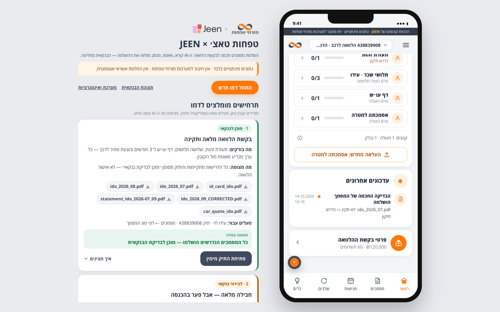
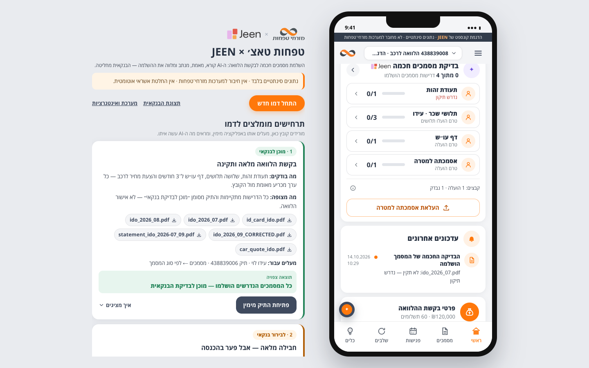
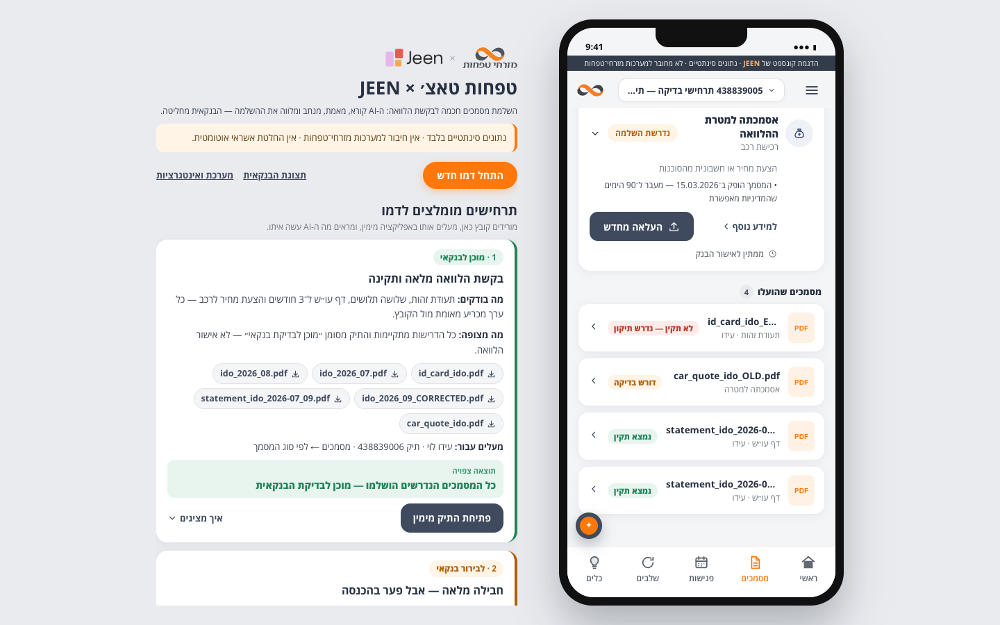
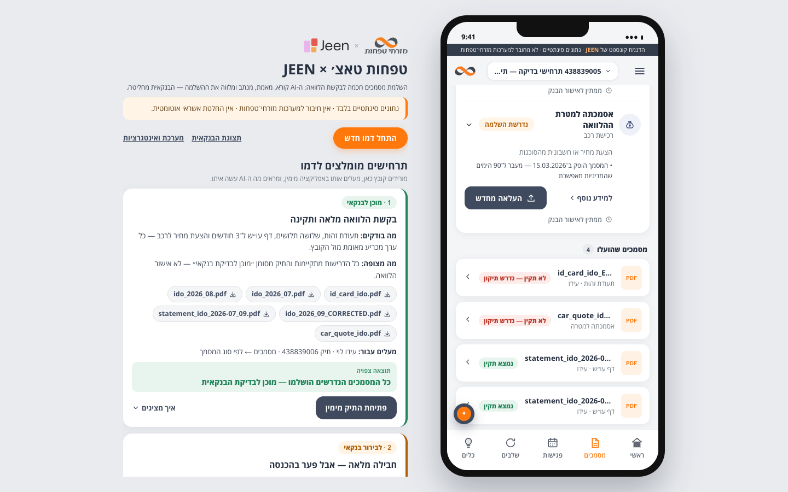

# Mizrahi #2 — Rounds 1–2 final product audit and hardening

> **Status 2026-10-14: approved and FROZEN.** Follow-ups done after approval:
> - payslip rubric v1.3.0 released (wording only);
> - :8791 restarted on this code;
> - final smoke on REPLAY passed.
>
> Baseline, guard and integration rules: `docs/plans/round-1-2-freeze/FREEZE.md`.

Date: 2026-10-14 · Scope: Rounds 1–2 only (loan foundation, multi-document review, intake, per-family UI). Rounds 3–5 were not started.
Environment: an isolated REPLAY stack (backend :8792, built frontend :5843, own `DATA_DIR` under `e2e/artifacts/`) and a
second one for the MCP and legacy suites (:8798 / :5846). Mizrahi #2 main (:8791, Vite :5192) was only read. Mizrahi #1
(:8790) received read-only GETs from the coexistence check and nothing else. No Gemini calls were made (REPLAY only).

**Verdict.** Mizrahi #2 is one loan application on one pipeline. Every upload entry point opens the same upload sheet,
which posts to the same endpoint and the same review engine. No mortgage process is active. The audit found one P1 (a file
filed under the wrong requirement could never be filed under the right one), four P2s and several P3s. All P1 and P2 issues
are fixed and covered by tests. One decision is left to you: the released payslip rubric still describes the borrower as
"mortgage" (see section 6).

Evidence: 49 screens walked in Chrome at 1440×900, 1600×1000 and 390×844 (`e2e/audit_explore.py`; inventory in
`round-1-2-audit/screen-inventory.json`). The audit also traced the code behind every upload button. The suites were then
re-run on a fresh stack.

---

## 1. Screen and workflow inventory

Seeded states (through the real upload endpoint, REPLAY answers): 009 wrong-month payslip, 008 payslip in the ID-card slot,
006 complete package, 011 income review, 005 statement gap + stale quote + expired ID, 001 two applicants, empty.

| Area | Screens inspected | Result |
|---|---|---|
| Customer home | action card, document summary, banker card, recent updates, loan details (all 6 states) | consistent with readiness; P2 wording fixed (F2) |
| Documents | requirement list (ID, payslips, statements, purpose proof, other bank docs), banker requests, uploaded files (6 states) | P2 badge fixed (F3), P2 label fixed (F2) |
| Document page | Evidence Viewer, facts, rubric criteria, findings, next step (6 states) | P2 replace preset fixed (F4) |
| Upload sheet | from home card, home summary, payslip row, ID row, chat action, banker request, document page, mobile | one sheet, requirement preset correct after F4 |
| Assistant | chat with action buttons (REPLAY: the no-model fallback answers from case data), action → upload sheet | works; live agent not exercised (no Gemini) |
| Secondary | request details, stages, meetings, tools, apply (intake), drawer | loan wording; intake opens new case with conditional tax requirement |
| Presenter pane | four featured loan scenarios, 10 test scenarios, Lavi payslips, technical details, "התחל דמו חדש" | works; P3 copy fixed (F5) |
| Banker | review queue, Evidence Viewer per family, decision panel, requirement matrix, conversation, technical log (5 cases) | works; matrix holds at 1366/1024/820 px with no overflow |
| System | integration matrix, MCP live check, Gemini usage | P3 labels fixed (F6) |
| Mobile 390×844 | home, documents, upload sheet, banker | customer: no sideways scroll; banker is desktop-only (inherited, section 6) |

Upload entry points (all go through `useCase().openUpload` → `UploadSheet` → `api.upload` → `POST /api/cases/{id}/documents` →
`engine.submit_document`, one review job per new document):

| Entry point | Code | Preset |
|---|---|---|
| Home action card primary | `components/DocumentCheckCard.tsx` (`uploadLink`) | next requirement / period from `actions.available` |
| Home summary secondary | `components/DocumentSummary.tsx` | another requirement the card does not lead to |
| Requirement row "להעלאה" / "העלאה מחדש" | `pages/customer/Documents.tsx` (`LoanDocRow`, payslip rows) | that requirement |
| Banker request card | `Documents.tsx`, `DocumentReview.tsx` | request's requirement, period, request id |
| Deep links `?upload=`, `?replace=`, `?request=` | `Documents.tsx` effect | checked server-side again |
| Document page "העלאת מסמך חלופי" / "להעלאת מסמך מתוקן" | `pages/customer/DocumentReview.tsx` | document's requirement (+ replaces when AI-blocked) |
| Chat action buttons | `components/AssistantActions.tsx` (re-validated, then `uploadLink`) | from the action |

No second upload pipeline, no direct `fetch` uploads, no mortgage-specific route. The two buttons on the home screen are
intentional: they lead to different requirements.

## 2. Mortgage leftovers

Classes: A reusable infrastructure · B historical naming · C active mortgage logic · D dead or duplicate · E legacy test/fixture.

| Where | What | Class | Action |
|---|---|---|---|
| `mcp/server.py` `INSTRUCTIONS`, 401 message | told MCP clients this is a "Mortgage Case Service" | C (domain framing for an AI client) | fixed (F6) |
| `/system` matrix (`api/routes.py`) | "Mortgage Case Service", "Mortgage Case MCP server" | B, user-visible | fixed (F6) |
| `App.tsx` presenter pane | "10 תרחישי Golden Set…" for the loan scenarios | B, user-visible | fixed (F5) |
| `backend/rubrics/payslip.il.salaried.v1.*.json` `description` | "…for a salaried mortgage borrower", sent in the judge prompt | C (wording only) | **kept — released rubric, needs your approval** |
| `mcp/server.py` `SERVER_INFO.name` `mizrahi-touch-mortgage-case` | MCP client identifier | B | kept (renaming breaks configured clients) |
| `config.py` `mortgage_case_service.sqlite3` | DB file name | B | kept (renaming orphans existing data) |
| Module docstrings "Mortgage Case Service" (engine, readiness, repo, contract, routes, actions, AssistantActions) | internal naming | B | kept |
| `continuation.py` event source `mortgage_case_service` | persisted event field | B | kept (stored in turns) |
| `visiontrace_provider.py`, `registry.py` | VisionTrace's own mortgage workflow (external product) | A | kept, accurate |
| `deterministic.py` injection patterns, `agent.py` approval guard | "approve the mortgage" / "אשר את המשכנתא" | A (security: still must be caught) | kept |
| `fixtures/presenter/golden_set/` | golden set v1.1 | E | never edited (rule) |
| Six live browser suites + `e2e/test_featured_demo.py` | assert mortgage cases | E | kept, marked LEGACY (F8) |
| Presenter "תלושי Golden Set המקוריים" notes, "תיק לביא" | accurate provenance: the payslips are the unmodified golden files; case 001 is the Lavi family | A | kept |

No mortgage stage, property, LTV, appraisal or mortgage requirement is reachable in the UI or the API. The audit regex
(`משכנת|נכס|דירה|מומחי`) found nothing on any customer, banker or system screen.

## 3. Duplicate or redundant functionality

| Finding | Severity | Result |
|---|---|---|
| File dedupe keyed on `(case, sha256)` competed with the requirement flow: a payslip uploaded into the ID slot could never be uploaded under the payslips ("כבר הועלה לתיק — לא נבדק פעם נוספת"); the payslip requirement stayed 0/3 | **P1** | fixed (F1) |
| `COVERAGE_CODES` defined twice in the backend (`engine.py`, `review_desk.py`) | P3 / D | `review_desk` now uses `engine.COVERAGE_CODES` |
| `DOCUMENT_TYPE_FAMILY` in `api.ts`, never used | P3 / D | removed |
| `ScenarioPresenter.tsx` `COVERAGE_CODES` | — | kept: a different set (golden-set income-set codes, used to show that rubric in the technical details) |
| `mock_bank.requirements()` / `case_context()` | — | kept: they delegate to `workflow/requirements.py`, a single source |
| Legacy `e2e/test_featured_demo.py` vs `e2e/test_loan_journey.py` | E | loan suite supersedes it; its two still-valid checks (card completeness, split screen) ported |
| Home card primary + summary secondary upload | — | kept (different requirements); see P3 note in section 10 |

## 4. Active workflow and sources of truth

| Fact | Single source | Consumers |
|---|---|---|
| Which documents a case needs | published policy version pinned per case (`policy/store.py`, `case_profile`) → `workflow/requirements.for_case` | readiness, actions, banker package, agent tools, MCP, UI |
| Which rubric reviews a file | `review/rubrics.for_document(code, requirements.family_of(code, case))` | `engine._run_document`; classification stays blind |
| Document verdict | provider result merged under code precedence (`gemini_provider._merge`) | document page, banker |
| Customer/banker route of a document | `workflow/outcomes` (`snap.outcomes`) | home, documents, document page, upload sheet, banker — **badge now follows it too (F3)** |
| Requirement state, progress, case status | `workflow/readiness.compute` | customer, banker, presenter, MCP `get_case_overview` |
| Next customer actions | `agent/actions.available(state)` | home card, summary, chat buttons, MCP guidance |
| Bank stage | `MockBankAdapter` (`authoritative=false`) | never mixed with AI readiness |
| Presenter scenarios | `fixtures/presenter/presenter_scenarios_manifest.json` (SHA-256 checked server-side) | presenter pane, featured cards |

Synchronization was verified end to end. A banker request appears on the customer's home and documents screens. The
customer's upload answers it and returns to the banker. Readiness then flips to `READY_FOR_BANKER` on both sides (loan
suite checks "banker: requests the missing September payslip", "correction: …READY_FOR_BANKER" and "banker: 4/4"). MCP `get_case_overview` and `list_open_items` match the app (MCP suite).

## 5. Issues fixed

| # | Sev. | Issue | Fix | Files |
|---|---|---|---|---|
| F1 | P1 | Same file could not be filed under another requirement; the wrong-slot payslip blocked the payslip requirement forever | dedupe per case **and document family**: same family → same document (with the existing "other applicant" note); other family → new document reviewed under that rubric. Unique index now `(case_id, sha256, COALESCE(requirement_code,''))`; the old index is dropped on start by `db.migrate()` (`DROPPED_INDEXES`) | `backend/app/workflow/engine.py`, `backend/app/store/repo.py` (`documents_by_sha`), `backend/app/db.py` |
| F2 | P2 | "העלאה מחדש: אסמכתה למטרה" for a document never uploaded (case-level "missing" finding counted as a fix), and "העלאה מחדש" for a statement gap | "re-upload" only when a finding is bound to an uploaded document | `backend/app/agent/actions.py`, `frontend/src/pages/customer/Documents.tsx` |
| F3 | P2 | Stale quote: file badge "דורש בדיקה" while its row and page asked for a replacement (also unreadable payslips, inherited) | `customerVerdict()`: a document the AI review sends back reads "לא תקין — נדרש תיקון" on the badge too | `frontend/src/api.ts`, `pages/customer/Documents.tsx`, `pages/customer/DocumentReview.tsx`, `components/UploadSheet.tsx` |
| F4 | P2 | Document page "להעלאת מסמך מתוקן" opened the upload with no requirement (fell back to the default kind) | always passes the document's requirement; `replacesDocumentId` only when AI-blocked | `frontend/src/pages/customer/DocumentReview.tsx` |
| F5 | P3 | Presenter pane called the loan scenarios "Golden Set" | loan wording; Lavi section says it holds payslips | `frontend/src/App.tsx` |
| F6 | P3 | MCP instructions / 401 and `/system` labels said "Mortgage Case" | loan wording | `backend/app/mcp/server.py`, `backend/app/api/routes.py` |
| F7 | P3 | Duplicate `COVERAGE_CODES`, dead `DOCUMENT_TYPE_FAMILY` | consolidated / removed | `backend/app/workflow/review_desk.py`, `frontend/src/api.ts` |
| F8 | P2 | Legacy suite docstrings started the backend with `./.venv/bin/uvicorn` (shebang → **Mizrahi #1's interpreter**) and `test_ai_card.py` on :8791/:8792 (collides with #2 main) | `python -m uvicorn`, isolated ports 8793/8794, LEGACY notes | `e2e/test_ai_card.py`, `test_banker_review.py`, `test_finding_resolution.py`, `test_chat_actions.py`, `test_journey.py`, `test_presenter.py`, `test_featured_demo.py` |

Docs updated: `README.md` (intake dedupe rule, test status, legacy suites, MCP keys for REPLAY), `docs/CODEMAP.md` (intake line).

## 6. Intentionally preserved

- **Payslip rubric description ("mortgage borrower").** It was kept during the audit because released rubrics change only
  with approval. **Resolved after approval:** `payslip.il.salaried` v1.3.0 rewords only the description. Its criteria
  equal v1.2.0, which `tests/test_pay_date.py` asserts; v1.2.0 and earlier are kept for history.
- B-class identifiers (MCP server name, DB file name, docstrings, persisted event source): renaming them breaks clients
  or data and adds no product value.
- Security patterns that mention mortgages: they must keep catching injected text.
- Banker console below 820 px: it was designed and tested as a desktop workspace (1440/1366, stacked at 820). At 390 px
  it overflows (`round-1-2-audit/mobile-banker-desktop-only.png`). This is inherited from the existing app.
- `/system` shows Gemini as LIVE on the REPLAY stack while the detail reads `replay-recorded`. That is the test harness
  (it sets a dummy key), not the product. The suites themselves report REPLAY.
- The legacy LIVE browser suites: kept (not deleted), labelled LEGACY. They need real Gemini calls to adapt (Round 5).

## 7. Belongs to Rounds 3–5, not Rounds 1–2

- Follow-up policy engine, scheduler, presence, pre-dispatch gate, mock JEEN Talk adapter, upload links, banker Talk card
  and timeline, presenter simulation controls, kill switch (Round 3). The tables exist (`db.py`) but nothing reads or
  writes them except `repo.reset_case`. `api/admin.py` and `api/followup.py` are empty routers.
- Capability-based RBAC (MAYA/AVI are seeded but not enforced yet), `/admin` with drafts, diff, simulate, publish and
  rollback UI, prompt registry (Round 4). The policy store API used by Round 1 already supports drafts and publishing.
- Adapting the six LIVE browser suites to loans, failure injection, full regression against the baseline (Round 5).

## 8. Screenshots (`docs/plans/round-1-2-audit/`)

| Before | After |
|---|---|
|  "העלאה מחדש: אסמכתה למטרה" for a quote never uploaded |  "העלאת אסמכתה למטרה" |
|  stale quote: badge "דורש בדיקה", row "העלאה מחדש" |  badge "לא תקין — נדרש תיקון", same as row and page |

Also: `c009-upload-sheet-from-card.png`, `c009-chat-actions.png`, `banker-c005-review.png`, `banker-c006-matrix.png`,
`system.png`, `presenter-bottom.png`, `mobile-upload-sheet.png`, `22-mobile-upload-sheet.png`, `16b-stale-quote.png`.

## 9. Automated test results (all run in this session)

| Check | Result | Command |
|---|---|---|
| Backend tests | **130 passed** (3 new: re-filing under another family, old-index migration, first-upload wording; `test_pay_date` asserts v1.3.0 = v1.2.0 criteria) | `cd backend && .venv/bin/python -m pytest -q tests` |
| Frontend typecheck | OK | `cd frontend && ./node_modules/.bin/tsc --noEmit -p .` |
| Production build | OK (`frontend/dist`, plus isolated copies) | `cd frontend && npm run build` |
| Loan browser suite | **34/34, REPLAY**, 22 extract/judge answers all `RECORDED_LIVE`, no network | `e2e/test_loan_journey.py` (7 new checks: card completeness, split screen, first-upload wording, re-filing, document-page replacement, stale-quote consistency, phone 390×844) |
| MCP SDK suite | **9/9, REPLAY** stack (empty case) | `E2E_BASE=… E2E_MCP_KEY=replay-mcp-key-001 E2E_MCP_KEY_2=replay-mcp-key-002 e2e/test_mcp_sdk.py` |
| Coexistence #1/#2 | **7/7** — #2's pages only reach #2's origin; #1's case list unchanged | `e2e/coexistence_check.py` |
| Legacy executive suite | 2/6 (expected: asserts three mortgage scenarios and 21 golden files) | `e2e/test_featured_demo.py` on :5846 |
| Browser audit walk | 49 screens, desktop + mobile | `e2e/audit_explore.py` (before/after in `e2e/artifacts/audit/`) |

Not run: anything LIVE (no approval for paid calls), the six LIVE legacy suites, `test_presenter.py`. Mizrahi #1: its
source and config files are unchanged; its own process wrote its log and WAL. Its server is the same process as before
(started 2026-10-13 14:17).

## 10. Remaining risks

- ~~Mizrahi #2 main (:8791) still runs the pre-audit backend.~~ **Done:** restarted with `./run.sh start`
  (PID 86948, 10:50). Before the restart its job queue was empty, so no Gemini calls followed. The old index was dropped
  and the new one is in place.
- The live chat agent and live Gemini review were not exercised this session. Only REPLAY was used, as instructed.
- With F1, the wrong-slot document stays a BLOCKER on its own requirement until the customer replaces it. This is
  intended, and the loan suite covers it.
- P3, not fixed: the home summary's secondary button is chosen per applicant. A requirement without an applicant (purpose
  proof) therefore always qualifies, even when the payslips are the more natural next step (case 008). It is correct but
  arbitrary; revisit together with Round 3's completion tasks.
- Two simultaneous uploads of the same file for two applicants in the same family can still create two documents (the
  index allows different requirement codes). The window is negligible in a demo.

**Ready to freeze?** Yes. Frozen on 2026-10-14 (see `docs/plans/round-1-2-freeze/FREEZE.md`).
