# Rounds 1–2 completion report (2026-10-14)

Mizrahi #2 runs as the personal-loan Loan Completion Agent on backend **:8791** and Vite **:5192**. Mizrahi #1
(mortgage) keeps :8790 / :5190 and was not stopped, restarted or modified.

## Results (run in this session)

| Check | Command | Result |
|---|---|---|
| Backend tests | `cd backend && .venv/bin/python -m pytest -q tests` | **127 passed** (was 100 at baseline) |
| Frontend typecheck | `cd frontend && ./node_modules/.bin/tsc --noEmit -p .` | clean |
| Loan journey, real Chrome, **REPLAY** | `e2e/test_loan_journey.py` (backend :8792, frontend :5843, fresh DATA_DIR) | **27/27** · 18 extract/judge answers, all `RECORDED_LIVE`, no network call ([results](round-1-2/loan-journey-results.json)) |
| Coexistence with #1 | `e2e/coexistence_check.py` | **7/7** ([results](round-1-2/results.json)) |
| Live Gemini recording | `e2e/replay/record_live.py` (approved) | 24 calls, 24 ok, 12 file × rubric combinations |

Not run: the older live browser suites (`test_journey`, `test_chat_actions`, `test_presenter`, `test_ai_card`,
`test_banker_review`, `test_finding_resolution`) — they are Gemini-live and still assert mortgage scenarios; adapting
them is Round 5 regression work. `e2e/test_featured_demo.py` (mortgage) is superseded by `e2e/test_loan_journey.py`.

## The wrong-month payslip investigation

Golden `ido_2026_09.pdf` prints **August** under a September file name. The live review returned `NEEDS_REVIEW` with
`BORROWER_MISMATCH`. Cause, in order:
1. **Fixture**: the identity number is printed under the label "(דמו) מזהה עובד" (employee identifier), not "מספר זהות".
2. **Extraction**: Gemini (prompt 2.0.0) read it as `employee_number` and left `employee_id` empty — a defensible reading.
3. **Rules**: PS-03 correctly refused PASS without a verified identity number, but labelled the downgrade with the
   criterion's own code `BORROWER_MISMATCH`, which reads as a different person.

Fixes (no new paid calls): code promotes `employee_number` to the identity number only on an exact, text-layer-verified
match with a case identity; a PASS downgraded for missing evidence now carries `EVIDENCE_UNVERIFIED`; the extraction
prompt now says how to read an ambiguous identifier. Result on the recorded answer: `VALID`, printed period 2026-08,
`employee_id` and `salary_period` witnessed `text_layer_exact`; the case review then reports the intended failure —
September missing, August duplicated, file name vs printed month (`test_recorded_reviews.py`, E2E check 9).

Also found and fixed during the browser run: a payslip uploaded into the ID card was reported as "unreadable" because
the judge failed both type and legibility; a legible document of another type now reports the type
("המסמך אינו תעודת זהות"). And statement recency is now a property of the statement set, not of each monthly statement.

## Working flows (all exercised in the browser suite)

1. Presenter pane: four featured loan scenarios, ten loan test scenarios, checksum-verified downloads, "התחל דמו חדש".
2. Customer upload → AI validation: ID card, three payslips, bank statement, car quote through their own cards.
3. Document findings: September missing, August duplicate, file-name mismatch; 3 of 4 requirements; next action on home.
4. Banker review: requirement matrix; evidence for ID (identity number), statement (period), quote (amount) and the
   wrong-month payslip (printed month); original PDF opens.
5. Banker request → customer correction through the request → `READY_FOR_BANKER`, "not a loan decision".
6. Wrong document type in the ID card → AI sends it back → banker cannot accept → customer replaces it → satisfied.
7. New application (intake): self-employed renovation loan → tax assessment instead of payslips.
8. Chat-to-action and MCP (API check on the REPLAY stack): upload actions for ID / statement / payslip resolve; MCP lists
   10 tools and every requirement.
9. Loan wording: no mortgage terms on customer screens, banker console, system page or presenter pane.

## Screenshots

| | |
|---|---|
| Presenter + home 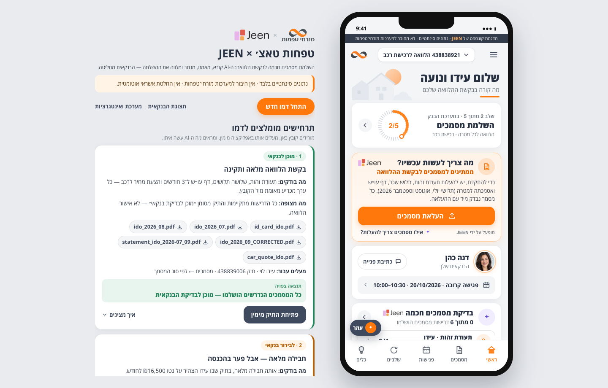 | Documents, four requirements  |
| Wrong month found  | Customer evidence 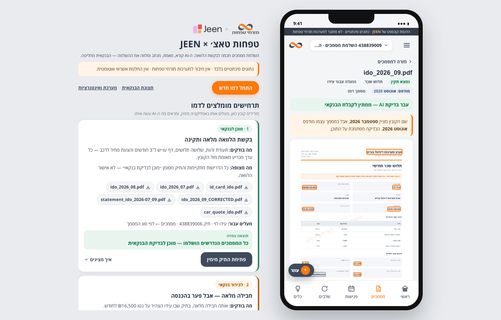 |
| Banker requirement matrix  | Banker evidence — ID card 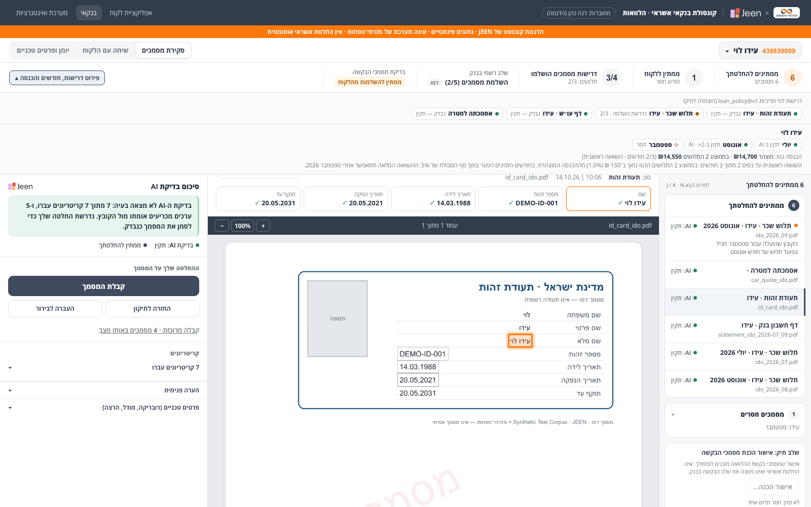 |
| Banker evidence — statement 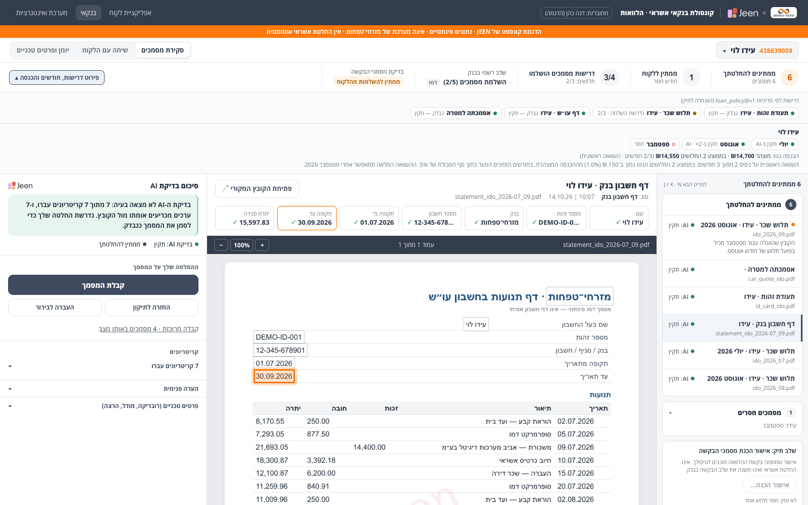 | Banker evidence — wrong month 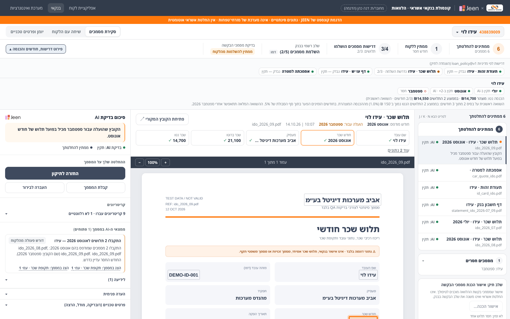 |
| Banker request 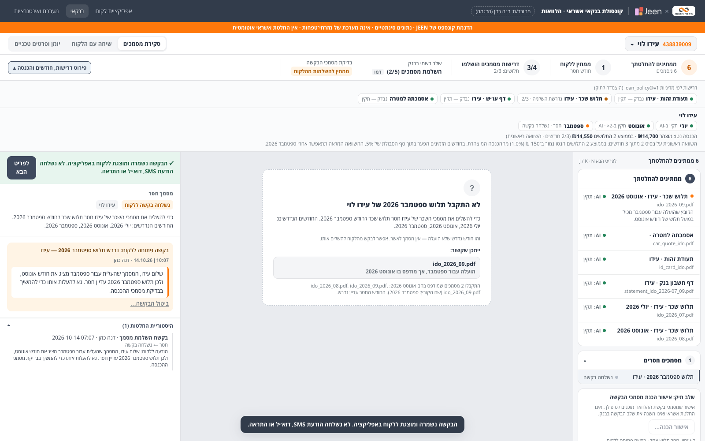 | Complete — ready for banker 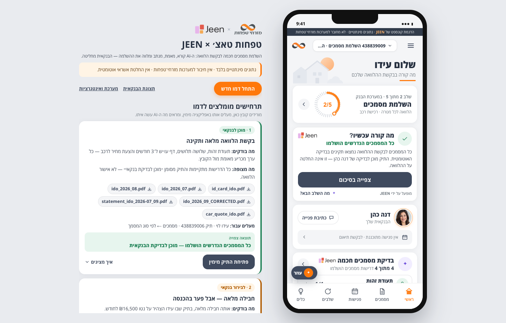 |
| Banker 4/4 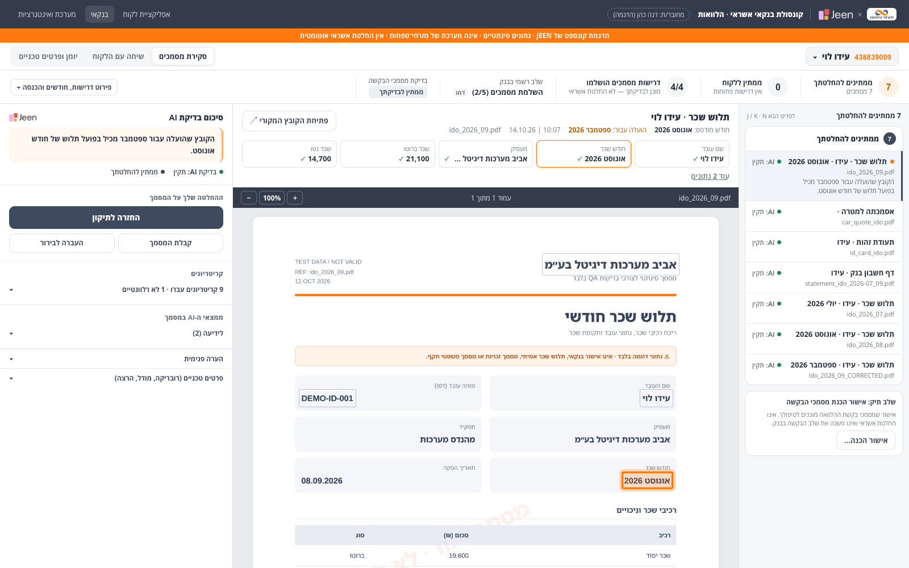 | Wrong type sent back 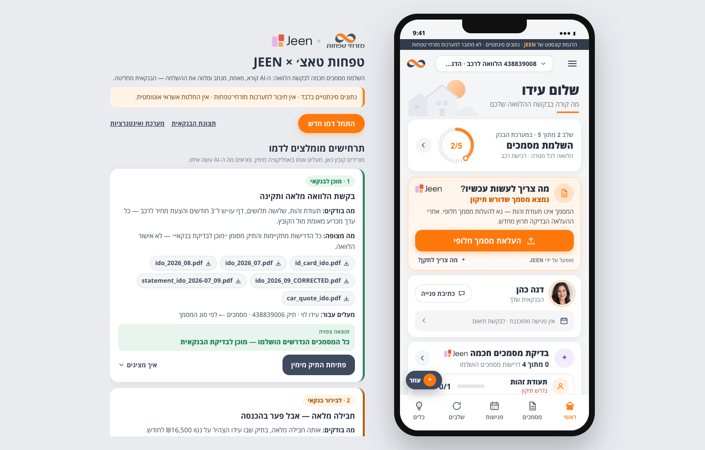 |
| Banker cannot accept 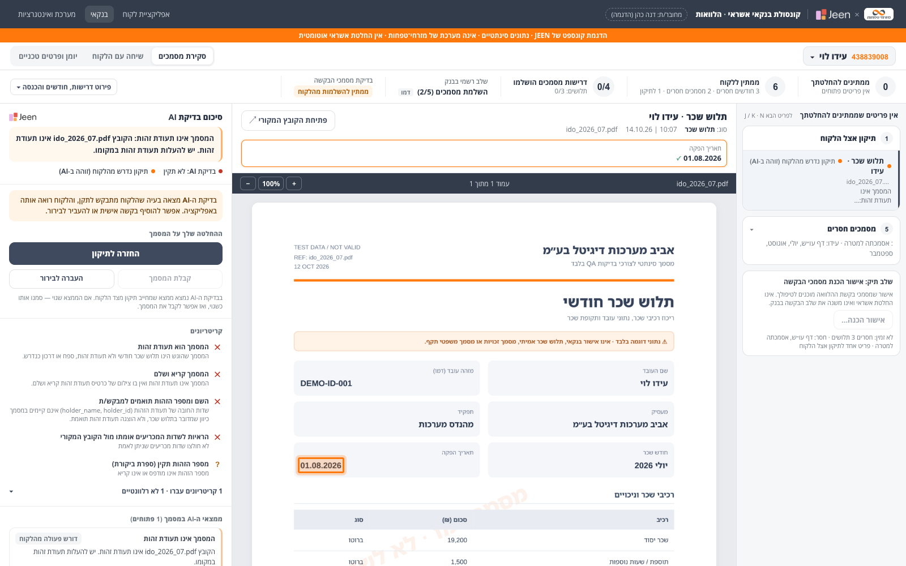 | After replacement 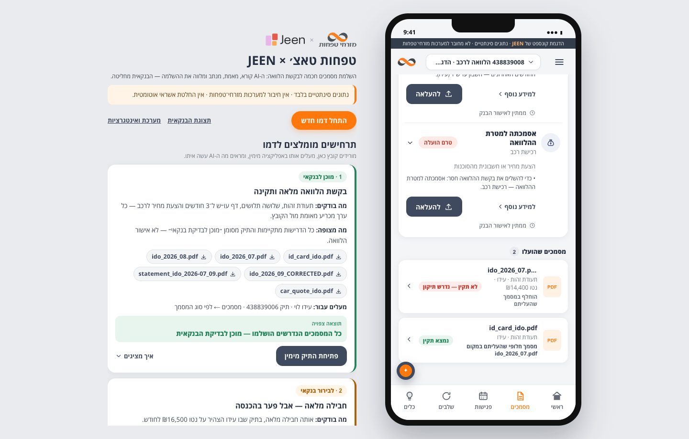 |
| Loan details 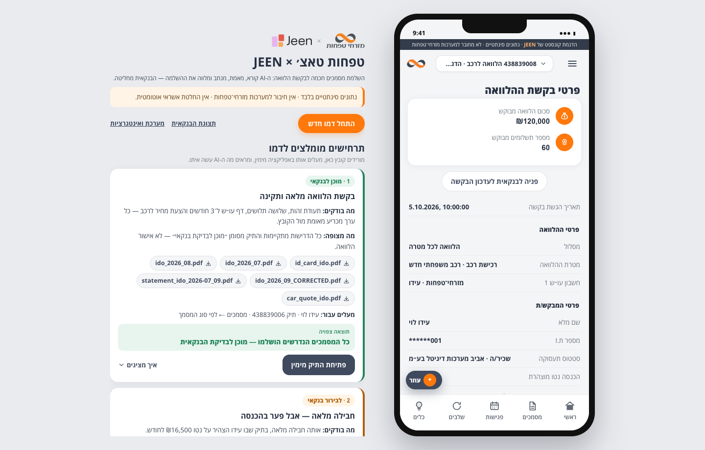 | Intake 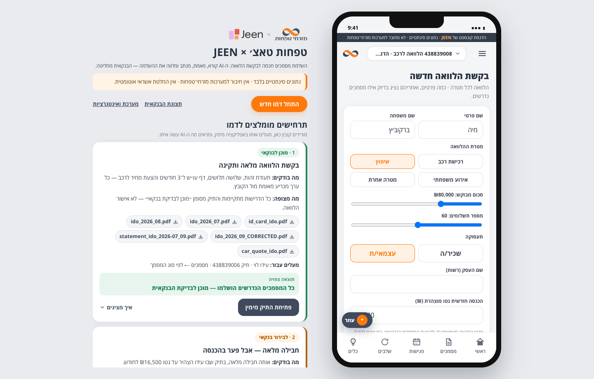 |
| Intake → tax assessment 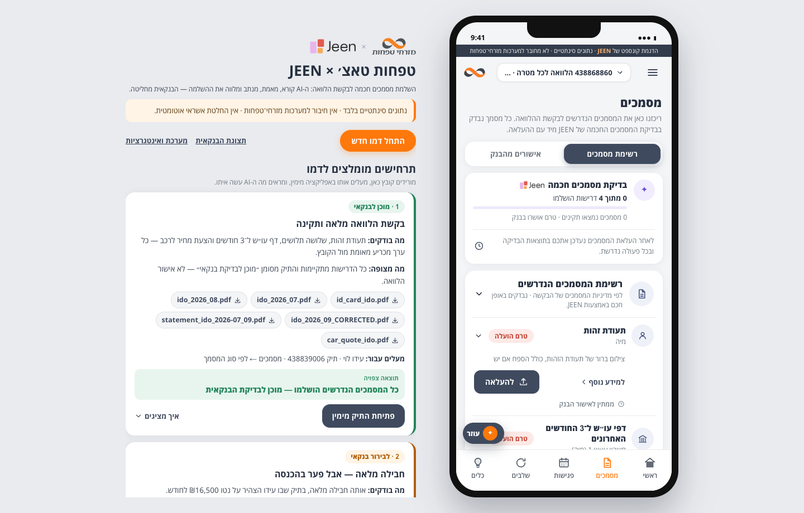 | #2 Vite :5192 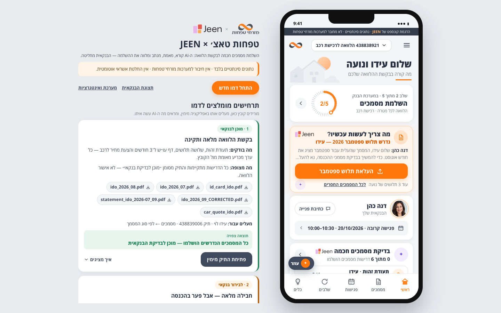 |

## Remaining for later rounds
Round 3: completion tasks, presence, follow-up policy engine, scheduler, simulated JEEN Talk, webhook, secure links,
banker Talk card and timeline. Round 4: Admin Settings UI, Customize Prompt, simulator, RBAC enforcement on policy
endpoints (staff capabilities already exist in the directory). Round 5: adapting the older live suites, regression
against the baseline, Talk handoff pack.
