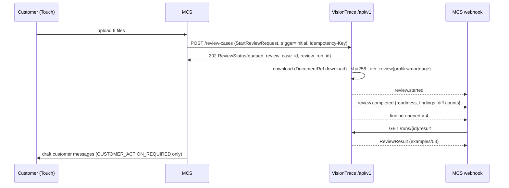
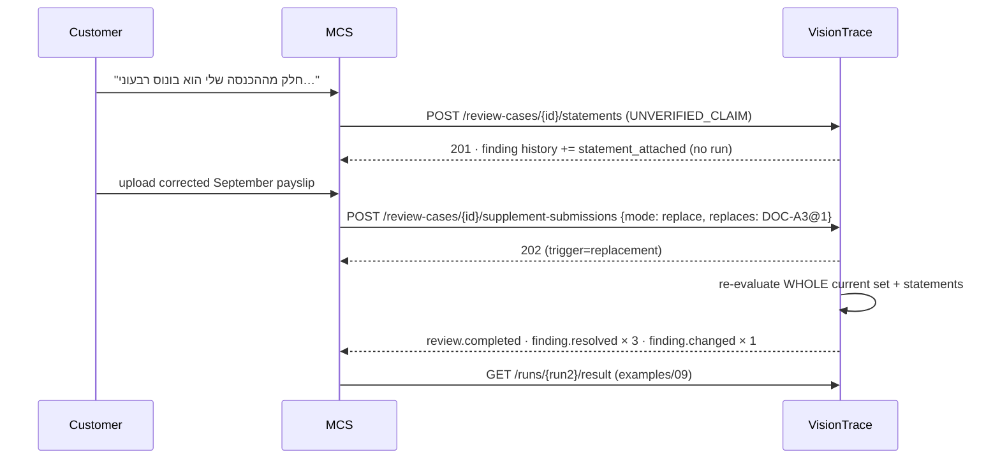

# Document D — חוזי נתונים ואינטגרציה (VISIONTRACE_REVIEW_DATA_CONTRACTS)

**גרסה:** 1.0 · **תאריך:** 12.10.2026 · **סכמה קנונית:** `D_VISIONTRACE_REVIEW_DATA_CONTRACTS/schemas/mortgage-review.v1.schema.json` (JSON Schema 2020-12, `$id` `https://jeen.ai/schemas/visiontrace/mortgage-review/v1`) · **API:** `…/api/openapi.yaml` (OpenAPI 3.1, עבר `openapi-spec-validator`) · **MCP:** `…/mcp/visiontrace_mcp_tools.json` · **דוגמאות:** `…/examples/01…15` (כולן מאומתות מול הסכמה ע״י `…/tools/build_examples.py`).

---

## 1. מטרה

חוזה אחד בין שירות תיקי המשכנתא (MCS) לבין **כל** ספק סקירה — Gemini (הדמו, היום) ו־VisionTrace (בהמשך) — כך שהחלפת ספק לא משנה את ה־MCS, את ממשק הבנקאי או את חוויית הלקוח. החוזה מכסה את מחזור הסקירה כולו, לא רק OCR: קליטה, סיווג, חילוץ, ראיות, קריטריונים, verdicts, בדיקות סט ובין־מסמכיות, ממצאים ומחזור חייהם, השלמה ובדיקה חוזרת, הסברי לקוח, החלטות בנקאי, חבילה לבנקאי, אירועים ושגיאות.

---

## 2. עקרונות

| נושא | כלל |
|---|---|
| גרסה | כל אובייקט עליון נושא `schema_version: "1.0"`. שינוי שובר → `v2` ו־`$id` חדש. |
| מזהים | `review_case_id`, `review_run_id` — אטומים (`^[A-Za-z0-9_\-]{6,40}$`) + רפרנס קצר לקריאה (`C-7K2M-9Q4X`, `R-A3F91`). `case_ref` שייך ל־MCS ולעולם לא מומצא. |
| זמן | UTC ISO-8601. `as_of` (תאריך) מגיע מה־MCS. |
| כסף | `{amount, currency: "ILS"}`; נרמול לא מנחש פורמט אירופי. |
| חודש | `"YYYY-MM"`. |
| עמוד | **1-based** (VisionTrace פנימית 0-based — ממירים בגבול). |
| תיבה | `bbox` מנורמל `[x0,y0,x1,y1]` ב־0..1, מסגרת מוצגת (אחרי סיבוב), מקור שמאל־עליון; אופציונלית `bbox_pdf_points` + `page_size_points`. |
| עד (witness) | `text_layer_exact` · `ocr_token_match` · `vision_reread_confirmed` (מאומתים) · `vision_unverified` · `not_found` · `unavailable`. |
| טקסט בעברית | שדות `_he`; הודעות ללקוח נפרדות מהודעות פנימיות. |
| היעדר מול null | שדה חובה שאין לו ערך → `null` עם `status` מתאים (`absent` / `illegible` / `ambiguous`); לא משמיטים בשקט. |
| תאימות קדימה | צרכנים מתעלמים משדות לא מוכרים; יצרנים ב־v1 לא פולטים שדות מחוץ לסכמה (`additionalProperties: false`). |
| גבול החלטה | `verdict` הוא תוצאת סקירת מסמך; `bank_acceptance` תמיד `NOT_DETERMINED_BY_PROVIDER`; `readiness` לעולם לא "מאושר". |

---

## 3. האובייקטים

| קבוצה | הגדרות | דוגמה |
|---|---|---|
| בקשה | `StartReviewRequest`, `CaseContext`, `CaseParty`, `DeclaredIncome`, `CaseRequirement`, `DocumentRef` | `01_start_review_request.initial.json` |
| מצב ריצה | `ReviewStatus`, `RunState`, `RunStage` | `02_review_status.running.json` |
| תוצאה | `ReviewResult`, `Provenance`, `PolicyParameterUse` | `03_…run1_initial.json`, `09_…run2_after_replacement.json` |
| מסמך | `DocumentReview`, `DocumentIntake`, `Classification`, `PartyBinding`, `ExtractedFact`, `EvidenceItem`, `CriterionOutcome`, `DocumentDimensions` | `04_document_facts.DOC-A3_v1.json`, `05_evidence_item….json` |
| סט ותיק | `SetReview`, `CrossDocumentComparison`, `Readiness` | בתוך 03/09 |
| ממצאים | `Finding`, `FindingHistoryEntry`, `FindingsDiff`, `ResolutionBasis` | בתוך 03/09 |
| לקוח | `SupplementRequest`, `SupplementSubmission`, `CustomerStatement` | `06`, `07`, `08` |
| בנקאי | `BankerDecision`, `BankerReviewPackage`, `Escalation`, `ReviewHistoryEntry` | `10`, `11`, `12`, `13` |
| אירועים ושגיאות | `LifecycleEvent`, `ErrorEnvelope` | `14_lifecycle_events.json`, `15_error.stale_review.json` |

---

## 4. משטח קיים מול TO BUILD

### 4.1 VisionTrace @ 5a1ca7d — מה קיים בפועל

| משטח | קיים | הערות |
|---|---|---|
| REST של workflows/ריצות/תיקים (`/unemployment-flow`, `/claim-cases`, `/intakes`) | כן | **מאחורי cookie gate** (`services/auth/middleware.py` `EXEMPT_PATHS`) — לא נגיש לשירות |
| `/claim-cases`: `GET ""`, `POST ""`, `POST /{id}/submissions`, `POST /{id}/supplement-link`, `POST /{id}/decisions`, `GET /{id}/journey` | כן | תיקי אבטלה; הבסיס להכללה |
| `/intake-portal/{redeem,session,submit,status}` | כן | פטור מה־gate; קישור חד־פעמי הוא הסמכות |
| `POST /mcp` + 6 כלים | כן | ראו `mcp/visiontrace_mcp_tools.json` → `existing_tools` |
| אירוע `review.completed` + outbox + dispatcher | כן | payload מוגבל: kind, run_id, severity, headline, checks, open_items, files, link, `decision: "human decision required"` |
| webhook גנרי חתום | כן | גוף הודעה מעוצבת `{event,title,text,fields,link}` — לא אירוע מובנה |

### 4.2 TO BUILD

| משטח | מה | איפה מוגדר |
|---|---|---|
| Service API `/api/v1` | 16 פעולות | `api/openapi.yaml` |
| Webhook אירועים מובנה | `LifecycleEvent` × 14 סוגים | `openapi.yaml` → `webhooks.lifecycleEvent` |
| כלי MCP תחומי־תיק | 5 כלים + טוקן תיק | `mcp/visiontrace_mcp_tools.json` → `proposed_tools`, `case_binding` |
| תיקון סחיפת enum של `visiontrace_open_intake` | enum מ־`contracts.WORKFLOWS` | F T-23 |

---

## 5. ממשק ספק נייטרלי

### 5.1 הממשק הקנוני (חדש — ב־MCS)

```python
from typing import Protocol, Optional
# המודלים נוצרים מהסכמה הקנונית (למשל datamodel-code-generator → pydantic v2)
from mortgage_review_v1 import (StartReviewRequest, ReviewStatus, ReviewResult, SupplementSubmission,
                                CustomerStatement, BankerDecision, BankerReviewPackage,
                                ReviewHistoryEntry, Finding, Provenance)


class DocumentReviewProvider(Protocol):
    """מחזור סקירה מלא של מסמכי תיק. ספק סינכרוני מסיים בתוך start_review ומחזיר מצב succeeded;
    ספק אסינכרוני (VisionTrace) מחזיר queued/running וה־MCS ממתין ל־webhook או עושה polling."""

    name: str                                                    # "gemini" | "visiontrace"

    def identity(self) -> Provenance: ...                        # ספק, גרסה, מודלים, גרסאות פרומפט/רובריקה
    def readiness(self) -> dict: ...                             # {"state": "READY"|"BLOCKED", "missing": [...]}

    def start_review(self, req: StartReviewRequest) -> ReviewStatus: ...
    def get_status(self, review_run_id: str) -> ReviewStatus: ...
    def get_result(self, review_run_id: str) -> ReviewResult: ...       # ReviewResult קנוני מלא
    def cancel(self, review_run_id: str) -> ReviewStatus: ...

    def submit_supplement(self, sub: SupplementSubmission) -> ReviewStatus: ...
    def record_statement(self, review_case_id: str, st: CustomerStatement) -> CustomerStatement: ...
    def record_decision(self, decision: BankerDecision) -> BankerDecision: ...   # 409 stale_review

    def list_findings(self, review_case_id: str, status: Optional[list[str]] = None) -> list[Finding]: ...
    def get_package(self, review_case_id: str, review_run_id: Optional[str] = None) -> BankerReviewPackage: ...
    def get_history(self, review_case_id: str) -> list[ReviewHistoryEntry]: ...
```

### 5.2 שני מימושים

| | `GeminiReviewProvider` (דמו, קיים) | `VisionTraceReviewProvider` (TO BUILD) |
|---|---|---|
| איפה רצה הסקירה | בתהליך ה־MCS (`backend/app/review/gemini_provider.py`, `case_review.py`) | ב־VisionTrace (`services/mortgage/*`) |
| איך ממומש הממשק הקנוני | **מתאם** `CanonicalGeminiAdapter` שעוטף את `ReviewProvider` הקיים (`start_document_review` לכל מסמך + `review_case`) ומרכיב `ReviewResult` (טבלת §8.2) | קריאות REST ל־`/api/v1` (§4.2); `get_result` מחזיר את `ReviewResult` כפי ש־VisionTrace חישב |
| מנוע מחזור חיי הממצאים | ב־MCS — `reconcile_findings` הקיים (`backend/app/workflow/engine.py`), מעודכן לכללי §6 | ב־VisionTrace — `services/review_cases/findings.py`; ה־MCS משקף |
| החלטות בנקאי | נשמרות ב־MCS | נשלחות ל־VisionTrace (`POST …/decisions`) ומשתקפות חזרה באירוע `decision.recorded` |
| בדיקת התאמה | **אותן בדיקות conformance**: GS-01 שלבים 1–4, GS-18, GS-19, GS-34, GS-35, GS-36 חייבים להפיק את אותם מפתחות, סטטוסים ו־diff בשני הספקים |

הממשק הישן בדמו (`ReviewProvider` ב־`backend/app/review/contract.py`) נשאר כממשק פנימי של ספק Gemini; ה־MCS עובר לדבר רק עם `DocumentReviewProvider`.

---

## 6. מנוע מחזור חיי הממצאים (FindingLifecycleEngine)

### 6.1 קלט ופלט
- קלט: `review_case_id`, `review_run_id`, `trigger`, **קבוצת הממצאים הרצויה** של הריצה (כל מה שהריצה הנוכחית חושבת שפתוח, עם מפתח יציב), הקשר (מסמכים נוכחיים, דרישות, פרמטרי מדיניות ששונו).
- פלט: `FindingsDiff {opened, resolved, changed, unchanged, reopened}` + עדכון רשומות `Finding` והיסטוריה.

### 6.2 האלגוריתם

```text
existing := all findings of the case, by key (any status)

for d in desired:
    f := existing[d.key]
    if f is None:                               → open(d)                        ⇒ opened
    elif f.status == OPEN:
        if f.not_reproduced_by_run: clear it (reproduced again)
        delta := diff(severity, review_state, message_*, evidence_hash, attached statements)
        delta ? update + one history entry per change ⇒ changed : ⇒ unchanged
    elif f.status in (RESOLVED, SUPERSEDED):    → reopen(f, d)                    ⇒ reopened
    elif f.status in (WAIVED, DISMISSED):
        evidence_hash(d) == f.decision_evidence_hash ? keep  ⇒ unchanged
                                                     : reopen(f, d, note="הראיות השתנו מאז ההחלטה") ⇒ reopened

for f in existing where f.status == OPEN and f.key ∉ desired:
    basis := DOCUMENT_WITHDRAWN    if every document f cites is no longer current (superseded/withdrawn)
             REQUIREMENT_CHANGED   elif the requirement f belongs to was removed by the MCS
             POLICY_CHANGED        elif trigger == rerun_policy_change and f's criterion flipped because of a changed parameter
             SUPERSEDED_BY_FINDING elif a desired finding declares it supersedes f      (status → SUPERSEDED)
             NEW_EVIDENCE          otherwise
    if f.review_state == BANKER_REVIEW_REQUIRED and (origin_method(f) ∈ {judge, hybrid} or basis == NEW_EVIDENCE):
        if not f.not_reproduced_by_run: set it to this run; history "not_reproduced"   ⇒ changed
        continue                                 # stays OPEN until a banker records confirm_resolution
    resolve(f, basis)                                                               ⇒ resolved
```

- `evidence_hash` = sha256 על (sha256 של המסמך, עמוד, ציטוט) של כל הראיות המצוטטות + ערכי ה־`detail` המכריעים.
- `origin_method(f)` = השיטה של הקריטריון שיצר את הממצא (`criterion_refs` → רובריקה).
- הכלל "ממצא בנקאי לא נסגר על סמך פלט מודל" זהה לכלל הקיים בדמו (`reconcile_findings`: *"never close a banker-review finding on the AI's own authority"*), מורחב: ממצא בנקאי שמקורו בקוד דטרמיניסטי **ושבסיס הפתרון שלו מכני** (מסמך הוחלף, דרישה הוסרה, מדיניות אושרה) נסגר אוטומטית — GS-34; כל השאר ממתינים לבנקאי — GS-36.

### 6.3 מעברי מצב

| מ־ | אל | מי | תנאי |
|---|---|---|---|
| — | OPEN | מערכת | מפתח חדש בקבוצה הרצויה |
| OPEN | RESOLVED | מערכת | לא בקבוצה הרצויה ומותר לפי §6.2 |
| OPEN | SUPERSEDED | מערכת | ממצא אחר מחליף |
| OPEN (not_reproduced) | RESOLVED | בנקאי | `confirm_resolution` → `HUMAN_CONFIRMED_NOT_REPRODUCED` |
| OPEN | WAIVED | בנקאי | `waive_finding` → `HUMAN_WAIVER`; נשמר `decision_evidence_hash` |
| OPEN | DISMISSED | בנקאי | `dismiss_finding_false_positive` → `HUMAN_DISMISSAL` |
| RESOLVED/SUPERSEDED | OPEN | מערכת | המפתח חזר לקבוצה הרצויה |
| WAIVED/DISMISSED | OPEN | מערכת | אותו מפתח עם ראיות שונות |
| RESOLVED/WAIVED/DISMISSED | OPEN | בנקאי | `reopen_finding` |

**הסבר לקוח** מוסיף `statement_attached` להיסטוריה ולעולם אינו משנה סטטוס. **`confirm_documentary_readiness`** מותר רק כשאין ממצא פתוח שאינו `INFO` (כל ממצא בנקאי חייב להיות נפתר/מוותר/נדחה קודם — החלטה מפורשת ומתועדת).

### 6.4 readiness
`ACTION_REQUIRED` אם יש OPEN `CUSTOMER_ACTION_REQUIRED`; אחרת `HUMAN_REVIEW_REQUIRED` אם יש OPEN `BANKER_REVIEW_REQUIRED`; אחרת `READY_FOR_HUMAN_REVIEW`. `NOT_STARTED` / `IN_PROGRESS` לפני הריצה הראשונה ובזמן ריצה ראשונה.

---

## 7. זרימות

### 7.1 בדיקה ראשונית (VisionTrace)



### 7.2 הסבר לקוח, החלפה ובדיקה חוזרת



### 7.3 החלטת בנקאי
`POST …/decisions` עם `review_run_id` של הריצה הנוכחית → 201 + אירוע `decision.recorded`. ריצה ישנה → `409 stale_review` (דוגמה 15). אותו `request_id` שוב → אותה תשובה.

### 7.4 שינוי מדיניות
ה־MCS מקבל אישור בנק לערך (למשל סובלנות 10%) → `POST …/runs` עם `trigger: rerun_policy_change` ו־`policy_overrides` → replay של התצפיות השמורות, בלי קריאת עמודים → ממצאים מתעדכנים לפי §6.2 (GS-34).

### 7.5 כשל
כשל ספק בקריאה או ב־Judge (אחרי ניסיון חוזר) → `ReviewStatus.state = failed`, `error: ErrorEnvelope{provider_unavailable|timeout, retryable: true}`, אירוע `review.failed`; **אין פרסום ממצאים חלקיים**; הריצה הנוכחית נשארת הקודמת שהצליחה (GS-33). ניסיון חוזר = בקשה חדשה עם `Idempotency-Key` חדש (ריצה חדשה); שליחה חוזרת של אותו מפתח מחזירה את הריצה שנכשלה.

---

## 8. מיפויים

### 8.1 VisionTrace → קנוני
ה־profile של המשכנתא (`services/mortgage/verdict.py`) **מחשב את `ReviewResult` הקנוני בתוך VisionTrace** ושומר אותו ב־envelope של הריצה (`result["mortgage_review"]`), ומפיק ממנו את ה־ledger (`screening`) עבור ה־UI הקיים. לכן:

| VisionTrace פנימי | קנוני |
|---|---|
| `result["mortgage_review"]` | `ReviewResult` (זהות) |
| `field_sources[key].page` (0-based) | `EvidenceItem.page = page + 1` |
| `field_sources[key].bbox` (מנורמל) | `EvidenceItem.bbox` (כמו שהוא), `precision: "exact"` |
| ledger `status` + `criterion_outcome` | `CriterionOutcome.outcome` = `criterion_outcome` (לא ממופה מ־status בלבד) |
| `verdict.severity` (`ok`/`review`) | לא משמש — ה־verdict הקנוני מגיע מ־`mortgage_review.documents[].verdict` |
| `run_events.completion` payload | `LifecycleEvent{type: review.completed}` + `payload{readiness, findings_diff_counts}` |

**הדמו היום** (`visiontrace_provider.map_envelope`) מניח `page` 1-based, `coord_space="pdf_points"`, `review→FAIL`, ו־`verdict = VALID if severity=="ok" else NEEDS_REVIEW` — ארבעתם שגויים מול VisionTrace בפועל; תיקון ב־F T-25.

### 8.2 Gemini (דמו) → קנוני

| דמו (`contract.py`) | קנוני |
|---|---|
| `DocumentReviewResult.verdict` (VALID/INVALID/NEEDS_REVIEW) | `DocumentReview.verdict`; `UNREADABLE` כש־`legibility="unreadable"` או `DOCUMENT_UNREADABLE`; `UNSUPPORTED` כש־`doc_type` מחוץ לקטלוג |
| `doc_type`, `doc_type_he` | `classification.doc_type`, `classification.doc_type_he` |
| `file_name_period` | `classification.claimed_by_filename` + קריטריון PSL-PER-02 |
| `is_scanned`, `pages` | `intake.text_layer = !is_scanned`, `intake.pages` |
| `matched_borrower_id` | `party_binding.matched_party_id` |
| `period` | `DocumentReview.period` + עובדה `salary_period` |
| `facts[]` (`field`, `value_raw`, `value_normalized`, `confidence`, `evidence`) | `ExtractedFact` (`raw`, `normalized`, `self_reported_confidence`, `evidence_ids`, `verified` = עד מאומת) |
| `EvidenceRef` (`bbox` ביחידות עמוד + `page_size`, `coord_space`) | `EvidenceItem.bbox = [x0/w, y0/h, x1/w, y1/h]`; `bbox_pdf_points`, `page_size_points` נשמרים |
| `box_2d` גולמי של Gemini `[ymin,xmin,ymax,xmax]` 0–1000 | `[xmin/1000, ymin/1000, xmax/1000, ymax/1000]`, עד `vision_unverified` עד עיגון/re-read |
| `criteria[]` (PS-xx/IS-xx) | `CriterionOutcome` עם מזהים חדשים לפי טבלת C §10 |
| `verdict_reason_codes`, `summary_he`, `limitations_he`, `uncertainty_he`, `security_flags` | `verdict_reason_codes`, `summary_internal_he`, `limitations_he` (איחוד), `security_flags` |
| `CaseReviewResult.coverage` | `SetReview` לכל צד |
| `CaseReviewResult.income` | `CrossDocumentComparison` (`rule_id: XD-INC-DEC`) |
| `CaseReviewResult.semantic` | `case_criteria` (judge) |
| `DesiredFinding` | קלט ל־FindingLifecycleEngine → `Finding` |
| `review_state: NEEDS_BANKER_REVIEW` | `BANKER_REVIEW_REQUIRED` |
| `usage` | `usage` |

---

## 9. אימות, בידוד ו־idempotency

| נושא | כלל |
|---|---|
| אימות שירות (MVP) | Bearer service key (מנגנון `server_auth.py` הקיים, scopes חדשים); ייצור: OAuth2 client credentials ו/או mTLS (Q-50) |
| אימות כלי MCP ללקוח | טוקן תיק JWS שה־MCS מנפיק (≤ 60 דק׳, `jti` חד־פעמי) — `mcp/…json` → `case_binding` |
| בידוד tenant | מפתח = workspace = tenant; `tenant_id` בגוף חייב להתאים (אחרת 403); תיק של tenant אחר → 404 (לא 403, כדי לא לאשר קיום) |
| בידוד תיק | כל שאילתה מסוננת לפי `review_case_id`; כלי MCP מתעלמים ממזהה תיק שלא תואם לטוקן → `case_scope_violation` |
| Idempotency | `Idempotency-Key` חובה בכל POST; אותו מפתח + אותו גוף בתוך 24 שעות → אותה תשובה; גוף שונה → `409 idempotency_conflict` |
| הורדת קבצים | `DocumentRef.download` — URL חתום וקצר־מועד של ה־MCS; VisionTrace מאמת sha256 מול `DocumentRef.sha256` (אי־התאמה → `document_unavailable`) |
| מגבלות | ≤ 80MB לקובץ (מגבלת workflows הקיימת), ≤ 30 קבצים לריצה (F §6.2), `max_sheets` ל־profile; מגבלת קצב לכל מפתח (429 + `retry_after_seconds`) |

---

## 10. אסינכרוניות ו־webhooks

- **polling:** `GET /runs/{id}` כל 2–5 שניות; או המתנה ל־webhook.
- **14 סוגי אירועים:** `review.queued`, `review.started`, `review.completed`, `review.failed`, `finding.opened`, `finding.changed`, `finding.resolved`, `finding.reopened`, `supplement.requested`, `supplement.received`, `decision.recorded`, `escalation.opened`, `package.generated`, `document.retention_purged`.
- **מסירה:** at-least-once דרך ה־outbox וה־dispatcher הקיימים, adapter חדש `event_webhook`.
- **חתימה:** `X-VisionTrace-Signature: sha256=HMAC(secret, ts + "." + body)` + `X-VisionTrace-Timestamp` (כמו `notify.render` היום) + `X-VisionTrace-Event-Id`.
- **צרכן:** מאמת חתימה, דוחה חותמת זמן ישנה מ־5 דקות, מסנן כפולים לפי `event_id`, ומסדר לפי `occurred_at` ומזהה ריצה. אירוע אינו מחליף את `GET …/result` — הוא רק אות.
- **תוכן:** אירועים לא נושאים תוכן מסמך, ת״ז או ציטוטים — רק מזהים, סטטוסים ומונים.

---

## 11. שגיאות והתאוששות

| קוד | HTTP | retryable | מתי |
|---|---|---|---|
| `invalid_request` | 400 | לא | גוף לא תקין, `confirm_documentary_readiness` כשיש ממצאים פתוחים, `confirm_resolution` על ממצא שלא סומן `not_reproduced` |
| `unauthenticated` | 401 | לא | מפתח/טוקן חסר או לא תקף |
| `forbidden` | 403 | לא | scope חסר; tenant לא תואם |
| `case_scope_violation` | 403 | לא | כלי MCP עם תיק שאינו בטוקן |
| `not_found` | 404 | לא | תיק/ריצה/ראיה לא קיימים (או של tenant אחר) |
| `idempotency_conflict` | 409 | לא | אותו מפתח, גוף שונה |
| `stale_review` | 409 | לא | החלטה על ריצה שאינה הנוכחית |
| `run_not_finished` | 409 | כן | בקשת תוצאה לריצה שעדיין רצה |
| `payload_too_large` | 413 | לא | קובץ/בקשה מעל המגבלה |
| `unsupported_media_type` | 415 | לא | MIME לא מותר |
| `rate_limited` | 429 | כן | `retry_after_seconds` |
| `document_unavailable` | 422/424 | כן | הורדה נכשלה או sha256 לא תואם |
| `provider_unavailable`, `timeout` | 503/504 | כן | ספק מודל/OCR לא זמין |
| `model_budget_exceeded` | 429 | לא | תקציב FinOps לתיק/יום מוצה |
| `internal_error` | 500 | כן | — |

**עקרונות התאוששות:** ריצה היא אטומית (הכל או כלום); ממצאים מתעדכנים רק מריצה שהצליחה; replay אפשרי מכל `ObservationSet` שמור; ריצה שבוטלה לא מפרסמת דבר.

---

## 12. צמצום נתונים בחוזה

- `message_customer_he` לא כולל ת״ז, סכומים של צד אחר, או שם של צד אחר.
- כלי MCP לקהל לקוח לא מחזירים תיבות, ציטוטים או `message_internal_he`.
- `DocumentRef.download` אינו נשמר בלוגים; קישורי `snippet_url` קצרי־מועד.
- `CaseParty.national_id` נשלח רק כשנדרש לקריטריון זהות; קוד אבטחה של ת״ז (LAW-02) לעולם לא נשלח.
- אירועים נושאים מזהים ומונים בלבד.

---

## 13. גרסאות החוזה

- שדה אופציונלי חדש / ערך enum חדש בשדה שהצרכן מתעלם ממנו → minor (`1.x`), אותו `$id`.
- שינוי משמעות, הסרת שדה, שינוי חובה → `v2` עם `$id` חדש; שתי הגרסאות נתמכות בתקופת מעבר.
- `build_examples.py` חייב לעבור לפני כל מיזוג שנוגע בסכמה.
