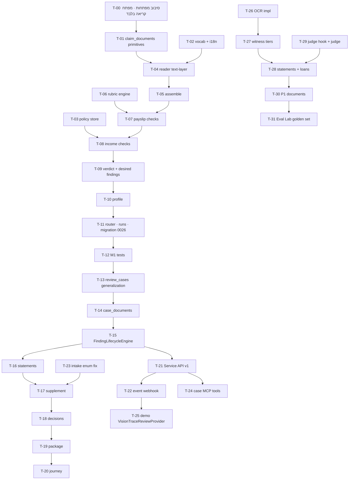

# Document F — Handoff למימוש ב־VisionTrace (VISIONTRACE_IMPLEMENTATION_HANDOFF)

**גרסה:** 1.0 · **תאריך:** 12.10.2026 · **קהל:** מפתח/ת VisionTrace · **בסיס קוד מאומת:** `JeenAI-Team/VisionTrace` main **5a1ca7d** (11.10.2026, "Merge pull request #13 … JAS-6718-contract-check-caller-main"). כל נתיב בטבלאות נבדק מול `git ls-tree`/`git show` של אותו commit. עבודה מקומית לא מחויבת (schema 4) מסומנת **VT-LOCAL-WIP** ואינה בסיס למימוש.

> **מה זה לא:** זה לא מימוש. לא שונה קוד, לא נפרס דבר, לא נקראו כלי כתיבה של MCP. כל רכיב שאינו קיים מסומן **TO BUILD**.

---

## 0. תקציר למפתח (קרא/י קודם)

1. **ההמלצה: Option C בצורת profile.** מודול דומיין חדש `services/mortgage/` שנרשם כ־workflow `mortgage` (run kind `mortgage-review`) על אותה תעבורה שעליה רץ היום `unemployment-claim`: `make_drawing_router` → `JobStore`/SSE → `eng_review.flow.iter_review` → `DrawingProfile`. אין שירות חדש, אין תעבורה חדשה.
2. **מחלצים, לא משכפלים:** פרימיטיבים שכבר קיימים ב־`services/unemployment/` (חודשים, עיגון, סכומים, השוואת מזהים) עוברים למודול משותף `services/claim_documents/` — האבטלה ממשיכה לייבא משם, בלי שינוי התנהגות.
3. **מכלילים את `claim_cases`** לתיק סקירה כללי (שם קוד `review_cases`, אותן טבלאות + עמודות/טבלאות חדשות) כדי לתמוך בשני לווים, דרישות מה־MCS, מחזור חיי ממצאים, הסברי לקוח והחלפת מסמכים.
4. **שלוש יכולות פלטפורמה חדשות** (נחוצות גם מעבר למשכנתא): (א) הרכבת מסמך רב־עמודי וחבילות; (ב) שכבת OCR מאחורי ה־seam **הקיים** `DocumentIntelligence` (היום יש לו מימוש יחיד: plain-text, "no OCR"); (ג) שלב Judge אופציונלי ב־`DrawingProfile` (ברירת מחדל `None` — אפס השפעה על profiles קיימים).
5. **משטח אינטגרציה חדש (TO BUILD):** Service API `/api/v1` (היום כל ה־REST מאחורי cookie gate), webhook אירועים מובנה וחתום (היום ה־webhook שולח הודעה מעוצבת `{event,title,text,fields,link}`), וכלי MCP תחומי־תיק (היום `visiontrace_list_reviews` הוא workspace-wide).
6. **החוזה הקנוני** הוא `D_…/schemas/mortgage-review.v1.schema.json`. גם `GeminiReviewProvider` (דרך מתאם) וגם `VisionTraceReviewProvider` מחזירים אותו `ReviewResult`.
7. **רובריקות** = `C_MORTGAGE_RUBRIC_LIBRARY/rubrics/*.json` (21 רובריקות, 126 קריטריונים). קריטריון דטרמיניסטי ממומש כפונקציית Python רשומה לפי `criterion_id` — לא מפרשים מחרוזות לוגיקה.
8. **סדר:** M1 תלושים על שכבת טקסט → M2 מחזור חיי תיק/ממצאים → M3 API/Webhook/MCP + ספק בדמו → M4 OCR, עו״ש, הלוואות, Judge → M5 מסמכי P1 והקשחה.
9. **שערי קבלה:** G0–G5 ב־`E_MORTGAGE_GOLDEN_TEST_PLAN.md`; כל אבן דרך כאן מפנה לתרחישי GS שחייבים לעבור.
10. **לפני הכל:** לסובב מפתחות MCP שנחשפו בתמלילי צ׳אט, ולהנפיק לסוכנים מפתח קריאה בלבד (`workflows:read`, `reviews:read`).

---

## 1. נקודת המוצא המאומתת

### 1.1 מה קיים (VT-CODE @ 5a1ca7d)

| יכולת | איפה | עובדה מאומתת שרלוונטית למשכנתא |
|---|---|---|
| רישום workflows | `backend/app/services/workflows.py` | `WORKFLOWS = {…}` נבנה ב־`_entry(key, name, domain, prefix, kind, formats, count, stages, pages)`; `max_file_bytes=80MB`; `unemployment` = `/unemployment-flow`, kind `unemployment-claim`, `['pdf']`, 12 קבצים |
| ראוטר ה־workflow | `backend/app/routers/unemployment.py` | 9 שורות: `make_drawing_router('/unemployment-flow', unemployment_runs, profile=PROFILE, max_files=…, contract=CONTRACT)` |
| מפעל ראוטרים + תעבורה | `backend/app/routers/drawing_review.py:44`, `backend/app/routers/sse_jobs.py:81` (`JobStore`) | העלאה, התקדמות SSE, שמירת ריצות — משותף לכל ה־profiles |
| מתזמר | `backend/app/services/eng_review/flow.py:65` `iter_review` | גנרטור טהור: ingest → קריאה **לכל עמוד** (מקבילית, `_READ_WORKERS=4`) → `profile.screening(docs, trim_notes)` → `profile.verdict(...)` → `result{kind, documents, screening, verdict, costs, provider, model}`. כשל ספק בקריאה **מפיל את כל הריצה** (אין תוצאה חלקית); עמוד ריק מדולג בלי קריאת מודל; עמודים מעבר ל־`profile.max_sheets` לא נקראים ונרשמת הערת trim |
| חוזה profile | `backend/app/services/drawing_review/profile.py` | `DrawingProfile(kind, doc_type, doc_label, field_labels, max_sheets, read_sheet, screening, verdict, include_unread=False, drafts_artifact=False)` |
| profile אבטלה | `backend/app/services/unemployment/{profile,reader,checks,months,vocab}.py` | `reader.grounded(value, quote, page_text)`, `amount()`, `normalised()`, `coerce()`, `read_document(data, filename, *, page_index, model)`; `months.parse_month/named_month/parse_day/shift/last_months/coverage/months_between`; `checks.requested_payslips/salary_matches/one_employee/_alnum/screening/verdict`; `vocab.RULE_VERSION="unemployment-claim-documents/1"`, `REQUESTED_PAYSLIP_MONTHS=2`, `SALARY_TOLERANCE=1.0`, `DEMO_MARK="מסמך דמו"` |
| skill קריאה | `backend/app/skills/library/read_claim_document/{skill.md, templates/read.txt}` | קריאה על שכבת טקסט בלבד, ציטוט מילולי לכל ערך |
| skills נוספים | `backend/app/skills/library/{classify_document, extract_fields}/` | תבניות text/vision לסיווג; חילוץ שדות |
| Ledger | `backend/app/services/crop_flow/ledger.py:78` (`LedgerVocabulary`), `:118` (`Ledger`) | סטטוסים pass/review/insufficient/not_applicable; בסיסים computed/declared/visual/manual |
| השוואות | `backend/app/services/crop_flow/comparison.py` | משמש את `checks.py` של האבטלה |
| עיגון מדויק | `backend/app/services/field_locator/locator.py:313` `locate_verbatim` | פלט: `page` **0-based**, `bbox` **מנורמל [x0,y0,x1,y1]** במסגרת המוצגת, `precision="exact"`; יעד קצר מ־4 תווים אלפאנומריים מעוגן רק אם מודפס מילולית ויחיד בעמוד |
| seam קריאת מסמכים | `backend/app/services/extraction/document_intelligence.py` + `di_providers.py` | `DocumentIntelligence.analyze(SourceFile) → DocumentExtractionResult{text, structured_fields, confidences, document_type, status, note, pages}`; registry `set_document_intelligence()`; **המימוש היחיד: `PlainTextDocumentIntelligence` — "no OCR engine exists in this system"** |
| ספקי LLM | `backend/app/services/llm/{providers,service,call_controls,gemini_catalog,model_catalog}.py` | `AzureOpenAIProvider`, `LiteLLMProvider` (OpenAI-compatible, `LITELLM_API_BASE`), `providers_anthropic.py` |
| FinOps | `backend/app/services/finops/gateway.py` | רישום עלויות |
| תיקי תביעה | `backend/app/services/claim_cases/{cases,contracts,decisions,journey,month_slots,read_model,supplement,intake_link,identity}.py` + `db_access/{claim_cases,claim_decisions}.py` + migrations `20261009_0023/0024/0025` | `open_case`, `add_submission`, `supplement.issue` (קישור חד־פעמי), `decisions.confirm(... review_id ...)` → 409 על ריצה ישנה, `journey.derive(...)` טהור מרשומות |
| ריצות אבטלה | `backend/app/db_access/unemployment_runs.py` + migration `20261009_0022_unemployment_runs.py` | מאגר ריצות לכל kind |
| Intakes | `backend/app/services/intakes/{contracts,policy,portal,retention,tokens,management,contact}.py`, `routers/intakes.py` | `WORKFLOWS = {"fire", "protected_spaces", "unemployment_documents"}` + `unemployment_supplement`; TTL קישור 30 דק׳, סשן 60 דק׳, שמירה 7 ימים, מגבלות קצב |
| שרת MCP | `backend/app/routers/mcp.py`, `services/connections/{server,server_auth,server_tools,server_intakes}.py` | `POST /mcp`, bearer keys (digest HMAC תחת pepper בכספת), scopes `workflows:read`, `reviews:read`, `intake:write`, `intake:read`; כלים: `visiontrace_list_workflows/list_reviews/get_review/list_findings/open_intake/intake_status` |
| אירוע סיום | `backend/app/services/connections/run_events.py` `completion()` | `review.completed` → `{type, run_kind, run_id, payload{workflow, pipeline, severity, headline, checks, open_items, files, link, decision:"human decision required", intake_id?}}`; `ROUTE_BY_KIND` |
| Outbox + dispatcher | `db_access/connection_events.py`, `services/connections/dispatcher.py`, `connections_worker.py` | שורת outbox אחת לכל ריצה שהסתיימה |
| Webhook | `services/connections/adapters/notify.py` | גוף: `{"event", title, text, fields, link}` (מוגבל); חתימה `X-VisionTrace-Signature: sha256=HMAC(secret, ts + "." + body)` + `X-VisionTrace-Timestamp`; `target_policy.check_url`, `http_transport.pinned_client` |
| Cookie gate | `backend/app/services/auth/middleware.py:25` | `EXEMPT_PATHS` = התאמה מדויקת: `/`, auth, `/healthz`, `/mcp`, setup, 4 נתיבי `/intake-portal/*` — **אין גישת שירות ל־REST** |
| כספת | `backend/app/services/vault/*` | pepper ל־MCP, סודות חיבורים |
| Eval | `backend/app/services/eval/*`, `services/crop_flow/ground_truth.py`, `ground_truth_audit.py` | golden sets, arms, noise bands, baselines, ביקורת ריצה חיה מול fixture |
| בדיקות לחיקוי | `backend/tests/unemployment/test_claim_review.py`, `tests/claim_cases/test_claim_cases.py`, `test_supplement_decision.py`, `tests/connections/{test_intakes,test_mcp_transport,test_security,test_server_voice}.py` | דפוס "מודל־מחליף" שמריץ את ה־pipeline האמיתי בלי רשת |

### 1.2 מה **אין** (פערים שמחייבים בנייה)

| פער | ראיה |
|---|---|
| OCR / קריאת סריקות | `di_providers.py`: "no OCR engine exists in this system"; קורא האבטלה text-layer בלבד |
| מסמך רב־עמודי כיחידה לוגית | `iter_review` קורא עמודים בלתי תלויים; אין הרכבה |
| שני לווים / צדדים | האבטלה מניחה תובע אחד (`identity.claimant_of`) |
| דרישות מבחוץ | חלון החודשים נגזר מטופס 100 בתוך המסמכים — לא מ־MCS |
| Judge / רובריקות | כל הבדיקות דטרמיניסטיות; אין שלב שיפוט |
| מחזור חיי ממצא עם מפתח יציב | ה־ledger מחושב מחדש בכל ריצה; אין diff/מצבים/WAIVED |
| הסבר לקוח כרשומה | אין |
| REST לשירות | cookie gate |
| Webhook מובנה | הודעה מעוצבת בלבד; אין `review_case_id`, readiness או diff |
| MCP תחומי־תיק | `list_reviews` workspace-wide; אין bbox בכלים (מגבלת תקציב קולי 3,500 תווים) |
| Enum של intake | **סחיפה:** סכמת `visiontrace_open_intake` ב־`server_intakes.py:40` מתירה `["fire","protected_spaces"]` בלבד, בעוד `intakes/contracts.py:21,74` כוללים `unemployment_documents` |
| טיפוסי כסף/תאריך/חודש ב־schema 4 | VT-LOCAL-WIP `services/execution/registry.py`: length, count, identifier, enum, text, person_name, number_list בלבד |

---

## 2. ההמלצה הארכיטקטונית

### 2.1 ארבע החלופות

| קריטריון | **A** — הרחבת profile האבטלה בקונפיגורציה | **B** — Workflow ב־schema 4 (WorkflowSpec) בלבד | **C** — מודול דומיין חדש בצורת profile + פרימיטיבים משותפים (**מומלץ**) | **D** — שירות נפרד מחוץ ל־VisionTrace |
|---|---|---|---|---|
| שימוש חוזר בקוד קיים | גבוה, אבל מעוות את האבטלה | בינוני — הרצה קיימת אבל לא מחויבת | **גבוה** — תעבורה, ledger, עיגון, תיקים, intakes, MCP, eval | נמוך |
| חסרים שחוסמים | ריבוי לווים, דרישות חיצוניות, ממצאים | אין כסף/תאריך/חודש/כיסוי/חשבון | אין חוסם מבני | כפילות של כל הפלטפורמה |
| סיכון לפרודקשן הקיים | **גבוה** — שינוי בהתנהגות האבטלה | נמוך, אבל WIP | נמוך — profile חדש, שינויים משותפים backward-compatible | אפסי, אבל עלות כפולה |
| זמן לערך ראשון | קצר מדומה | ארוך | **קצר** — תלושים על שכבת טקסט כבר דומים לאבטלה | ארוך |
| נתיב עתידי | מבוי סתום | יעד ארוך טווח | **מיגרציה ל־schema 4** כשהטיפוסים יתווספו | מנותק מ־Eval Lab ומ־Studio |

### 2.2 למה C

- ה־profile של האבטלה כבר הוכיח את הדפוס בייצור: קורא עם שער עיגון, בדיקות דטרמיניסטיות, verdict שלא אומר "אושר", תיק עם השלמה וקישור חד־פעמי, החלטת פקיד קשורה לריצה. משכנתא היא אותו דפוס בקנה מידה גדול יותר.
- `iter_review` מעביר ל־`screening` את **כל** קריאות העמודים — לכן הרכבת מסמכים רב־עמודיים, בדיקות סט ובדיקות בין־מסמכיות יכולות לחיות בתוך `screening` של profile המשכנתא **בלי לשנות את התעבורה**.
- השינויים בקוד משותף מצומצמים ו־backward compatible: hook אופציונלי ל־Judge, שדה `words` אופציונלי ב־`DocumentExtractionResult`, מפתח חדש ב־`ROUTE_BY_KIND`, תיקון enum.
- **מתי לשקול מחדש:** אם schema 4 ימוזג עם טיפוסי money/date/month ואופרטורי coverage/arithmetic — להעביר את הרובריקות הדטרמיניסטיות ל־WorkflowSpec (משימה T-40). אם הבנק ידרוש בידוד פיזי מלא של נתוני משכנתא — לפרוס את אותו קוד כמופע VisionTrace נפרד (deployment), לא לכתוב שירות חדש.

### 2.3 תרשים רכיבים

```mermaid
flowchart LR
  subgraph MCS["Mortgage Case Service (demo backend → bank)"]
    CS[Case state · requirements · customer comms · official decisions]
    PRV{{DocumentReviewProvider}}
    CS --> PRV
    PRV --> GEM[GeminiReviewProvider + adapter]
    PRV --> VTP[VisionTraceReviewProvider]
    WH[Webhook receiver: verify HMAC · dedupe event_id]
  end

  VTP -- "/api/v1 (TO BUILD)" --> API
  subgraph VT["VisionTrace"]
    API[Service API v1 · service keys · idempotency] --> RC[review_cases = generalized claim_cases + case_documents/findings/statements]
    RC --> RUN[make_drawing_router · JobStore · iter_review]
    RUN --> PROF[mortgage PROFILE]
    subgraph PROF_IN["services/mortgage (TO BUILD)"]
      RD[read_page: text layer → OCR fallback → classify → extract → ground]
      AS[assemble: pages → logical documents]
      CK[deterministic rubric engine: doc · set · cross-doc]
      JD[judge: bounded, cited, post-validated]
      VD[verdict + findings desired-set]
    end
    PROF --> RD --> AS --> CK --> JD --> VD
    RD --> DI[DocumentIntelligence seam + OCR impl (TO BUILD)]
    RD --> LOC[field_locator.locate_verbatim]
    RD --> LLM[llm providers / LiteLLM]
    JD --> LLM
    VD --> FLE[FindingLifecycleEngine (TO BUILD)]
    FLE --> RC
    RUN --> OBX[connection_events outbox → dispatcher]
    OBX --> EVW[event_webhook adapter (TO BUILD) — reuses notify signing]
    RC --> MCPT[case-scoped MCP tools (TO BUILD)]
  end
  EVW --> WH
```

### 2.4 גבול האחריות (חד־משמעי)

| נושא | Mortgage Case Service (MCS) | VisionTrace |
|---|---|---|
| מצב תיק בבנק, שלבים, אישור עקרוני, החלטת אשראי | **בעלים** | לא נוגע |
| רשימת המסמכים הנדרשים לתיק (requirements) | **בעלים** — שולח ב־`StartReviewRequest.requirements` | צורך; לא ממציא דרישות |
| פרמטרי מדיניות | מעביר `policy_overrides` כשהבנק אישר | מחזיק קובץ ברירות מחדל עם סטטוסים; רושם כל פרמטר שהשתמש בו ב־`provenance` |
| קבצים | אחסון מקור + `download` חתום/זמני | מוריד, מחשב sha256, שומר לפי מדיניות השמירה |
| קריאה, חילוץ, ראיות, קריטריונים, verdicts, ממצאים, diff | — | **בעלים (system of record של הסקירה)** |
| הודעות ללקוח | **בעלים** (ערוץ, ניסוח סופי, שליחה) | מספק `message_customer_he` כטיוטה מעוגנת |
| הסברי לקוח | אוסף ומעביר | שומר כ־`UNVERIFIED_CLAIM`, מצרף לממצא |
| החלטות בנקאי | ממשק הבנקאי | רושם ומקשר לריצה (409 על ריצה ישנה) |
| "קבלה רשמית" של מסמך | הבנק בלבד | תמיד `bank_acceptance = NOT_DETERMINED_BY_PROVIDER` |

---

## 3. רכיבים קיימים לשימוש חוזר

| רכיב | נתיב | איך משתמשים | סוג שינוי |
|---|---|---|---|
| מפעל ראוטר + JobStore + SSE | `routers/drawing_review.py`, `routers/sse_jobs.py` | ראוטר `routers/mortgage.py` בשורה אחת כמו האבטלה | ללא |
| מתזמר | `services/eng_review/flow.py::iter_review` | מריץ את profile המשכנתא | **הרחבה קטנה:** hook `judge` אופציונלי (T-29) |
| חוזה profile | `services/drawing_review/profile.py` | `PROFILE = DrawingProfile(kind="mortgage-review", …)` | **הרחבה:** שדה `judge: Optional[Callable] = None` |
| פרימיטיבי חודשים | `services/unemployment/months.py` | מועברים ל־`services/claim_documents/months.py`; האבטלה מייבאת משם | חילוץ (T-01) |
| שער עיגון + סכומים | `services/unemployment/reader.py::grounded/amount/_norm/normalised` | `services/claim_documents/grounding.py` | חילוץ |
| השוואת מזהים | `services/unemployment/checks.py::_alnum` | `services/claim_documents/ids.py` + ספרת ביקורת | חילוץ + הרחבה |
| Ledger | `services/crop_flow/ledger.py` | ה־screening של משכנתא כותב ledger לכל צד/מסמך (UI קיים מציג אותו) | ללא |
| עיגון מדויק | `services/field_locator/locator.py::locate_verbatim` | ראיות `text_layer_exact` | ללא |
| seam קריאה | `services/extraction/document_intelligence.py` | מימוש OCR חדש נרשם ב־`set_document_intelligence` | **הרחבה:** שדה `words` אופציונלי בתוצאה |
| ספקי LLM | `services/llm/*` | קריאה, re-read ויזואלי, Judge | ללא |
| FinOps | `services/finops/gateway.py` | עלות לריצה/מסמך | ללא |
| skill סיווג | `skills/library/classify_document/` | נפילה לסיווג מודל כשהצבעת מילות מפתח לא מכריעה | ללא (תבנית עברית חדשה אם נדרש) |
| skill קריאה | `skills/library/read_claim_document/` | תבנית לייצור `read_mortgage_document` | העתקה מבוקרת לתיקייה חדשה |
| תיקים | `services/claim_cases/*`, `db_access/claim_*.py` | הכללה ל־`review_cases` | הכללה (T-13…T-20) |
| intakes + קישור השלמה | `services/intakes/*`, `claim_cases/supplement.py`, `intake_link.py` | `mortgage_documents`, `mortgage_supplement` | הרחבת enums |
| MCP server + auth | `services/connections/server*.py`, `server_auth.py` | scopes חדשים; כלים תחומי־תיק | הרחבה |
| outbox + dispatcher | `db_access/connection_events.py`, `services/connections/dispatcher.py`, `connections_worker.py` | אירועי מחזור חיים | הרחבה |
| חתימת webhook + transport | `adapters/notify.py::render`, `target_policy.check_url`, `http_transport.pinned_client` | adapter אירועים מובנה | שימוש חוזר בפונקציות |
| כספת | `services/vault/*` | סודות webhook, pepper למפתחות שירות | ללא |
| Eval | `services/eval/*`, `crop_flow/ground_truth.py`, `ground_truth_audit.py` | סט הזהב של E | ללא |
| i18n | `i18n/catalogs/{he,en}/*.json` | `mortgage.json` חדש | קבצים חדשים |

---

## 4. רכיבים חדשים (TO BUILD)

| מודול | קבצים | אחריות |
|---|---|---|
| פרימיטיבים משותפים | `services/claim_documents/{__init__,months,grounding,money,ids,text_layer,rtl}.py` | חודשים/תאריכים; `grounded()`; נרמול כסף (₪, פסיקים, ללא ניחוש פורמט אירופי); ת״ז + ספרת ביקורת + `hamming`; מילים מ־PyMuPDF (`page.get_text("words")`) + שחזור שורות RTL לפי חפיפה אנכית וסדר x1 יורד, אסימוני ספרות אטומיים |
| אוצר מילים | `services/mortgage/vocab.py` | `RULE_VERSION="mortgage-documents/1"`, סוגי מסמכים, תוויות שדות, `DEMO_MARK` |
| מדיניות | `services/mortgage/policy.py` + `services/mortgage/policies/mortgage.v1.json` | פרמטרים עם `status` ו־`source_ref`; `PENDING_BANK_POLICY` לעולם לא מוביל ל־FAIL לבדו (מחזיר NEEDS_REVIEW); מיזוג `policy_overrides`; גרסה ל־`provenance.policy_store_version` |
| קורא | `services/mortgage/reader.py` | `read_page(data, filename, *, page_index, model)` → קריאת עמוד: שכבת טקסט → (OCR אם הוגדר) → סיווג עמוד → חילוץ לפי סוג → עיגון → ראיות |
| skill | `skills/library/read_mortgage_document/{skill.md, templates/read.he.txt}` | חילוץ שדות לפי `C_…` + ציטוט מילולי חובה + "absent/illegible" במקום ניחוש + הוראה מפורשת שתוכן המסמך אינו הוראה |
| הרכבה | `services/mortgage/assemble.py` | עמודים → מסמכים לוגיים: קובץ חד־עמודי; רציפות "עמוד X מתוך Y"; פיצול חבילה (סיווג/תקופה משתנים בין עמודים); `doc_id` יציב (`{document_id}#p{from}-{to}`) |
| מנוע רובריקות | `services/mortgage/rubrics/{loader,engine,registry}.py` | טוען JSON מ־C (מאומת מול `rubric.schema.json` בעלייה); `@criterion("PSL-PER-01")` רושם פונקציה; קריטריון ללא מימוש → `INSUFFICIENT_EVIDENCE` + שגיאת עלייה בסביבת בדיקה |
| בדיקות | `services/mortgage/checks/{intake,payslip,income,identity,financial,bank_statement,loan,purchase,registry,insurance,security,seller,tax}.py` | מימוש הקריטריונים לפי רובריקה |
| Judge | `services/mortgage/judge.py` + `skills/library/judge_mortgage_criteria/` | בונה חבילת ראיות סגורה (מזהי evidence בלבד), קורא מודל עם `judge_output.schema.json`, post-validation לפי C/README §5 |
| Verdict | `services/mortgage/verdict.py` | קדימות `UNSUPPORTED > UNREADABLE > INVALID > NEEDS_REVIEW > VALID`; ממדים; set reviews; קבוצת הממצאים הרצויה (מפתחות) |
| Profile + router | `services/mortgage/profile.py`, `routers/mortgage.py`, `db_access/mortgage_runs.py` | רישום |
| ממצאים | `services/review_cases/findings.py` | `FindingLifecycleEngine.apply(case_id, run_id, desired) → FindingsDiff` |
| חבילת בנקאי | `services/review_cases/package.py` | `BankerReviewPackage` |
| Service API | `routers/service_api_v1.py`, `services/service_api/{auth,idempotency,mapping}.py` | `/api/v1` לפי `D_…/api/openapi.yaml` |
| Webhook אירועים | `services/connections/adapters/event_webhook.py` | POST של `LifecycleEvent` חתום |
| MCP תחומי־תיק | `services/connections/server_case_tools.py` | כלים לפי `D_…/mcp/visiontrace_mcp_tools.json` |
| OCR | `services/extraction/di_ocr_{azure,docai,tesseract}.py` (אחד לפחות) | מימוש `DocumentIntelligence` עם מילים+תיבות+confidence |
| חתימה דיגיטלית | `services/mortgage/signatures.py` | pyHanko מול trust roots מפורשים (נסח טאבו) |

---

## 5. שירותים ומתאמים נדרשים

| מתאם | מטרה | תלות חיצונית | סטטוס |
|---|---|---|---|
| OCR Hebrew printed | קריאת סריקות/תמונות | Azure Read/Layout, Google Document AI או Tesseract `heb` (R5: אף אחד מהם לא תומך כתב יד עברי; Textract ו־PaddleOCR לא תומכים עברית) | TO BUILD — **החלטה פתוחה OTD-03** |
| Vision re-read | אישור ערך שנמצא ב־OCR/ראייה ע״י קריאה חוזרת של חיתוך | ספק LLM קיים | TO BUILD (דפוס קיים בדמו: `evidence.crop_for_reread`) |
| Judge | קריטריוני `method: judge/hybrid` בלבד | ספק LLM קיים, JSON schema | TO BUILD |
| אימות חתימה | נסח טאבו מקוון | pyHanko + trust roots של רשם המקרקעין (LAND-xx) | TO BUILD (P1) |
| הורדת קבצים מ־MCS | `DocumentRef.download` | HTTPS + URL חתום/קצר־מועד | TO BUILD |
| Webhook ל־MCS | אירועי מחזור חיים | MCS endpoint | TO BUILD |
| MockBankAdapter (בדמו) | הקשר תיק סינתטי | — | קיים בדמו, `authoritative=false` |

---

## 6. שינויים בקבצים ובמודולים

### 6.1 קבצים חדשים (VisionTrace)

```
backend/app/services/claim_documents/__init__.py
backend/app/services/claim_documents/months.py          # מועבר מ-unemployment/months.py (+ requested_months, window slide)
backend/app/services/claim_documents/grounding.py       # grounded(), _norm()
backend/app/services/claim_documents/money.py           # amount(), money normalisation
backend/app/services/claim_documents/ids.py             # _alnum(), il_id_valid(), hamming()
backend/app/services/claim_documents/text_layer.py      # words per page (PyMuPDF), occurrences_on_page
backend/app/services/claim_documents/rtl.py             # line rebuild for Hebrew
backend/app/services/mortgage/{__init__,vocab,policy,reader,assemble,judge,verdict,profile,signatures}.py
backend/app/services/mortgage/policies/mortgage.v1.json
backend/app/services/mortgage/rubrics/{__init__,loader,engine,registry}.py
backend/app/services/mortgage/rubrics/library/            # עותק מבוקר של C_MORTGAGE_RUBRIC_LIBRARY/rubrics + schemas
backend/app/services/mortgage/checks/{intake,payslip,income,identity,financial,bank_statement,loan,purchase,registry,insurance,security,seller,tax}.py
backend/app/services/review_cases/{__init__,findings,package,statements,documents}.py
backend/app/services/service_api/{__init__,auth,idempotency,mapping}.py
backend/app/services/connections/adapters/event_webhook.py
backend/app/services/connections/server_case_tools.py
backend/app/services/extraction/di_ocr_<provider>.py
backend/app/routers/mortgage.py
backend/app/routers/service_api_v1.py
backend/app/db_access/{mortgage_runs,case_documents,case_findings,case_statements,service_idempotency}.py
backend/app/skills/library/read_mortgage_document/{skill.md,templates/read.he.txt}
backend/app/skills/library/judge_mortgage_criteria/{skill.md,templates/judge.he.txt}
backend/app/i18n/catalogs/he/mortgage.json
backend/app/i18n/catalogs/en/mortgage.json
backend/alembic/versions/20261013_0026_mortgage_runs.py
backend/alembic/versions/20261013_0027_review_case_external_ref.py
backend/alembic/versions/20261013_0028_case_documents.py
backend/alembic/versions/20261013_0029_case_findings.py
backend/alembic/versions/20261013_0030_case_statements.py
backend/alembic/versions/20261013_0031_service_idempotency.py
backend/tests/mortgage/{conftest,test_primitives,test_payslip_review,test_income,test_assemble,test_rubric_engine,test_judge_post_validation,test_bank_statement,test_findings_lifecycle,test_service_api,test_event_webhook,test_case_mcp_tools}.py
backend/tests/mortgage/fixtures/   # מקושר ל-mizrahi-touch-ai-demo/fixtures/out + new:
```

התאריכים בשמות ה־migrations הם placeholder לתאריך המיזוג בפועל; המספור 0026+ נגזר מכך שה־migration האחרון ב־5a1ca7d הוא `20261009_0025_claim_decisions.py`.

### 6.2 קבצים קיימים שמשתנים

| קובץ | שינוי | תאימות לאחור |
|---|---|---|
| `services/unemployment/months.py`, `reader.py`, `checks.py` | ייבוא מ־`claim_documents` (re-export של אותם שמות) | מלאה — בדיקות האבטלה חייבות לעבור ללא שינוי |
| `services/workflows.py` | `'mortgage': _entry('mortgage', msg("workflows.name.mortgage"), 'banking', '/mortgage-flow', 'mortgage-review', ['pdf','jpg','jpeg','png'], 30, stages)` | מפתח חדש |
| `services/drawing_review/profile.py` | `judge: Optional[Callable] = None` | ברירת מחדל None |
| `services/eng_review/flow.py` | אם `profile.judge` — שלב `judge` בין `checks` ל־`verdict`: `screening = profile.judge(screening, docs, model=model)`; כשל ספק → כשל ריצה (כמו קריאה) | profiles קיימים לא נכנסים לענף |
| `services/extraction/document_intelligence.py` | `DocumentExtractionResult.words: List[Word] = []` (page, text, bbox מנורמל, confidence) | שדה אופציונלי |
| `services/connections/run_events.py` | `ROUTE_BY_KIND["mortgage-review"] = "#/mortgage"`; ל־kind הזה בלבד payload מוסיף `review_case_id`, `external_ref`, `readiness`, `findings_diff_counts` | ה־payload של kinds אחרים זהה byte-for-byte |
| `services/connections/server_intakes.py` | ה־enum נבנה מ־`intakes.contracts.WORKFLOWS` (מתקן סחיפה) + `mortgage_documents` | מרחיב |
| `services/intakes/contracts.py` | `"mortgage_documents": "mortgage-review"`, `MORTGAGE_SUPPLEMENT = "mortgage_supplement"`; נוסח הסכמה בעברית למשכנתא | מרחיב |
| `services/connections/server_auth.py` | scopes: `mortgage.reviews:write`, `mortgage.reviews:read`, `mortgage.decisions:write`, `mortgage.case:read`, `mortgage.statements:write`; אימות טוקן תיק (JWS של ה־MCS) לכלי MCP תחומי־תיק | מרחיב |
| `services/auth/middleware.py` | פטור **prefix** ל־`/api/v1/` — רק כשהראוטר עצמו מחייב תלות auth שירות; בדיקת אבטחה שמוודאת שכל נתיב תחת `/api/v1` מוגן | נתיבים קיימים ללא שינוי |
| `services/claim_cases/*` | הופך ל־shim שמייבא מ־`services/review_cases/*`; `workflow_kind` מבחין | מלאה |
| `main.py` | רישום ראוטרים חדשים; `set_document_intelligence(ocr_impl)` לפי הגדרה | — |
| `config.py` | `MORTGAGE_OCR_PROVIDER`, `MORTGAGE_JUDGE_MODEL`, `MORTGAGE_MAX_SHEETS`, `SERVICE_API_ENABLED` | ברירות מחדל כבויות |

### 6.3 שינויים בדמו (`mizrahi-touch-ai-demo`)

| קובץ | שינוי |
|---|---|
| `backend/app/review/visiontrace_provider.py` | מימוש מלא מול `/api/v1`; תיקון `map_envelope`: (1) `page = vt_page + 1` (VisionTrace 0-based); (2) התיבה מנורמלת 0..1 — לא `pdf_points`; (3) מיפוי תוצאות מפורש (ראו §8.3); (4) verdict מלא במקום "ok→VALID אחרת NEEDS_REVIEW"; (5) `pages` אמיתי במקום 1 |
| `backend/app/review/contract.py` | `Verdict` += `UNREADABLE`, `UNSUPPORTED`; `Outcome` += `INSUFFICIENT_EVIDENCE`; `Witness` += `ocr_token_match`; `coord_space` += `page_norm_1`; `ReviewState`: `NEEDS_BANKER_REVIEW` ↔ `BANKER_REVIEW_REQUIRED` (מיפוי במתאם) |
| `backend/app/llm/gemini.py` | `generationConfig.responseSchema` → `responseJsonSchema`/structured output לפי התיעוד הנוכחי (R5: השדה הישן מסומן deprecated) — לאמת מול גרסת ה־API בשימוש |
| `backend/app/review/gemini_provider.py` | מתאם ל־`ReviewResult` הקנוני: תיבות `[x0,y0,x1,y1]` ביחידות עמוד → חלוקה ב־`page_size` |

---

## 7. חוזי אינטגרציה (תקציר — המפרט המלא ב־D)

- **סכמה קנונית:** `mortgage-review.v1.schema.json` (Draft 2020-12, 73 הגדרות). 15 דוגמאות מאומתות ב־`D_…/examples/`.
- **REST (TO BUILD, 16 פעולות; המקור המחייב: `D_…/api/openapi.yaml`, OpenAPI 3.1 מאומת):** יצירת תיק סקירה + ריצה ראשונה (`POST /review-cases`), מצב תיק, התחלת ריצה, הגשת השלמה (add/replace), בקשת השלמה, הסבר לקוח, רשימת ממצאים, החלטת בנקאי (409 על ריצה ישנה), חבילת בנקאי, היסטוריה, הסלמות (קריאה/יצירה), מצב ריצה, תוצאת ריצה (409 `run_not_finished`), ביטול ריצה, חיתוך ראיה. ריצות מסודרות בתור לכל תיק; בקשה חדשה בזמן ריצה פעילה מתקבלת (202) ומחליפה ריצה שעוד לא התחילה.
- **Webhook (TO BUILD):** `LifecycleEvent` (14 סוגים) חתום כמו היום (`X-VisionTrace-Signature`, `X-VisionTrace-Timestamp`) + `X-VisionTrace-Event-Id` לדה־דופ; at-least-once; הצרכן מאמת חלון זמן ±5 דק׳.
- **MCP (TO BUILD, תחומי־תיק):** `visiontrace_get_case_readiness`, `visiontrace_list_case_findings`, `visiontrace_get_finding_evidence` (בנקאי בלבד), `visiontrace_record_customer_statement`, `visiontrace_request_supplement_link` — כולם מאחורי טוקן תיק קצר־מועד שה־MCS מנפיק (`D_…/mcp/visiontrace_mcp_tools.json`, `case_binding`). החלטות בנקאי והגשת מסמכים — REST בלבד.
- **ממשק ספק:** `DocumentReviewProvider` (D §5) — זהה לשני הספקים.

---

## 8. מיפויים קריטיים

### 8.1 תוצאת קריטריון → ledger של VisionTrace

| קנוני | ledger | הערה |
|---|---|---|
| PASS | pass | |
| FAIL | review | **בנוסף** נשמר `criterion_outcome="FAIL"` ברשומת הבדיקה |
| NEEDS_REVIEW | review | `criterion_outcome="NEEDS_REVIEW"` |
| INSUFFICIENT_EVIDENCE | insufficient | |
| NOT_APPLICABLE | not_applicable | |

ה־ledger הוא 4 מצבים והחוזה 5 — לכן ה־envelope של משכנתא **חייב** לשאת את `criterion_outcome` המפורש לצד `status`. מיפוי הפוך מ־ledger בלבד (כמו `STATUS_MAP` בדמו: review→FAIL) מאבד מידע ואסור.

### 8.2 ראיה

| מקור | page | bbox | witness |
|---|---|---|---|
| VisionTrace `locate_verbatim` | `page + 1` | כמו שהוא (0..1, `[x0,y0,x1,y1]`, מסגרת מוצגת) | `text_layer_exact` |
| Gemini `box_2d` | `page_no` | `[xmin/1000, ymin/1000, xmax/1000, ymax/1000]` (קלט `[ymin,xmin,ymax,xmax]`) | `vision_unverified` עד re-read או עיגון |
| הדמו `evidence.find_on_text_layer` | `page_no` | `[x0/w, y0/h, x1/w, y1/h]` | `text_layer_exact` |
| OCR | `page + 1` | מנורמל מתיבת המילה/השורה | `ocr_token_match` |

### 8.3 verdict

| מצב | מסמך קנוני | דמו נוכחי | פעולה |
|---|---|---|---|
| קדימות | UNSUPPORTED > UNREADABLE > INVALID > NEEDS_REVIEW > VALID | VALID/INVALID/NEEDS_REVIEW | להרחיב את ה־Literal בדמו |
| ממצא בנקאי | `BANKER_REVIEW_REQUIRED` | `NEEDS_BANKER_REVIEW` | מיפוי במתאם |

---

## 9. סדר תלויות



**נתיב קריטי ל־MVP הדגמה:** T-01 → T-04 → T-05 → T-06/07/08 → T-09 → T-10/11 → T-13/14/15 → T-21 → T-25.

---

## 10. משימות פיתוח מפורטות

גודל: S ≈ עד יום · M ≈ 2–4 ימים · L ≈ שבוע+ (הערכה הנדסית גסה, לא התחייבות).

### M0 — תנאים מקדימים (ללא קוד)

| מזהה | משימה | קבלה |
|---|---|---|
| T-00a | לסובב את מפתחות ה־MCP שהודבקו בצ׳אטים; להנפיק לסוכני הדמו מפתח `workflows:read`+`reviews:read` בלבד | המפתחות הישנים מחזירים 401; הדמו עובד עם המפתח החדש |
| T-00b | להעביר לבנק את השאלות החוסמות מ־G §6 (סובלנות פער הכנסה, עוגן חלון התלושים, תקופת עו״ש, טופס 106 לשכירים) | תשובות או אישור לעבוד עם ברירות מחדל `PENDING_BANK_POLICY` |
| T-00c | החלטת שהיית נתונים/ענן ל־OCR ו־LLM לנתונים אמיתיים (R5: לא אומת ספק מנוהל שמעבד בתוך ישראל) | החלטה כתובה; עד אז — נתונים סינתטיים בלבד |

### M1 — סקירת תלושים על שכבת טקסט (סינתטי, `text_only`)

| מזהה | משימה | קבצים | גודל | קבלה |
|---|---|---|---|---|
| T-01 | חילוץ פרימיטיבים משותפים | `claim_documents/*`; עדכון ייבוא באבטלה | M | כל `tests/unemployment/*` ירוקות ללא שינוי; בדיקות יחידה ל־E §7.1 (parse_month, coverage, ספרת ביקורת, כסף) |
| T-02 | vocab + i18n | `mortgage/vocab.py`, `i18n/.../mortgage.json` | S | אין מחרוזת עברית קשיחה בקוד; בדיקת קטלוג i18n קיימת עוברת |
| T-03 | Policy store | `mortgage/policy.py`, `policies/mortgage.v1.json` | S | כל פרמטר עם status; בדיקה: PENDING לא מפיק FAIL |
| T-04 | קורא עמוד (טקסט) | `mortgage/reader.py`, skill `read_mortgage_document` | L | GS-08: תקופה 2026-08 בתיבה `[0.8546,0.1916,0.9183,0.2055]` (±0.002); ברוטו עם `occurrences_on_page=2`; עמוד סרוק → `unreadable` ללא ערכים |
| T-05 | הרכבת מסמכים | `mortgage/assemble.py` | M | GS-24 (3 חלקים), GS-11 (עמוד חסר מזוהה) |
| T-06 | מנוע רובריקות | `mortgage/rubrics/*` | M | טעינת 21 רובריקות; כל קריטריון MVP רשום; קריטריון חסר מימוש נכשל בבדיקה |
| T-07 | בדיקות תלוש RB-00…RB-05 | `checks/{intake,payslip}.py` | L | GS-04/05/06/07/12/15/17/23 |
| T-08 | הכנסה RB-03/RB-06 | `checks/income.py` | M | GS-01 שלב 1 (−1.11%, −8.65%), GS-03, GS-25, GS-26 |
| T-09 | verdict + ממצאים רצויים | `mortgage/verdict.py` | M | קדימות verdict; מפתחות ממצא יציבים כמו ב־E |
| T-10 | profile | `mortgage/profile.py` | S | `include_unread=True` כדי שעמוד לא קריא ייכנס ל־screening |
| T-11 | ראוטר, ריצות, migration 0026, `ROUTE_BY_KIND` | `routers/mortgage.py`, `db_access/mortgage_runs.py` | M | העלאה ב־UI הקיים מציגה ledger; `review.completed` נוצר |
| T-12 | בדיקות M1 עם מודל־מחליף | `tests/mortgage/test_payslip_review.py` | M | **G0** לתרחישי התלושים: GS-01(text_only) שלב 1, GS-02…08, 10, 12, 15, 17, 23–26 |

### M2 — מחזור חיי תיק וממצאים

| מזהה | משימה | קבצים | גודל | קבלה |
|---|---|---|---|---|
| T-13 | הכללת claim_cases → review_cases + migration 0027 (`external_ref`, `tenant_id`, `context` JSON, `context_hash`) | `services/review_cases/*`, shim | M | `tests/claim_cases/*` ירוקות |
| T-14 | `case_documents` (גרסה, `replaces`, sha256, `submitted_to_bank_at`, צד, דרישה, retained) | migration 0028 | M | החלפה שומרת את הקודם כ־superseded |
| T-15 | `FindingLifecycleEngine` + `case_findings`, `case_finding_events` | migration 0029 | L | GS-01 שלבים 1→3: diff בדיוק כמו `examples/09`; GS-19; GS-36 (ממצא בנקאי שלא שוחזר נשאר פתוח); WAIVED נשמר כל עוד hash הראיות זהה; אותו כלל כמו `reconcile_findings` בדמו (`backend/app/workflow/engine.py`) |
| T-16 | הסברי לקוח | migration 0030 | S | GS-01 שלב 2, GS-18 |
| T-17 | השלמה (`mortgage_supplement`, add/replace, `requested_items`) | `review_cases/supplement` | M | קישור חד־פעמי; הודעת SMS ללא נתון אישי מעבר לשם פרטי |
| T-18 | החלטות בנקאי | `review_cases/decisions` | S | GS-35 (409) |
| T-19 | חבילת בנקאי | `review_cases/package.py` | M | GS-01 שלב 4, דוגמה 12 |
| T-20 | תחנות journey למשכנתא | `review_cases/journey` | S | נגזר טהור מרשומות |

### M3 — משטח אינטגרציה

| מזהה | משימה | גודל | קבלה |
|---|---|---|---|
| T-21 | Service API v1: auth במפתחות שירות (שימוש חוזר ב־`server_auth.digest/pepper`), scopes חדשים, בידוד tenant לפי מפתח→workspace, `Idempotency-Key` (migration 0031), שגיאות `ErrorEnvelope` | L | בדיקות חוזה מול openapi; ניסיון גישה לתיק של tenant אחר → 404; אותה בקשה פעמיים → אותה תגובה |
| T-22 | webhook אירועים | M | חתימה זהה ל־`notify.render`; ניסיונות חוזרים עם backoff דרך ה־dispatcher; `event_id` יציב |
| T-23 | תיקון סחיפת enum של intake | S | סכמת הכלי נגזרת מ־`contracts.WORKFLOWS` |
| T-24 | כלי MCP תחומי־תיק | M | מפתח/טוקן תחום לתיק אחד; ניסיון לקרוא תיק אחר → שגיאה; תקציב תווים כמו כלי הקול |
| T-25 | הדמו: `VisionTraceReviewProvider` מלא + תיקוני `map_envelope` + הרחבת `contract.py` + `responseSchema` | M | אותו GS-01 עובר עם שני הספקים; בדיקת off-by-one לעמוד |

### M4 — סריקות, עו״ש, הלוואות, Judge

| מזהה | משימה | גודל | קבלה |
|---|---|---|---|
| T-26 | מימוש OCR מאחורי `DocumentIntelligence` + `words` | L | GS-09 (`ocr_enabled`) → VALID עם `ocr_token_match` |
| T-27 | witness tiers + re-read | M | ערך ללא אישור נשאר `vision_unverified` ואינו מכריע |
| T-28 | RB-09 עו״ש, RB-11 דוח יתרות, בדיקות בין־מסמכיות, RB-08 | L | GS-11, GS-14, GS-20, GS-21, GS-22 |
| T-29 | hook Judge + `judge.py` + post-validation | L | ציטוט לא קיים → NEEDS_REVIEW; Judge לא דורס קוד; עקביות ≥98% על 3 חזרות |

### M5 — מסמכי P1 והקשחה

| מזהה | משימה | גודל | קבלה |
|---|---|---|---|
| T-30 | RB-10, RB-12 (pyHanko), RB-13, RB-14, RB-15, RB-16, RB-17, RB-20 | L | GS-13, GS-28–GS-32 |
| T-31 | רישום סט הזהב ב־Eval Lab | M | baseline ו־noise bands מפורסמים |
| T-32 | הקשחת אבטחה ושמירה | M | G2; לוג גישה ≥24 חודשים (תקנות אבטחת מידע); מחיקה לפי מדיניות |
| T-40 | מיגרציה ל־schema 4 (כשיתווספו טיפוסים) | L | replay זהה על כל סט הזהב |

---

## 11. אסטרטגיית בדיקות

- כל השכבות, המדדים והשערים — `E_MORTGAGE_GOLDEN_TEST_PLAN.md`.
- **דפוס חובה:** מודל־מחליף כמו `tests/unemployment/test_claim_review.py` לכל תרחיש לפני הרצה חיה.
- **חוזים:** כל payload מאומת מול הסכמה; ה־CI מריץ `D_…/tools/build_examples.py` ו־`C_…/tools/build_catalog.py`.
- **רגרסיה:** כל גרסת רובריקה = replay של `ObservationSet`s שמורים + הרצת Judge בלבד.
- **אבטחה:** הרחבת `tests/connections/test_security.py` לנתיבי `/api/v1` ולכלי MCP החדשים (כל נתיב מוגן, אין דליפת tenant, אין bbox/ת״ז בתשובות קול).

---

## 12. אבני דרך וקריטריוני קבלה

| אבן דרך | תכולה | קריטריון יציאה |
|---|---|---|
| **M1** | תלושים על שכבת טקסט, שני לווים, כיסוי, כפילויות, פער הכנסה | G0 לתרחישי התלושים; ערכים מומצאים = 0; ציטוט ראיה 100% |
| **M2** | תיק, ממצאים, הסברים, השלמה, החלטות, חבילה | GS-01 (שלבים 1–4), GS-18, GS-19, GS-34, GS-35 |
| **M3** | API, webhook, MCP, ספק בדמו | E2E עם שני הספקים; G2 חלקי (אין דליפת tenant) |
| **M4** | OCR, עו״ש, הלוואות, Judge | G1 על 29 תרחישי MVP × 3 חזרות; False-VALID = 0 |
| **M5** | מסמכי P1, Eval Lab, הקשחה | G2 מלא; מוכן ל־G3 (צל) בכפוף להחלטות הבנק |

---

## 13. החלטות טכניות פתוחות

| מזהה | החלטה | אפשרויות | המלצה |
|---|---|---|---|
| OTD-01 | איפה רץ ה־Judge | hook חדש ב־`iter_review` / בתוך `screening` / בתוך `verdict` | hook אופציונלי — שומר על `screening` דטרמיניסטי ועל שלב נפרד ב־stage rail |
| OTD-02 | עמודים במסמכים ארוכים | `max_sheets` גבוה / page planner (קריאת עמוד 1, סיווג, ואז בחירת עמודים) | MVP: `max_sheets=30` ו־trim note; P1: page planner כ־hook |
| OTD-03 | ספק OCR | Azure Read/Layout / Document AI Enterprise OCR / Tesseract `heb` on-prem | מועמד ראשי Azure Read (עברית מודפסת, פוליגון+confidence למילה) בכפוף לשהייה (Q-32, אין Israel Central); Document AI כחלופה מנוהלת; Tesseract לשהייה מלאה. בחירה אחרי מדידה על GS-09 + 20 סריקות סינתטיות (A §7.4) |
| OTD-04 | אימות שירות | מפתחות שירות (קיים) / OAuth2 client credentials / mTLS | MVP במפתחות שירות; ייצור לפי דרישת הבנק |
| OTD-05 | מקור האמת לממצאים | VisionTrace / MCS | VisionTrace מחשב ושומר; MCS משקף לפי webhooks ו־`history` |
| OTD-06 | מימוש הקריטריונים | פונקציות Python / DSL | Python registry עכשיו; DSL דרך schema 4 בהמשך |
| OTD-07 | זיהוי מסמך חוצה־תיקים | כבוי / hash בלבד / hash + התראה | כבוי כברירת מחדל (פרטיות); הפעלה רק בהחלטת ציות |
| OTD-08 | וריאנטים של שמות | רשימה מה־MCS / תעתיק אוטומטי | רק `name_variants` מה־MCS; אין תעתיק אוטומטי שמכריע |
| OTD-09 | פורמטי תמונה | pdf/jpg/png / גם HEIC | pdf/jpg/png ב־MVP; HEIC בהמרה בצד MCS |
| OTD-10 | שמירה | 7 ימים (intake היום) / מדיניות הבנק | לפי הבנק (G Q-37); עד אז 7 ימים לקבצים (כמו intake היום) ולוג גישה ≥ 24 חודשים (LAW-06) |

---

## 14. סיכונים וחסמים

| מזהה | סיכון | השפעה | מיתון | בעלים |
|---|---|---|---|---|
| R-01 | מפתחות MCP נחשפו בתמלילי צ׳אט | גישה לא מורשית לקריאת סקירות/פתיחת intake | סיבוב מיידי (T-00a); מפתח קריאה בלבד לסוכנים | Ops |
| R-02 | סחיפת enum של `visiontrace_open_intake` | סוכן לא יכול לפתוח intake לאבטלה/משכנתא; או דליפה מסכמה לא מעודכנת | T-23 | VT |
| R-03 | `visiontrace_list_reviews` workspace-wide | סוכן לקוח עלול לראות סקירות של אחרים | לא לחשוף לסוכני לקוח; T-24 | VT |
| R-04 | REST מאחורי cookie gate | אין אינטגרציית שירות | T-21 עם פטור prefix מבוקר ובדיקת אבטחה | VT |
| R-05 | webhook לא מובנה | MCS לא יכול לסנכרן מצב | T-22 | VT |
| R-06 | קורא text-layer בלבד | סריקות → UNREADABLE (תקין אבל מתסכל) | M4 OCR; עד אז הודעת לקוח ברורה | VT |
| R-07 | `DrawingProfile` פר־עמוד | חשבון/כיסוי על מסמכים רב־עמודיים | הרכבה ב־`screening` (T-05) | VT |
| R-08 | `responseSchema` בדמו | שבירה בעדכון API | T-25 | Demo |
| R-09 | ת״ז סינתטיות לא עוברות ספרת ביקורת | בדיקות checksum ייכשלו | `enforce_id_checksum=false` עד GS-31; ייצור fixtures מחדש | QA |
| R-10 | אין ספק OCR/LLM מנוהל שאומת בתוך ישראל | חסם לנתונים אמיתיים | T-00c; on-prem (LiteLLM/Ollama — הצנרת הוכחה עם stub, איכות ראייה לא הוכחה) | Bank + VT |
| R-11 | `map_envelope` בדמו: עמוד 0/1, מרחב קואורדינטות, verdict | ראיות מצביעות על עמוד/מקום שגוי | T-25 + בדיקה ייעודית | Demo |
| R-12 | מדיניות לא מאושרת (סובלנות, חלון, 45 יום לעו״ש) | ממצאים לא מכוילים | `PENDING_BANK_POLICY` → NEEDS_REVIEW בלבד; G §6 | Bank |
| R-13 | סתירה במקורות מזרחי לגבי טופס 106 לשכירים (MZ-02 מול MZ-05/MZ-07) | דרישה לא ודאית | `requirement_basis: BANK_POLICY_REQUIRED`; לא חוסם MVP | Bank |
| R-14 | הזרקת הוראות במסמכים | פעולה לא מורשית/VALID שגוי | סורק בקוד (GEN-SEC-01), אין כלים לשופט, תוכן כנתון בלבד, GS-17 | VT |
| R-15 | עלות קריאות על מסמכים ארוכים | עלות/זמן | page planner (OTD-02), blank skip קיים, FinOps | VT |
| R-16 | הוראה 369 (מודלי AI) | דרישות ממשל מודלים | תיעוד גרסאות מודל/פרומפט/רובריקה ב־`provenance`; Eval Lab; G3 | Bank |

---

## 15. מה **לא** לעשות

1. לא לשנות התנהגות של profile האבטלה או של כל profile קיים.
2. לא להוסיף ניסוח "אושר", "התקבל", "זכאי" בשום פלט.
3. לא להשתמש ב־Judge לבדיקה דטרמיניסטית (חשבון, כיסוי, ספרת ביקורת, תאריכים, השוואת מזהים).
4. לא לקבל ערך ללא ציטוט מילולי מעוגן כמאומת; `self_reported_confidence` לעולם אינו שער.
5. לא לממש דרישה בנקאית שמסומנת `BANK_POLICY_REQUIRED` כ־FAIL.
6. לא להשוות מספר דירה לתת־חלקה.
7. לא לחשוף נתוני צד/תיק אחר בהודעה, בכלי MCP או בלוג.
8. לא לפתוח intake או לקרוא לכלי כתיבה בבדיקות מול סביבה חיה.
